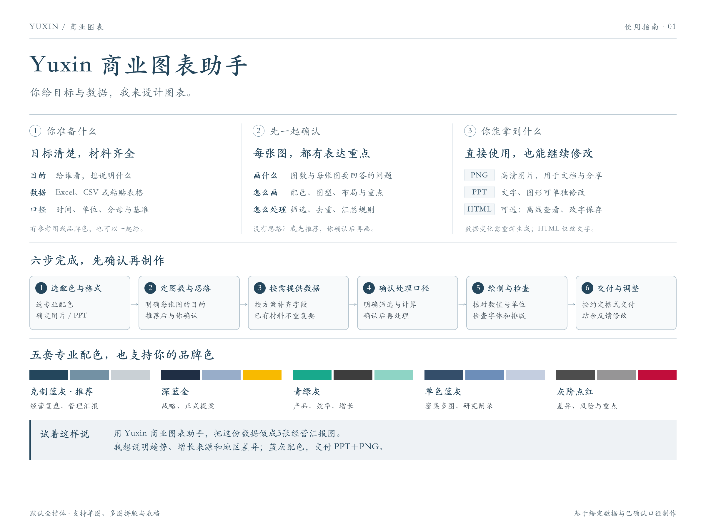
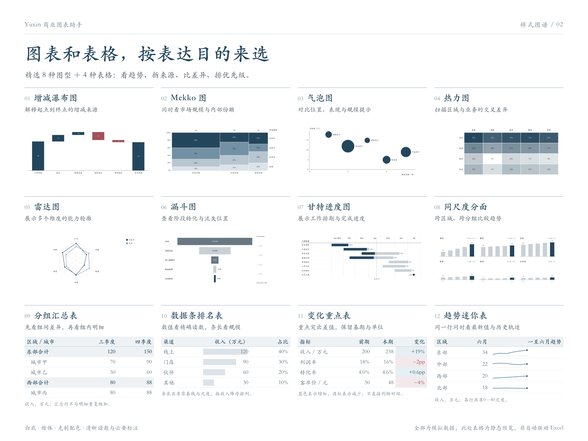
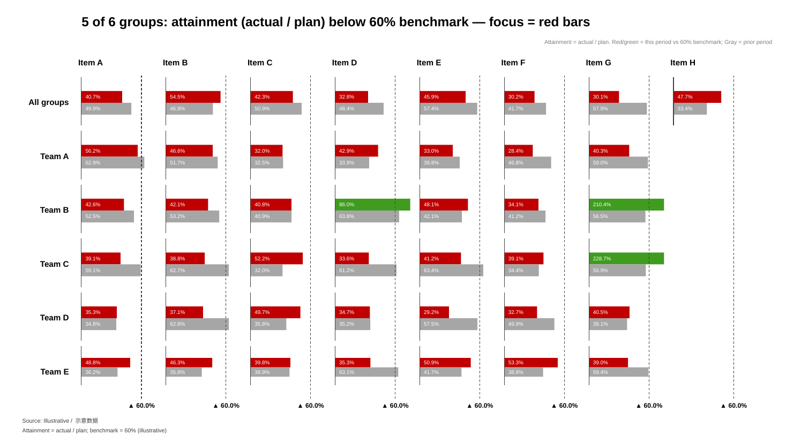
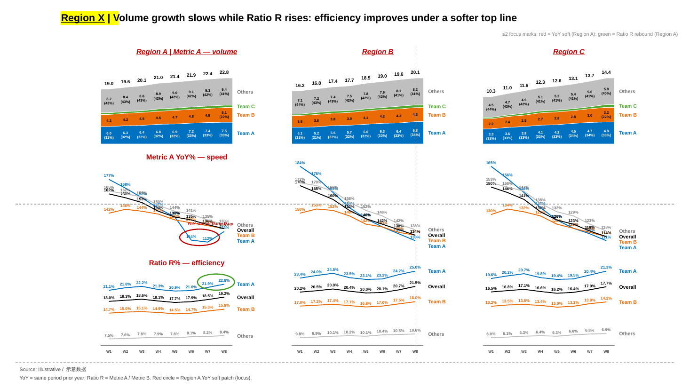
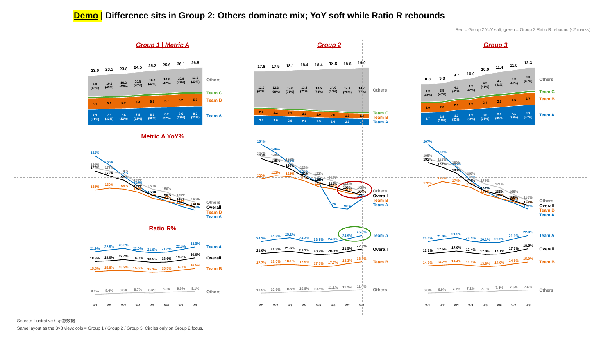
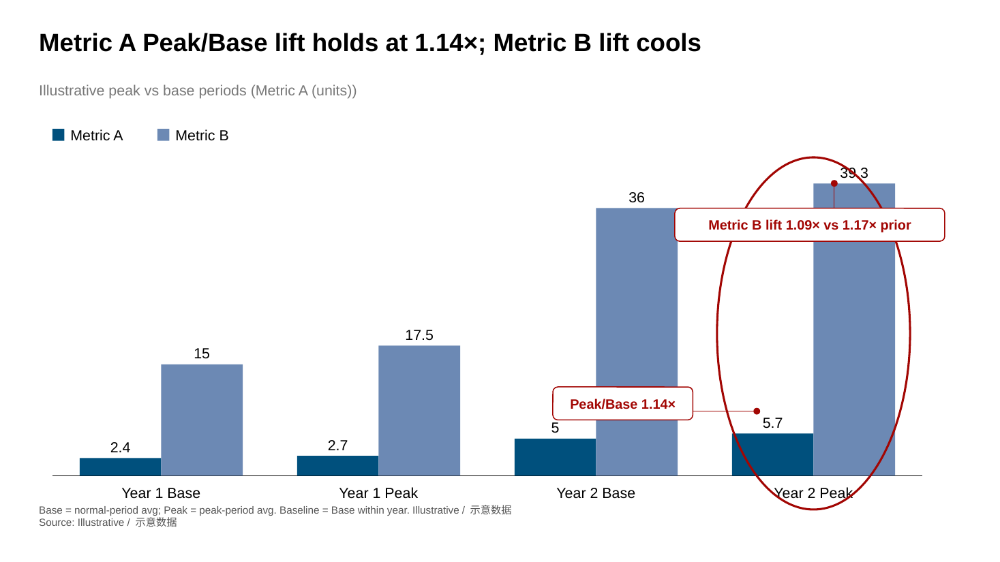
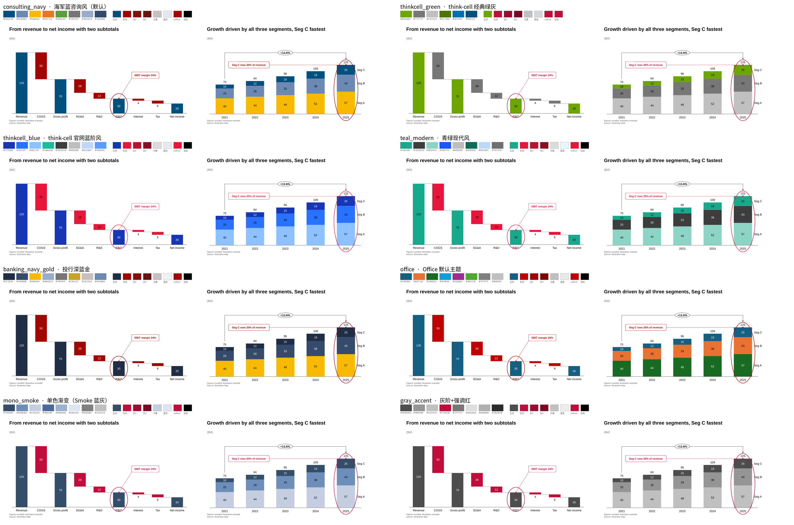

# Yuxin 商业图表助手

> 你给目标与数据，我来设计图表。由 Yuxin 定制，默认楷体，先确认方案，再制作商业图表与表格。





[下载两张高清介绍图](gallery/intro/intro-images.zip) · [查看技能说明](SKILL.md) · [24 种图表图谱](gallery/chart-atlas.html)

示例图片使用模拟数据。支持高清 PNG、可编辑 PPT 形状与可改字 HTML；实际交付形式按需求确认。

**简体中文** · [English](README_EN.md)

[](LICENSE) [](scripts/requirements.txt) [](docs/CATALOG.md) [](#gallery) [](docs/PALETTES.md) [](#quickstart) [](https://github.com/ZeroxZhang/zerox-skills)

**把表格数据变成咨询汇报图表：推荐图型、校验数据，生成可编辑的 PowerPoint 形状、PNG 预览与可离线改字的 HTML。**

也可基于给定数据制作重点表格：数据条、色阶、图标集、迷你图，以及分组层级与精确读数。这里只负责图片和表格，不自动启动VOC分析/验证、策略评价或整份报告写作。已有报告中的分类、口径和已确认设计直接沿用。

| 制作需求 | 方法参考 |
| --- | --- |
| 管理层重点表、策略组下拆城市、阶段表、类别矩阵 | [管理层表格](references/management-tables.md) |
| Excel数据条/色阶/图标集、公式规则、REPT与迷你图 | [Excel条件格式](references/excel-conditional-formatting.md) |
| 差值柱、同比箭头、嵌套柱、断轴、合计标签与平均线 | [高阶比较配方](references/advanced-comparison-patterns.md) |

这些是可复用的制作方法，不等于新增了同名CLI图型。原生XLSX条件格式使用电子表格工具；Word表使用原生表格；HTML可使用CSS与SVG。静态图片、PPT形状、HTML外观和会随数据变化的Excel规则明确区分。

例如：
> 用 `$yuxin-business-charts`，沿用已确认的楷体和蓝灰配色，把已有汇总数据做成图片和一张重点表；用数据条看规模、变化列显示正负号、迷你图看走势。

本技能由 Yuxin 定制，基于 [zerox-skills](https://github.com/ZeroxZhang/zerox-skills) 的 `zerox-thinkcell-charts`，支持 **55 种单图类型、11 个分类、61 个单图示例、9 套配色主题**，并支持一页多图的 **dashboard / facet 拼版**（共用横轴、分段标注、条件着色、圈注与批注）。从瀑布桥、Mekko、堆叠柱，到甘特、敏感性分析、KPI 卡片，再到运营看板，均可用一份 JSON 重复生成。另含 5 个拼版和 6 个经营对账示例，上游原有 **72 个图表 spec**；本地另增 8 个克制版单页示例与 1 份 24 页图谱，共 81 个 spec 文件、104 页，见 `examples/restrained/`。

PPTX 中的柱、线、文字、箭头和标注可在 PowerPoint 中逐个选中修改。它们是**可编辑形状**，不是带内嵌工作表的数据绑定图表；修改源数据后，应重新运行脚本。

这是独立实现的开源项目，与 think-cell 无隶属、授权或背书关系。名称描述所参考的视觉风格；运行不依赖 think-cell 插件。

[快速开始](#quickstart) · [可编辑 HTML](#editable-html) · [如何使用与怎么写 prompt](#how-to-use) · [能力与流程](#capabilities) · [多图拼版](#multipanel) · [经营对账页](#ops-report) · [输入与输出](#data-contract) · [配色](#themes) · [全部示例](#gallery) · [CLI](#cli) · [维护与验证](#maintenance) · [限制](#limitations) · [协议](#license)

<a id="quickstart"></a>
## 快速开始

### 1. 安装本技能并准备 Python 依赖

从本仓库安装到 Codex 的 skills 目录（已有同名技能时，请先备份现有版本）：

```bash
git clone https://github.com/yuxinliang0301/yuxin-business-charts.git ~/.codex/skills/yuxin-business-charts
```

也可下载仓库 ZIP，解压后将完整 `yuxin-business-charts` 目录放入 `~/.codex/skills/`。重新载入会话后，使用 `$yuxin-business-charts` 调用。

```bash
cd ~/.codex/skills/yuxin-business-charts
python3 -m venv .venv
.venv/bin/python -m pip install -r scripts/requirements.txt
```

| 依赖 | 用途 | 何时需要 |
| --- | --- | --- |
| Python 3.9+ | 运行脚本 | 必需 |
| `python-pptx>=1.0` | 创建 PPTX 形状、文字与连接线 | 必需，已列入 requirements |
| `openpyxl>=3.1` | 读取 `.xlsx` / `.xlsm` 表格 | Excel 推荐流程需要，已列入 requirements |
| LibreOffice（`soffice`） | 将 PPTX 渲染成中间 PDF | 导出 PNG 或重建画廊时需要 |
| Poppler（`pdftoppm`） | 将 PDF 转为 PNG | 导出 PNG 或重建画廊时需要 |
| 楷体（Kaiti SC） | 稳定文字布局 | 本地默认楷体-简；渲染器需能找到字体，PPT 不内嵌字体 |

仅生成 PPTX 或 HTML 时，无需安装 LibreOffice 和 Poppler。完整预览环境可按平台安装：

```bash
# macOS
brew install --cask libreoffice
brew install poppler

# Ubuntu / Debian
sudo apt install libreoffice-impress poppler-utils fonts-liberation
```

以上工具需在 `PATH` 中可用。LibreOffice、PowerPoint 和不同字体环境的文字排版可能存在差异。

### 2. 渲染第一张图

在本技能目录运行：

```bash
# 可编辑 PPTX + PNG 预览
.venv/bin/python scripts/tc_render.py examples/waterfall.json \
  -o out.pptx --png out_png/

# 多个 JSON 按输入顺序合成一个演示文稿
.venv/bin/python scripts/tc_render.py examples/waterfall.json examples/mekko_percent.json \
  -o deck.pptx --png deck_png/ --theme consulting_navy
```

首条命令生成 `out.pptx` 和 `out_png/waterfall.png`。打开 PPTX 可逐个编辑形状；PNG 用于目检和嵌入文档。也可直接查看现成的 [完整示例 PPTX](gallery/thinkcell-gallery.pptx)、[PDF](gallery/thinkcell-gallery.pdf) 或下载后在浏览器打开 [PNG 静态画廊](gallery/index.html)。

### 3. 在 Agent 中使用

Codex 使用 `~/.codex/skills/yuxin-business-charts/SKILL.md` 识别本技能。其他宿主按其安装方式导入完整目录。如技能清单缓存了旧名称，重新载入会话。

可向支持 Agent Skills 的宿主这样描述任务：

> 使用 yuxin-business-charts，把这份收入明细做成瀑布图，配色用 consulting_navy，保留真实来源，交付可编辑 PPTX 和 PNG。

<a id="editable-html"></a>
## 可编辑 HTML：离线查看、改字与保存

`--html` 生成一个可直接在浏览器打开的 HTML 文件，图表由**原生 SVG 与可编辑文字**组成，支持全部 55 种单图类型及 `dashboard` / `facet`。样式和编辑脚本都在文件内，无 CDN、无网络服务依赖；生成 HTML 也不需要 LibreOffice 或 Poppler。

```bash
# 只写 HTML；不会生成或改写已有 PPTX / PNG
.venv/bin/python scripts/tc_render.py examples/waterfall.json --html report.html

# 按需同时交付 PPTX、PNG 与独立 HTML
.venv/bin/python scripts/tc_render.py examples/waterfall.json \
  -o report.pptx --png report_png/ --html report.html

# 多图拼版也可单独导出 HTML
.venv/bin/python scripts/tc_render.py examples/dashboards/dash_three_column.json \
  --html dashboard.html
```

使用方式：

1. 下载并在浏览器打开 HTML，点击工具条的「编辑文字」。
2. 点击标题、说明、数据标签、脚注或批注，修改显示文字。
3. 点击「保存 HTML」（或按 Ctrl / Cmd + S）下载 `*-edited.html`，打开保存的文件即可继续查看和编辑；分享这一个文件即可。

工具条还提供字号增减与适配文字框，文字溢出时会提示；「还原本次修改」恢复为当前文件刚打开时的内容。小屏幕编辑时可横向滚动。浏览器需启用 JavaScript 才能编辑与保存；关闭脚本时仍可查看图表。

可从 [可编辑示例](gallery/editable-demo.html) 开始体验；在 GitHub 页面看到源码时，请先下载再用浏览器打开。原有 [PNG 示例总览](gallery/index.html) 只是用图片浏览图型的静态画廊，与这里的可编辑导出是两种用途。

HTML 编辑只改变当前文档的文字展示：**不会重新计算数值、改变图形尺寸，也不会回写 JSON、PPTX 或 PNG**。例如把标签 `100` 改成 `120`，柱子的高度仍不变；需要更改数据时，应修改源 spec 后重新生成。较长文字以及浏览器与 PowerPoint 的字体差异可能影响排版，保存前需目检。不提供图形拖拽、悬浮数据提示或数据联动。

CLI 的原有命令不自动生成 HTML；按本次已确认格式交付，PPTX＋PNG是图表任务可选的推荐组合，HTML按需生成。只要图片时PPTX可作渲染中间文件，不额外交付。渲染时至少提供 `-o` 或 `--html`；`--png` 仍必须与 `-o` 一起使用。

<a id="capabilities"></a>
## 能力与工作流程

| 能力 | 具体行为 |
| --- | --- |
| 数据识别 | 识别维度、度量、时间序列、宽表、两层分类、起止桥、目标、区间、市场宽度、项目日期等结构 |
| 图表推荐 | 结合数据形态与中英文表达意图，给出首选和最多两个备选，并附理由、结论候选、强调点和首选 spec 草稿 |
| 数据校验 | 覆盖 55 种类型；检查必填结构、数字类型、列表长度、瀑布平衡、比例、日期、范围和可读性，返回问题、补法及替代图 |
| PPTX 生成 | 每份 spec 生成一页 16:9 幻灯片；支持多个文件或 `slides` 数组合并为一个 PPTX |
| 可编辑 HTML | 原生 SVG 图表与可编辑文字，单文件离线运行；可单独导出，改字后保存并再次编辑 |
| 图表呈现 | 总计、段内标签、系列名、同比、目标、双轴、误差线、分类间隔、数值轴或类别轴破断，按图型启用 |
| 说明与强调 | 结论式标题、单位、圈/框/箭头、callout、脚注、来源；支持 CAGR、总差、差值箭头及数值线 |
| 配色 | 9 套语义主题；正向、负向、目标、重点和背景有分工，也可覆盖系列色板 |
| 预览与复用 | PNG 预览、分类 PPTX/PDF 画廊、PNG 静态 HTML 总览、可编辑 HTML、逐图 JSON 示例和自动生成的图型目录 |

推荐流程是：**确认配色、交付形式与逐图方案 → 索取数据 → 确认必要的处理口径 → 处理与校验 → 渲染 → 目检 → 交付**。

- **尚未选图**：运行 `tc_advise.py`。Agent 应结合业务含义判断，确认图表和要表达的结论，再完善草稿。规则引擎无法替代业务判断。
- **已经指定图表**：从相应示例写 spec，运行 `tc_validate.py`。数据不足时补真实数据或说明替代方案，不编造数值。
- **已经指定图型、结论或配色**：沿用用户明确选择；缺失的选择先沟通确认，提供专业配色和逐图推荐方案。详见 [绘图前沟通](references/drawing-intake.md)。
- **渲染之后**：检查用户所需交付物的标签、标注、颜色语义与来源。PPTX / PNG 用预览目检；交付 HTML 时还要检查开启编辑、改字、保存、重新打开后继续编辑的流程。

推荐器会暂时把草稿中的部分空值填为 `0`，`source` 也需要补写。草稿是起点，不可把占位数或自动推断的结论直接当成事实。

```bash
# 从现成 CSV 获取推荐、草稿和机器可读报告
.venv/bin/python scripts/tc_advise.py tests/data/03_ebit_bridge.csv \
  --intent "解释利润变化的驱动因素" -o draft.json --json advice.json

# 校验一个或多个 spec
.venv/bin/python scripts/tc_validate.py examples/waterfall.json examples/mekko_percent.json

# JSON 格式校验结果，可用于自动化
.venv/bin/python scripts/tc_validate.py examples/waterfall.json --json
```

校验结论分为「能做」「能做但有问题」「不能做」。`tc_validate.py` 对致命问题返回退出码 `2`，警告返回 `0`。渲染器自动校验：警告会显示并继续；致命问题会停止。`--force` 只允许尝试越过致命校验，不会修复数据，也不保证能渲染；`--no-validate` 完全跳过这一层检查。

<a id="data-contract"></a>
## 输入、输出与 JSON 结构

### 原始数据与图表 spec 是两种输入

| 入口 | 接受内容 | 产出 |
| --- | --- | --- |
| `tc_advise.py` | CSV、TSV、分号文本、Markdown 表格、多空格对齐文本；Excel `.xlsx` / `.xlsm` 的活动工作表；表格形态 JSON；`-` 从标准输入读取文本 | 中文说明报告、可选完整报告 JSON、可选首选图 spec 草稿 |
| `tc_validate.py` | 单图 JSON、`{"slides":[...]}`、多个 spec 文件 | 人类可读或 JSON 格式的校验结果 |
| `tc_render.py` | 单图或拼版 JSON、`{"slides":[...]}`、多个 spec 文件 | 按参数输出 PPTX、每页 PNG 或独立可编辑 HTML；支持只写 HTML |

表格 JSON 支持对象列表、列名到数组的对象、含表头的二维数组，或 `{"columns":[...],"rows":[...]}`。Excel 使用已保存的公式缓存值，不会计算工作簿公式；建议先在表格软件中完成重算和保存。不支持旧版二进制 `.xls`。

下面是可直接保存为 `revenue.json` 的最小完整示例。数字仅用于演示，`source` 已明确标注：

```json
{
  "id": "revenue",
  "type": "column",
  "title": "Revenue grew 25% from 2024 to 2025",
  "unit": "$M",
  "source": "Illustrative data",
  "theme": "consulting_navy",
  "data": {
    "categories": ["2024", "2025"],
    "series": [{"name": "Revenue", "values": [100, 125]}]
  },
  "decorations": [{"type": "total_diff", "from": 0, "to": 1}],
  "highlight": [{"category": "2025", "shape": "circle"}],
  "footnote": "Example only; replace with verified business data"
}
```

```bash
.venv/bin/python scripts/tc_render.py revenue.json -o revenue.pptx --png revenue_png/
```

| 字段 | 所在位置与含义 |
| --- | --- |
| `type`、`data` | 单图对象的核心字段；`data` 的结构随类型变化，不能把所有图都套成 `categories + series` |
| `id` | 单图标识，也是 PNG 文件名；省略时使用输入 JSON 文件名，不自动生成唯一页码 |
| `title`、`subtitle`、`unit` | 顶层标题、补充信息与单位；交付时应有明确的结论标题和单位 |
| `source`、`footnote` | 顶层来源与脚注；缺少来源时图上会出现提醒，应填写真实出处 |
| `theme`、`palette` | 顶层主题；`palette` 可用预设名称或十六进制颜色数组覆盖系列色 |
| `font_size` | 顶层图内文字字号，默认 14 pt；标题与脚注使用各自字号 |
| `highlight`、`callouts` | 顶层重点圈选与解释气泡，可按标签或位置定位 |
| `decorations` | 顶层计算标记；只在支持的图型上生效，详见下表 |
| `format`、`delta_format` | 通常放在 `data` 内；支持的图型使用 Python 格式串，例如 `"{:.1f}"`、`"{:+.1f}pp"` |

多个图可封装成 `{"slides":[spec1,spec2]}`。主题、标题和其他配置应写在每个图表对象内；CLI `--theme` 可以统一覆盖整次渲染。批量导出 PNG 时，每页应提供唯一 `id`，否则同名文件可能被覆盖。CLI 不接受把图表直接放在顶层 JSON 数组中。

### 图型数据结构速查

| 图型家族 | 主要数据结构 | 可运行例子 |
| --- | --- | --- |
| 柱、条、线、面积 | `categories` + `series[].values` | [stacked.json](examples/stacked.json) |
| 瀑布 | `items[]`，含 `label`、`value`、`kind`；`kind` 区分起点、增量、合计 | [waterfall.json](examples/waterfall.json) |
| Mekko | `categories` + `series`，百分比 Mekko 还需要市场 `widths` | [mekko_percent.json](examples/mekko_percent.json) |
| 散点、气泡 | `points[]`，含 `x`、`y`，气泡另有 `size` | [bubble.json](examples/bubble.json) |
| 饼、环 | `segments[]`，含 `label`、`value` | [doughnut.json](examples/doughnut.json) |
| 甘特、时间线 | 日期范围及 `tasks` 或 `phases` / `milestones` | [gantt.json](examples/gantt.json) |
| 评估表、热力矩阵 | 行、列及对应值；Harvey 球和勾叉有专用对象 | [table_harvey.json](examples/table_harvey.json)、[heatmap.json](examples/heatmap.json) |
| 其他咨询图 | 每种有独立结构，如 `cards`、`root`、`levels`、`stages` | [完整图型与格式目录](docs/CATALOG.md) |

### 图表装饰与四区版面

版面统一分为标题与单位、数据标签、重点强调、备注与来源四区。默认 16:9（约 13.333 × 7.5 英寸），采用平面填充、细线和直接数据标签。

| 装饰 | JSON 示例 | 用途 |
| --- | --- | --- |
| CAGR | `{"type":"cagr","from":0,"to":4}` | 按首末值及类别间隔数计算增长率 |
| 总差 | `{"type":"total_diff","from":0,"to":4,"percent":false}` | 跨柱显示绝对差；默认显示相对变化 |
| 差值箭头 | `{"type":"diff","from":0,"to":2}` | 连接两个数值高度，标示相对或绝对差 |
| 数值线 | `{"type":"value_line","value":100,"label":"Target"}` | 在指定高度画参考线 |

这些 `decorations` 适用于 `column`、`stacked`、`percent`、`clustered`、`waterfall`、`waterfall_subtotal`、`waterfall_percent`。`from` / `to` 可以是从 `0` 开始的索引或类别名。CAGR 使用类别间隔数计算，输入应为等间隔时期；不要把不等距日期直接当成年化周期。

`highlight` 支持 `circle`、`box`、`arrow`；`callouts` 支持引线气泡。定位可用支持图型的 `category`、图上已有标签 `anchor`（重名时用 `nth`），或图表区比例坐标 `at: [x,y]`。详细字段与可复用写法见 [版面规范](docs/STYLE_SPEC.md) 和 [高亮示例](examples/stacked_highlight.json)。

<a id="multipanel"></a>
## 多图拼版（dashboard / facet）

一页放多张小图，常用于运营看板和周报。完整字段说明见 [docs/DASHBOARD.md](docs/DASHBOARD.md)；版面约定见 [docs/STYLE_SPEC.md](docs/STYLE_SPEC.md) §10。

### 两种拼版方式

| 类型 | 什么时候用 | 怎么排 |
| --- | --- | --- |
| `dashboard` | 一页里要混用不同图型（左边面积、中间折线、右边同比），或区域大小不一样 | 用 `box: [x, y, 宽, 高]`（内容区 0–1 比例）自由划分，或用 `grid` + `cell` / `span` |
| `facet` | 同一套图型，按「行 = 指标、列 = 国家 / 团队」重复铺开，方便横向对比 | 写 `rows`、`cols`、`cells[行][列]`；没有数据的格子写 `null` |

### 拼版能力一览

| 能力 | 说明 |
| --- | --- |
| 共用横轴 | `x_labels` 可写多层，例如周 / 月 / 年三层，子图共用同一套横轴刻度 |
| 分段标注 | `segments` 画竖向虚线，顶部写分段名（By Q / By M / 年份）；样式用 `segment_style` 调 |
| 条件着色 | 成对条形的 `rule`：≥ 时间进度标绿、低于标红、对比期标灰；页面底部标 `▲ 60%` 进度线 |
| 标注 | 红圈（`circle`）、红色斜箭头（`arrow`）、按正负自动着色的「VS … ±pp」批注（`note`）、趋势通道（`channel`） |
| 页面装饰 | 总标题前可加黄底标签块（`title_tag`）；新默认主题的子图标题为深色正体；页脚统一写 `source` 和 `footnotes` |
| 子图类型 | 目前 4 种：`area_stack`、`lines`、`column_stack`、`bars_pair`（可平滑曲线、色块内写「值 (占比%)」、右侧系列名） |
| 配色 | 拼版可用 `ops_bright`（蓝 / 橙 / 绿 / 灰，[约定]），在 spec 写 `"palette": "ops_bright"`；不影响9 套主题 |

`tc_advise.py` 发现数据同时有「时间 + 分组 + ≥2 个指标」时，会首选推荐 `facet` 并生成草稿；`tc_validate.py` 会检查拼版 spec（子图类型、数据长度、分段越界、系列名、区域重叠等）。

| | |
|---|---|
|  |  |
|  |  |

```bash
.venv/bin/python scripts/make_dashboards.py          # 重新生成 5 个示例 spec（示意数据）
.venv/bin/python scripts/tc_render.py examples/dashboards/*.json -o dashboards.pptx --png examples/dashboards
```


<a id="ops-report"></a>
### 经营对账页配方（Scorecard / 量速效 / 换维）

周会、月度复盘、经营复盘常见三种一页骨架，字段见 [docs/DASHBOARD.md](docs/DASHBOARD.md) §7；结论页四件套与易误读护栏见 [docs/STYLE_SPEC.md](docs/STYLE_SPEC.md) §11–§12。选型意图补充见 [docs/CHART_SELECTION.md](docs/CHART_SELECTION.md) §5。


| 配方 | 用途 | 示例 spec | 预览 |
| --- | --- | --- | --- |
| Scorecard | 相对时间进度对账；红=落后、绿=超前 | [examples/ops-report/scorecard.json](examples/ops-report/scorecard.json) | 见下 |
| 量–速–效三联 | 绝对量 + YoY + 效率是否同向 | [volume-speed-efficiency.json](examples/ops-report/volume-speed-efficiency.json) | 见下 |
| 换维分面 | 同指标换分组 / 团队找结构差异 | [facet-by-tier.json](examples/ops-report/facet-by-tier.json) | 见下 |
| 高峰 vs 日常（Peak vs Base） | 高峰期相对日常的放大倍数 | [promo-vs-bau.json](examples/ops-report/promo-vs-bau.json) | [图](gallery/ops-report/promo-vs-bau.png) |
| CTG 瀑布 | 谁解释了增速差额 | [ctg-waterfall.json](examples/ops-report/ctg-waterfall.json) | [图](gallery/ops-report/ctg-waterfall.png) |
| 饱和散点 | 预算是否触顶 | [saturation-scatter.json](examples/ops-report/saturation-scatter.json) | [图](gallery/ops-report/saturation-scatter.png) |

下图均为**示意数据**（Illustrative），指标、分组与数字均为占位。

| | |
|---|---|
|  |  |
|  |  |

```bash
.venv/bin/python scripts/tc_render.py examples/ops-report/*.json \
  -o ops-report.pptx --png gallery/ops-report/
```

<a id="how-to-use"></a>
## 如何使用与怎么写 prompt

这一节给**真正用这个 skill 的人**看：你怎么跟 Agent 说话、给什么数据、拿到什么交付物。Agent 侧的详细步骤见 [SKILL.md](SKILL.md)。

### 什么时候用

- 有一张表，想做成咨询汇报里常见的柱 / 线 / 瀑布 / Mekko / 甘特等图。
- 有多张相关小图，想塞进**一页看板**（dashboard）或**分面网格**（facet）。
- 已经有 JSON spec，想先校验再出图，或换一套配色重渲。
- 需要一个能离线打开、直接修改标题和说明并保存的 HTML 图表。

### 怎么给数据

任选一种即可：

1. 把 CSV / TSV / Excel / 粘贴的表格交给 Agent（或放到 skill 目录里，告诉它路径）。
2. 直接给一份图表 JSON（可参考 `examples/` 或 `examples/dashboards/`）。
3. 附一张参考截图，说「按这个版式做，数字换成我的表」——**不要让 Agent 照抄参考图里的真实业务数字**。

每张图都需要写清**数据来源**（`source`）。没有来源时页脚会显示红字提醒；不要编造来源。

### 没指定图型时怎么说

把表给 Agent，说你想说明什么结论即可。Agent 会跑推荐器，给出 1 个首选 + 2 个备选，请你确认后再出图。

### 指定了图型时怎么说

直接说图型名字（瀑布、占比 Mekko、目标柱、甘特……），并附上数据。Agent 会按 `docs/CATALOG.md` 写 spec、先校验、再渲染。数据不够时它会告诉你缺什么，**不会自己编数字**。

### 想拼多图时怎么说

- 「做成一页运营看板 / 周报拼版」→ 通常出 `dashboard`（可混用面积、折线、同比）。
- 「按国家（或团队）分列、按指标分行」→ 通常出 `facet`。
- 需要分段、时间进度线、红圈、VS 批注时，在 prompt 里直接说出来（见下面示例）。

### 怎么选配色

- 单图：说主题名，或说「你定 / 随便」→ 推荐 `restrained_navy`，先确认整体画法再索取数据。9 套主题见 [docs/PALETTES.md](docs/PALETTES.md)。
- 拼版看板：可以说「用运营看板那套蓝橙绿灰」→ `ops_bright`。

### 交付物是什么

默认交付楷体的可编辑 PPTX 和逐页 PNG，HTML 按需附加。

- **可编辑 PPTX**：柱、线、文字、箭头都是 PowerPoint 形状，可在 PPT 里改色改字；改数据要重新跑脚本。
- **PNG 预览**：方便目检标签是否重叠、箭头是否压字。
- **可编辑 HTML（可选）**：需要浏览器预览或明确要求时附加；也可单独提供。在浏览器改字、保存后仍可继续编辑，不回写其他文件。
- 可选：校验报告、推荐报告 JSON。

### 可直接复制的 prompt 示例

把下面整段复制给 Agent，把路径和业务词换成你的即可。

**1. 单图推荐（还没想好用什么图）**

```text
用 yuxin-business-charts。数据在 ./revenue.csv。
我想说明「近三年收入构成变化」，请先推荐图表和结论，等我确认后再出图。
配色先用默认，来源写「公司财务系统 · 2024」。
交付可编辑 PPTX + PNG。
```

**2. 指定瀑布图**

```text
用 yuxin-business-charts，画一张瀑布图解释利润变化。
数据：起点 120，价格 +18，销量 +9，成本 -11，费用 -6，终点 130（单位 Mn）。
标题写成结论式；正值用主色、负值用酒红；脚注写来源「管理报表 · Q3」。
出 PPTX + PNG。
```

**3. 多图拼版看板（dashboard）**

```text
用 yuxin-business-charts 做一页运营看板（type: dashboard）。
左栏：各团队指标 A 堆积面积；中上：指标 C 占比折线，并加红色斜箭头；中下：指标 B 堆积面积；右栏：同比折线（平滑）。
横轴按 By Q / By M 分段虚线；总标题前加黄底标签「区域 A」；配色用 ops_bright。
数据用我附的表（团队名 Team A/B/C 即可）；不要用参考图里的真实数字。
交付 PPTX + PNG。
```

**4. 分面网格（facet）**

```text
用 yuxin-business-charts 做分面图（type: facet）。
列 = 6 个分组，行 = 指标 A / 指标 A 占比 / 指标 D / 指标 E；同行共用纵轴。
指标 A 用堆积面积并显示「值 (占比%)」；下面两行用折线。
数据见 ./by_group.csv；来源写「示意数据」。出 PPTX + PNG。
```

**5. 先校验数据再出图**

```text
用 yuxin-business-charts。我写好了 examples/waterfall.json 的改版，路径是 ./my_bridge.json。
请先跑校验，用大白话告诉我能不能做、缺什么；只有「能做」或我同意折中后才渲染。
```

**6. 换配色重渲**

```text
把 ./out/deck.pptx 对应的 spec（./draft.json）改成 banking_navy_gold 主题重新渲染；
图型、数据和结论都不要改。交付新的 PPTX + PNG。
```

**7. 只要可离线改字的 HTML**

```text
用 yuxin-business-charts，把 ./draft.json 导出为可编辑 HTML。
只生成 ./report.html，不修改已有 PPTX 或 PNG。
我需要在浏览器中改标题、数据标签和说明，保存后重新打开还能继续编辑。
不要改变图型和数据；交付前检查编辑、保存、重新打开流程。
```

**8. 保留原有输出，再加一份 HTML**

```text
用 yuxin-business-charts，按 ./draft.json 交付三份：可编辑 PPTX、PNG 预览、可编辑 HTML。
HTML 需要离线打开、点击文字修改并保存；保存后还能继续编辑。
保持原来的 PPTX / PNG 生成方式，HTML 作为独立附加文件，不替代前两份。
```

<a id="themes"></a>
## 9 套配色主题

主题会改变语义色；新默认还会简化拼版标题和注释样式，图型不变。默认 `restrained_navy`；命令行 `--theme` 优先于每页的 `theme`。显式设置 `palette` 的页面仍会保留自己的系列色板。

| 名称 | 视觉特点 | 常见用途 |
| --- | --- | --- |
| `restrained_navy`（默认） | 深蓝、蓝灰、对照灰；酒红只表示负差 | 克制专业的经营分析 |
| `consulting_navy` | 海军蓝主色、酒红负向、金橙绿辅色 | 战略分析、经营汇报 |
| `thinkcell_green` | 经典绿、深灰、浅灰 | 绿灰咨询图表 |
| `thinkcell_blue` | 蓝色阶梯、青绿、亮红 | 产品、科技、财务分析 |
| `teal_modern` | 青绿、炭灰和红色强调 | 现代简洁报告 |
| `banking_navy_gold` | 深海军蓝与金色 | 融资、估值、并购材料 |
| `office` | 预设 Office 风格系列色 | 接近常见 Office 视觉习惯 |
| `mono_smoke` | 同一蓝灰系深浅变化 | 克制、多系列表达 |
| `gray_accent` | 灰阶配红色强调 | 聚焦单一重点 |



```bash
.venv/bin/python scripts/tc_render.py --list-themes
.venv/bin/python scripts/tc_render.py examples/waterfall.json \
  -o teal.pptx --png teal_png/ --theme teal_modern
```

完整色值、语义角色及来源见 [PALETTES.md](docs/PALETTES.md) 与 [COLORS.md](docs/COLORS.md)。主题名仅描述视觉方向，不代表任何机构的品牌认证。

<a id="gallery"></a>
## 全部图表示例

下面直接排列本项目生成的 **61 张 PNG**，覆盖全部 **55 种 `type`**。部分类型有多张示例，用来演示轴破断、差值、重点标记、正负标签等变体；这些变体不重复计入类型总数。点击截图查看原图，点击 JSON 查看可复用的完整配置。示例数据是演示数据。

[柱形图](#gallery-columns) · [瀑布图](#gallery-waterfalls) · [Mekko 与比例图](#gallery-mekko) · [条形图](#gallery-bars) · [对比图](#gallery-comparisons) · [折线与面积图](#gallery-trends) · [散点与气泡图](#gallery-scatter) · [饼图与环形图](#gallery-shares) · [甘特图与时间线](#gallery-schedules) · [评估表格](#gallery-tables) · [咨询常用图](#gallery-consulting)

<a id="gallery-columns"></a>
### 柱形图 · 13 个示例

<table>
<tr>
<td width="50%" valign="top">
<strong>基础柱形图</strong><br>
<a href="examples/column.png"></a><br>
单一指标随时间/类别变化<br>
<code>column</code> · <a href="examples/column.json">JSON</a>
</td>
<td width="50%" valign="top">
<strong>堆叠柱形图 + CAGR</strong><br>
<a href="examples/stacked.png"></a><br>
总量+构成随时间变化（带总计和 CAGR）<br>
<code>stacked</code> · <a href="examples/stacked.json">JSON</a>
</td>
</tr>
<tr>
<td width="50%" valign="top">
<strong>100% 堆叠柱形图</strong><br>
<a href="examples/percent.png"></a><br>
构成占比变化（100% 堆叠）<br>
<code>percent</code> · <a href="examples/percent.json">JSON</a>
</td>
<td width="50%" valign="top">
<strong>簇状柱形图</strong><br>
<a href="examples/clustered.png"></a><br>
少量系列跨类别直接比较<br>
<code>clustered</code> · <a href="examples/clustered.json">JSON</a>
</td>
</tr>
<tr>
<td width="50%" valign="top">
<strong>数值轴破断</strong><br>
<a href="examples/column_axis_break.png"></a><br>
有个别极大值时用轴破断<br>
<code>column</code> · <a href="examples/column_axis_break.json">JSON</a>
</td>
<td width="50%" valign="top">
<strong>堆叠柱 + 差值箭头</strong><br>
<a href="examples/stacked_diff.png"></a><br>
突出两点之间的差值（差值箭头）<br>
<code>stacked</code> · <a href="examples/stacked_diff.json">JSON</a>
</td>
</tr>
<tr>
<td width="50%" valign="top">
<strong>堆叠柱 + 高亮说明</strong><br>
<a href="examples/stacked_highlight.png"></a><br>
强调某一列 + callout 说明<br>
<code>stacked</code> · <a href="examples/stacked_highlight.json">JSON</a>
</td>
<td width="50%" valign="top">
<strong>分组堆叠柱形图</strong><br>
<a href="examples/stacked_clustered.png"></a><br>
计划 vs 实际等「每类多根堆叠柱」<br>
<code>stacked_clustered</code> · <a href="examples/stacked_clustered.json">JSON</a>
</td>
</tr>
<tr>
<td width="50%" valign="top">
<strong>误差线柱形图</strong><br>
<a href="examples/column_error.png"></a><br>
带置信区间/波动范围的均值比较（误差线）<br>
<code>column_error</code> · <a href="examples/column_error.json">JSON</a>
</td>
<td width="50%" valign="top">
<strong>双层分类柱形图</strong><br>
<a href="examples/column_grouped.png"></a><br>
两级类别（年-季度）分组 + 组间间隔<br>
<code>column_grouped</code> · <a href="examples/column_grouped.json">JSON</a>
</td>
</tr>
<tr>
<td width="50%" valign="top">
<strong>实际与目标柱形图</strong><br>
<a href="examples/column_target.png"></a><br>
实际 vs 目标（目标标记线 + 达成率）<br>
<code>column_target</code> · <a href="examples/column_target.json">JSON</a>
</td>
<td width="50%" valign="top">
<strong>类别轴破断</strong><br>
<a href="examples/column_xbreak.png"></a><br>
类别轴不连续（跳过年份）时用横轴破断<br>
<code>column_xbreak</code> · <a href="examples/column_xbreak.json">JSON</a>
</td>
</tr>
<tr>
<td width="50%" valign="top">
<strong>堆叠柱 + 数值线</strong><br>
<a href="examples/stacked_value_line.png"></a><br>
数值线/平均线（value line）<br>
<code>stacked</code> · <a href="examples/stacked_value_line.json">JSON</a>
</td>
<td width="50%"></td>
</tr>
</table>

<a id="gallery-waterfalls"></a>
### 瀑布图 · 7 个示例

<table>
<tr>
<td width="50%" valign="top">
<strong>基础瀑布图</strong><br>
<a href="examples/waterfall.png"></a><br>
起点→驱动因素→终点的桥（收入桥、利润桥）<br>
<code>waterfall</code> · <a href="examples/waterfall.json">JSON</a>
</td>
<td width="50%" valign="top">
<strong>带正负号的瀑布图</strong><br>
<a href="examples/waterfall_signed.png"></a><br>
需要一眼看出正负方向时<br>
<code>waterfall</code> · <a href="examples/waterfall_signed.json">JSON</a>
</td>
</tr>
<tr>
<td width="50%" valign="top">
<strong>水平瀑布图</strong><br>
<a href="examples/waterfall_h.png"></a><br>
总额向下分解（build-down，条目名较长时用水平版）<br>
<code>waterfall_h</code> · <a href="examples/waterfall_h.json">JSON</a>
</td>
<td width="50%" valign="top">
<strong>堆叠瀑布图</strong><br>
<a href="examples/waterfall_stacked.png"></a><br>
每个驱动再按产品/区域拆分（堆叠瀑布）<br>
<code>waterfall_stacked</code> · <a href="examples/waterfall_stacked.json">JSON</a>
</td>
</tr>
<tr>
<td width="50%" valign="top">
<strong>带小计的瀑布图</strong><br>
<a href="examples/waterfall_subtotal.png"></a><br>
多级小计的损益桥（subtotal 自动计算）<br>
<code>waterfall_subtotal</code> · <a href="examples/waterfall_subtotal.json">JSON</a>
</td>
<td width="50%" valign="top">
<strong>百分比瀑布图</strong><br>
<a href="examples/waterfall_percent.png"></a><br>
百分比/利润率桥（pp 变化）<br>
<code>waterfall_percent</code> · <a href="examples/waterfall_percent.json">JSON</a>
</td>
</tr>
<tr>
<td width="50%" valign="top">
<strong>负终点瀑布图</strong><br>
<a href="examples/waterfall_negative_end.png"></a><br>
终点为负的桥（零线以下）<br>
<code>waterfall</code> · <a href="examples/waterfall_negative_end.json">JSON</a>
</td>
<td width="50%"></td>
</tr>
</table>

<a id="gallery-mekko"></a>
### Mekko 与比例图 · 4 个示例

<table>
<tr>
<td width="50%" valign="top">
<strong>百分比 Mekko</strong><br>
<a href="examples/mekko_percent.png"></a><br>
市场规模（宽度）× 份额（高度），看结构<br>
<code>mekko_percent</code> · <a href="examples/mekko_percent.json">JSON</a>
</td>
<td width="50%" valign="top">
<strong>单位 Mekko</strong><br>
<a href="examples/mekko_unit.png"></a><br>
宽度和高度都是绝对值（单位 Mekko）<br>
<code>mekko_unit</code> · <a href="examples/mekko_unit.json">JSON</a>
</td>
</tr>
<tr>
<td width="50%" valign="top">
<strong>变宽柱形图</strong><br>
<a href="examples/variwide.png"></a><br>
宽=规模、高=指标的变宽柱（单系列 Mekko）<br>
<code>variwide</code> · <a href="examples/variwide.json">JSON</a>
</td>
<td width="50%" valign="top">
<strong>比例面积图</strong><br>
<a href="examples/proportional_area.png"></a><br>
量级差距很大时用面积比例<br>
<code>proportional_area</code> · <a href="examples/proportional_area.json">JSON</a>
</td>
</tr>
</table>

<a id="gallery-bars"></a>
### 条形图 · 6 个示例

<table>
<tr>
<td width="50%" valign="top">
<strong>基础条形图</strong><br>
<a href="examples/bar.png"></a><br>
类别名较长/类别较多时的排名<br>
<code>bar</code> · <a href="examples/bar.json">JSON</a>
</td>
<td width="50%" valign="top">
<strong>自动排序条形图</strong><br>
<a href="examples/bar_sorted.png"></a><br>
自动降序 + 高亮重点项<br>
<code>bar_sorted</code> · <a href="examples/bar_sorted.json">JSON</a>
</td>
</tr>
<tr>
<td width="50%" valign="top">
<strong>堆叠条形图</strong><br>
<a href="examples/bar_stacked.png"></a><br>
水平堆叠，类别名长时用<br>
<code>bar_stacked</code> · <a href="examples/bar_stacked.json">JSON</a>
</td>
<td width="50%" valign="top">
<strong>同比条形图</strong><br>
<a href="examples/bar_yoy.png"></a><br>
两年逐项对比 + 变化率列<br>
<code>bar_yoy</code> · <a href="examples/bar_yoy.json">JSON</a>
</td>
</tr>
<tr>
<td width="50%" valign="top">
<strong>正负条形图</strong><br>
<a href="examples/bar_diverging.png"></a><br>
有正有负的变化（正负条形）<br>
<code>bar_diverging</code> · <a href="examples/bar_diverging.json">JSON</a>
</td>
<td width="50%" valign="top">
<strong>100% 堆叠条形图</strong><br>
<a href="examples/bar_percent.png"></a><br>
调研量表（李克特）/ 100% 构成条形<br>
<code>bar_percent</code> · <a href="examples/bar_percent.json">JSON</a>
</td>
</tr>
</table>

<a id="gallery-comparisons"></a>
### 对比图 · 3 个示例

<table>
<tr>
<td width="50%" valign="top">
<strong>蝴蝶图</strong><br>
<a href="examples/butterfly.png"></a><br>
两组人群/两个时期左右对照（蝴蝶图）<br>
<code>butterfly</code> · <a href="examples/butterfly.json">JSON</a>
</td>
<td width="50%" valign="top">
<strong>哑铃图</strong><br>
<a href="examples/dumbbell.png"></a><br>
两个时点的前后对比（哑铃图）<br>
<code>dumbbell</code> · <a href="examples/dumbbell.json">JSON</a>
</td>
</tr>
<tr>
<td width="50%" valign="top">
<strong>足球场图</strong><br>
<a href="examples/football.png"></a><br>
估值区间（足球场图）<br>
<code>football</code> · <a href="examples/football.json">JSON</a>
</td>
<td width="50%"></td>
</tr>
</table>

<a id="gallery-trends"></a>
### 折线与面积图 · 7 个示例

<table>
<tr>
<td width="50%" valign="top">
<strong>折线图</strong><br>
<a href="examples/line.png"></a><br>
连续时间趋势<br>
<code>line</code> · <a href="examples/line.json">JSON</a>
</td>
<td width="50%" valign="top">
<strong>堆叠面积图</strong><br>
<a href="examples/area.png"></a><br>
总量趋势 + 构成<br>
<code>area</code> · <a href="examples/area.json">JSON</a>
</td>
</tr>
<tr>
<td width="50%" valign="top">
<strong>100% 堆叠面积图</strong><br>
<a href="examples/area_percent.png"></a><br>
构成占比的连续变化<br>
<code>area_percent</code> · <a href="examples/area_percent.json">JSON</a>
</td>
<td width="50%" valign="top">
<strong>柱线双轴组合图</strong><br>
<a href="examples/combo.png"></a><br>
量 + 率（双轴组合）<br>
<code>combo</code> · <a href="examples/combo.json">JSON</a>
</td>
</tr>
<tr>
<td width="50%" valign="top">
<strong>带目标的折线图</strong><br>
<a href="examples/line_target.png"></a><br>
趋势 + 目标线 / 目标区间<br>
<code>line_target</code> · <a href="examples/line_target.json">JSON</a>
</td>
<td width="50%" valign="top">
<strong>斜率图</strong><br>
<a href="examples/slope.png"></a><br>
两个时点的排名/份额变化（斜率图）<br>
<code>slope</code> · <a href="examples/slope.json">JSON</a>
</td>
</tr>
<tr>
<td width="50%" valign="top">
<strong>小倍数图</strong><br>
<a href="examples/small_multiples.png"></a><br>
多个对象同刻度并排比较（小倍数）<br>
<code>small_multiples</code> · <a href="examples/small_multiples.json">JSON</a>
</td>
<td width="50%"></td>
</tr>
</table>

<a id="gallery-scatter"></a>
### 散点与气泡图 · 2 个示例

<table>
<tr>
<td width="50%" valign="top">
<strong>散点图</strong><br>
<a href="examples/scatter.png"></a><br>
两个指标的相关/四象限<br>
<code>scatter</code> · <a href="examples/scatter.json">JSON</a>
</td>
<td width="50%" valign="top">
<strong>气泡图</strong><br>
<a href="examples/bubble.png"></a><br>
三个维度（x、y、规模）的组合定位<br>
<code>bubble</code> · <a href="examples/bubble.json">JSON</a>
</td>
</tr>
</table>

<a id="gallery-shares"></a>
### 饼图与环形图 · 2 个示例

<table>
<tr>
<td width="50%" valign="top">
<strong>饼图</strong><br>
<a href="examples/pie.png"></a><br>
少数（≤5）部分占整体<br>
<code>pie</code> · <a href="examples/pie.json">JSON</a>
</td>
<td width="50%" valign="top">
<strong>环形图</strong><br>
<a href="examples/doughnut.png"></a><br>
占比 + 中心放总量<br>
<code>doughnut</code> · <a href="examples/doughnut.json">JSON</a>
</td>
</tr>
</table>

<a id="gallery-schedules"></a>
### 甘特图与时间线 · 4 个示例

<table>
<tr>
<td width="50%" valign="top">
<strong>甘特图</strong><br>
<a href="examples/gantt.png"></a><br>
项目计划、里程碑、负责人<br>
<code>gantt</code> · <a href="examples/gantt.json">JSON</a>
</td>
<td width="50%" valign="top">
<strong>阶段时间线</strong><br>
<a href="examples/timeline.png"></a><br>
高层路线图/阶段 + 里程碑<br>
<code>timeline</code> · <a href="examples/timeline.json">JSON</a>
</td>
</tr>
<tr>
<td width="50%" valign="top">
<strong>进度甘特图</strong><br>
<a href="examples/gantt_progress.png"></a><br>
甘特 + 完成百分比（项目状态汇报）<br>
<code>gantt_progress</code> · <a href="examples/gantt_progress.json">JSON</a>
</td>
<td width="50%" valign="top">
<strong>泳道甘特图</strong><br>
<a href="examples/gantt_swimlane.png"></a><br>
按工作流分组（泳道）的甘特<br>
<code>gantt_swimlane</code> · <a href="examples/gantt_swimlane.json">JSON</a>
</td>
</tr>
</table>

<a id="gallery-tables"></a>
### 评估表格 · 1 个示例

<table>
<tr>
<td width="50%" valign="top">
<strong>Harvey 球评估表</strong><br>
<a href="examples/table_harvey.png"></a><br>
多维度定性评估（Harvey ball / 勾叉）<br>
<code>table_harvey</code> · <a href="examples/table_harvey.json">JSON</a>
</td>
<td width="50%"></td>
</tr>
</table>

<a id="gallery-consulting"></a>
### 咨询常用图 · 12 个示例

<table>
<tr>
<td width="50%" valign="top">
<strong>转化漏斗</strong><br>
<a href="examples/funnel.png"></a><br>
转化漏斗（逐级转化率）<br>
<code>funnel</code> · <a href="examples/funnel.json">JSON</a>
</td>
<td width="50%" valign="top">
<strong>热力矩阵</strong><br>
<a href="examples/heatmap.png"></a><br>
两维交叉的强弱分布（热力矩阵）<br>
<code>heatmap</code> · <a href="examples/heatmap.json">JSON</a>
</td>
</tr>
<tr>
<td width="50%" valign="top">
<strong>战略 2×2 矩阵</strong><br>
<a href="examples/matrix_2x2.png"></a><br>
战略矩阵 / 二乘二优先级<br>
<code>matrix_2x2</code> · <a href="examples/matrix_2x2.json">JSON</a>
</td>
<td width="50%" valign="top">
<strong>帕累托图</strong><br>
<a href="examples/pareto.png"></a><br>
找出 80/20 主因（帕累托）<br>
<code>pareto</code> · <a href="examples/pareto.json">JSON</a>
</td>
</tr>
<tr>
<td width="50%" valign="top">
<strong>龙卷风图</strong><br>
<a href="examples/tornado.png"></a><br>
敏感性分析（龙卷风图）<br>
<code>tornado</code> · <a href="examples/tornado.json">JSON</a>
</td>
<td width="50%" valign="top">
<strong>指标驱动树</strong><br>
<a href="examples/tree.png"></a><br>
指标拆解树 / 驱动树<br>
<code>tree</code> · <a href="examples/tree.json">JSON</a>
</td>
</tr>
<tr>
<td width="50%" valign="top">
<strong>KPI 卡片</strong><br>
<a href="examples/kpi_cards.png"></a><br>
KPI 仪表板卡片<br>
<code>kpi_cards</code> · <a href="examples/kpi_cards.json">JSON</a>
</td>
<td width="50%" valign="top">
<strong>子弹图</strong><br>
<a href="examples/bullet.png"></a><br>
实际 vs 目标 vs 区间（子弹图）<br>
<code>bullet</code> · <a href="examples/bullet.json">JSON</a>
</td>
</tr>
<tr>
<td width="50%" valign="top">
<strong>目标进度条</strong><br>
<a href="examples/progress_bars.png"></a><br>
举措/目标完成进度（对照时间进度）<br>
<code>progress_bars</code> · <a href="examples/progress_bars.json">JSON</a>
</td>
<td width="50%" valign="top">
<strong>雷达图</strong><br>
<a href="examples/radar.png"></a><br>
多维能力画像对比（雷达）<br>
<code>radar</code> · <a href="examples/radar.json">JSON</a>
</td>
</tr>
<tr>
<td width="50%" valign="top">
<strong>TAM / SAM / SOM</strong><br>
<a href="examples/tam_sam_som.png"></a><br>
潜在市场规模分层（TAM/SAM/SOM）<br>
<code>tam_sam_som</code> · <a href="examples/tam_sam_som.json">JSON</a>
</td>
<td width="50%" valign="top">
<strong>华夫图</strong><br>
<a href="examples/waffle.png"></a><br>
直观的百分比（华夫图）<br>
<code>waffle</code> · <a href="examples/waffle.json">JSON</a>
</td>
</tr>
</table>

<a id="cli"></a>
## CLI 参数

### `tc_render.py`：渲染

```text
python scripts/tc_render.py SPEC.json [MORE.json ...] [-o OUTPUT.pptx] [--png DIR] [--html OUTPUT.html] [选项]
```

| 参数 | 含义 |
| --- | --- |
| `specs` | 一个或多个 JSON 文件，按顺序读取；`examples/*.json` 可批量渲染，分类索引 `catalog.json` 会跳过 |
| `-o` / `--out` | 目标 PPTX 路径；与 `--html` 至少提供一个，输出父目录应事先存在 |
| `--png DIR` | 需同时提供 `-o`；导出每页 PNG，自动创建目录，经 LibreOffice → PDF → Poppler 完成 |
| `--html FILE` | 导出包含所有输入页面的独立可编辑 HTML；文件后缀为 `.html` / `.htm`，可与 PPTX / PNG 同时输出，也可省略 `-o` 只写 HTML |
| `--dpi N` | PNG 分辨率，默认 `110` |
| `--theme NAME` | 为本次所有页面指定主题 |
| `--list-themes` | 列出主题后退出，不需要输入文件或 `-o` |
| `--force` | 显示校验问题后仍尝试渲染 |
| `--no-validate` | 跳过渲染前校验 |

```bash
# 渲染 61 个基础示例；拼版及经营对账示例位于各自子目录
.venv/bin/python scripts/tc_render.py examples/*.json \
  -o all-examples.pptx --png all-examples_png/ --dpi 150
```

### `tc_advise.py`：推荐

```text
python scripts/tc_advise.py DATA [--intent TEXT] [-o DRAFT.json] [--json REPORT.json]
```

- `DATA`：数据文件；`-` 表示读取标准输入。
- `--intent`：希望表达的结论或比较目的，中英文关键词均可。
- `-o` / `--out`：有可生成的首选图时写出 spec 草稿；部分数据形态仍需手写配置。
- `--json`：完整推荐结果路径；传 `-` 会把 JSON 追加打印到文字报告后，**不是纯 JSON 标准输出**。自动化读取应使用文件路径。

### `tc_validate.py`：校验

```text
python scripts/tc_validate.py SPEC.json [MORE.json ...] [--json]
```

`--json` 把所有校验结果作为 JSON 数组输出；详细检查规则见 [图表选择与数据充分性](docs/CHART_SELECTION.md)。

<a id="maintenance"></a>
## 目录、维护与验证

```text
yuxin-business-charts/
├── SKILL.md                 # Agent 入口与工作流程
├── README.md / README_EN.md  # 中英文说明和完整画廊
├── LICENSE                  # Apache-2.0
├── NOTICE                   # 外部参考材料的权利与来源说明
├── scripts/
│   ├── tc_core.py           # 版面、基础图表、主题、装饰与标注
│   ├── tc_more.py           # 扩展图表实现
│   ├── tc_dash.py           # dashboard / facet 拼版
│   ├── tc_render.py         # PPTX / PNG / HTML CLI
│   ├── tc_svg.py            # 图表形状转原生 SVG
│   ├── tc_html.py           # 单文件可编辑 HTML 导出
│   ├── tc_advise.py         # 规则推荐与 spec 草稿
│   ├── tc_validate.py       # 数据充分性与可读性检查
│   ├── make_examples.py     # 示例 JSON 生成
│   ├── build_gallery.py     # 分类 PPTX / PDF 与示例 PNG
│   ├── build_docs.py        # 图型目录与 HTML 画廊生成
│   ├── audit.py             # 历史前后对照审核（需旧示例目录）
│   └── requirements.txt
├── assets/html-editor.html  # 内嵌 HTML 编辑与保存界面
├── examples/                # 61 单图 + 5 拼版 + 6 经营对账 spec
├── docs/                    # 图型、选型、版面、配色与审核文档
├── gallery/                 # PPTX、PDF、静态画廊、可编辑示例和主题预览
├── references/              # 公开来源清单；原始参考图仅留本地
└── tests/                   # 推荐数据集、校验用例与回归脚本
```

| 文档 | 内容 |
| --- | --- |
| [SKILL.md](SKILL.md) | Agent 如何做判断、处理缺数、选配色和交付 |
| [CATALOG.md](docs/CATALOG.md) | 每种类型的 `data` 格式、完整 JSON 与截图 |
| [CHART_SELECTION.md](docs/CHART_SELECTION.md) | 数据形态 × 表达意图的推荐规则及校验范围 |
| [STYLE_SPEC.md](docs/STYLE_SPEC.md) | 版面、标签、箭头、锚点与四区规范 |
| [PALETTES.md](docs/PALETTES.md) / [COLORS.md](docs/COLORS.md) | 主题角色、色值及取色出处 |
| [AUDIT.md](docs/AUDIT.md) | 示例是否具备四区元素的审核表 |
| [tests/README.md](tests/README.md) | 测试数据与检查说明 |

```bash
# 推荐、校验、示例覆盖和 PPTX 渲染回归
.venv/bin/python tests/run_tests.py

# SVG、HTML 编辑器与 HTML 导出的回归
.venv/bin/python -m unittest discover -s tests -p 'test_*.py'

# 重建五页可编辑 HTML 演示，不改写对应的 PPTX / PNG
.venv/bin/python scripts/tc_render.py examples/waterfall.json examples/doughnut.json \
  examples/timeline.json examples/dashboards/dash_three_column.json \
  examples/ops-report/scorecard.json --html gallery/editable-demo.html

# 重建图型文档和 PNG 静态 HTML 画廊
.venv/bin/python scripts/build_docs.py

# 重建 61 个示例 PNG，以及带 11 张分类页的 72 页 PPTX / PDF
.venv/bin/python scripts/build_gallery.py

# 历史审核工具：需先提供包含旧版 JSON 的真实目录
# .venv/bin/python scripts/audit.py /absolute/path/to/previous-examples
```

`run_tests.py` 使用 20 份推荐数据集和 16 份校验用例，覆盖意图偏好、草稿渲染、61 个基础示例校验、5 个拼版示例及自动拦截与 `--force` 行为。`test_*.py` 另覆盖 SVG、HTML 文档与 CLI 导出，包括全部 72 个示例。具体范围见 [测试说明](tests/README.md)；自动化检查不替代图表目检和浏览器内的编辑、保存、重开验证。`audit.py` 是历史前后对照工具，需要显式传入旧示例目录；默认目录不随仓库分发，不能直接用作通用测试。重建脚本会覆盖对应生成产物；`make_examples.py` 会重写示例 JSON，修改前应明确以生成脚本还是手工 spec 为准。

<a id="limitations"></a>
## 已知限制

- **形状编辑，不是数据绑定图表**：没有 PowerPoint「编辑数据」工作表、Excel 自动链接或 think-cell 交互式拖动重排。
- **HTML 只编辑显示文字**：不重算数据、不回写 JSON / PPTX / PNG，也不提供图形拖拽或数据联动；长文本修改后需检查遮挡。
- **固定版面**：默认 16:9 和固定布局；没有模板导入、任意画布尺寸或对数轴的 CLI 功能。
- **自动标签有边界**：避让依赖估算和微移，小色块的标签可能隐藏；长标题、密集类别、多重标注仍需目检和调整。
- **推荐与校验是规则系统**：它不能验证来源真实性、证明因果或确定业务结论；字段检查也不等于完整的 JSON Schema 验证。
- **部分图型为本项目扩展**：漏斗、热力矩阵、驱动树、KPI 卡、雷达等沿用统一视觉约定，不能据此推断它们与商业 think-cell 功能一一对应。
- **渲染环境影响预览**：字体以及浏览器、Office / LibreOffice 差异会影响换行和对齐；只安装 Python 依赖可导出 PPTX / HTML，但不会得到 PNG。
- **多语言边界**：两份 README 可切换；推荐及校验报告以中文为主，图表标题和标签使用你提供的文本。

<a id="license"></a>
## 开源协议与参考资料

本技能的自有代码、文档和生成示例按 [Apache License 2.0](LICENSE) 发布；本目录协议不改变套件其他成员的授权。

原始外部或用户提供的视觉参考图只保留在本地 `references/img/` 与 `references/palettes/`，已从公开 Git 分发排除；运行技能不依赖这些原图。它们的权利仍属于相应权利人，**不因本项目使用 Apache-2.0 而自动获得同样授权**。公开仓库只保留参考来源索引，列于 [图形来源清单](references/SOURCES.csv)、[配色来源清单](references/palettes/SOURCES.csv)，具体范围见 [第三方说明](NOTICE)。README 展示的是本项目生成的图表与主题预览，不是第三方参考截图。
