# 图表目录（自动生成：scripts/build_docs.py）

共 **61** 个示例，覆盖 **55** 种图表类型，分 **11** 类。

通用字段：`theme`（可选）：`consulting_navy`（默认）｜`thinkcell_green`｜`thinkcell_blue`｜`teal_modern`｜`banking_navy_gold`｜`office`｜`mono_smoke`｜`gray_accent`（见 PALETTES.md）；
**四区通用字段（所有 55 种类型都支持，见 docs/STYLE_SPEC.md §9）**

| 区 | 字段 | 说明 |
|---|---|---|
| ① 标题区 | `title`（必填）、`subtitle`、`unit`（必填） | 结论式标题；单位显示在副标题行的括号里 |
| ② 数据标签区 | `format`、`delta_format`、`font_size` | 数字格式和字号；标签会自动防重叠 |
| ③ 重点强调区 | `highlight: [{"category"|"anchor"|"at", "shape":"circle|box|arrow", "w","h","ox","oy","dx","dy"}]` | tc Red 圈、框或箭头 |
| ④ 备注说明区 | `callouts: [{"text", "category"|"anchor"|"at", "dx","dy","w","nth"}]`、`footnote`、`source`（必填） | 引申气泡 + 脚注 + 来源 |

锚点：`category`（柱形/瀑布的类别）；`anchor`（图上任意标签文字，如 "515"、"Hardware|South"）；`at`（图表区比例坐标 [fx,fy]）。

其他：`"palette": "thinkcell"|"office"|[hex...]`；`"decorations": [...]`（仅柱形/瀑布，见下）


装饰（decorations，适用于 column/stacked/percent/clustered/waterfall）：
- `{"type":"cagr","from":i|类别名,"to":j}` CAGR 箭头（手册 chartdecorations: cagr_formula.jpg）
- `{"type":"total_diff","from","to","percent"?:bool,"label"?:str}` 总差折线箭头（手册 differencearrow_abs2.jpg）
- `{"type":"diff","from","to","percent"?:bool}` 水平差值（level difference）箭头（手册 differencearrow_abs1.jpg）
- `{"type":"value_line","value":num,"label"?:str}` 数值线（手册 averageline.jpg）
- `{"type":"highlight","category"}` 红色椭圆圈出重点列
- `{"type":"callout","category","text","dx"?,"dy"?,"w"?}` 红色 callout


## 柱形图

### `column`（type: `column`）

- **适合场景**：单一指标随时间/类别变化
- **data 格式**：`{"categories":[str], "series":[{"name":str,"values":[num]}], "axis_break"?:{"from":num,"to":num}, "format"?:"{:.1f}"}`
- **示例**：[examples/column.json](../examples/column.json)

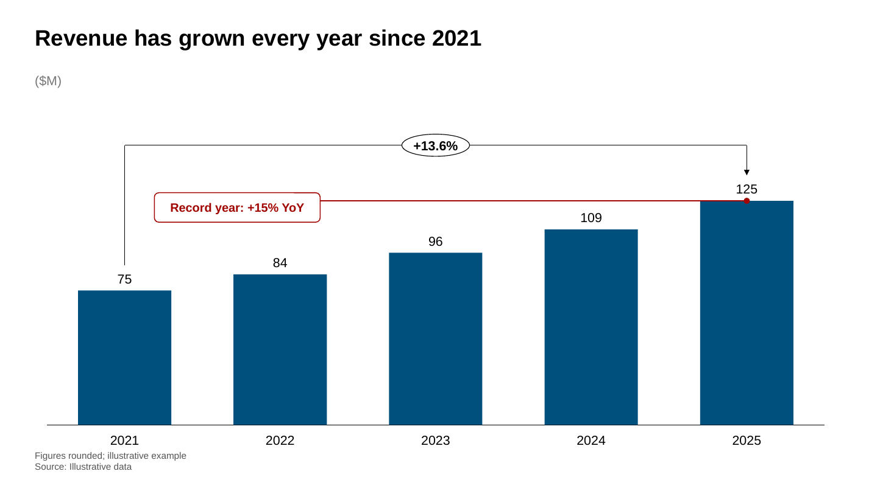

<details><summary>完整样例 JSON</summary>

```json
{
 "id": "column",
 "type": "column",
 "title": "Revenue has grown every year since 2021",
 "subtitle": "",
 "unit": "$M",
 "source": "Illustrative data",
 "data": {
  "categories": [
   "2021",
   "2022",
   "2023",
   "2024",
   "2025"
  ],
  "series": [
   {
    "name": "Revenue",
    "values": [
     75,
     84,
     96,
     109,
     125
    ]
   }
  ]
 },
 "decorations": [
  {
   "type": "cagr",
   "from": 0,
   "to": 4
  }
 ],
 "callouts": [
  {
   "text": "Record year: +15% YoY",
   "category": "2025",
   "dx": -7.6,
   "dy": 0.1
  }
 ],
 "footnote": "Figures rounded; illustrative example"
}
```
</details>

### `stacked`（type: `stacked`）

- **适合场景**：总量+构成随时间变化（带总计和 CAGR）
- **data 格式**：`{"categories":[str], "series":[{"name":str,"values":[num]}]  // 第 1 个系列画在最上面, "show_totals"?:bool}`
- **示例**：[examples/stacked.json](../examples/stacked.json)

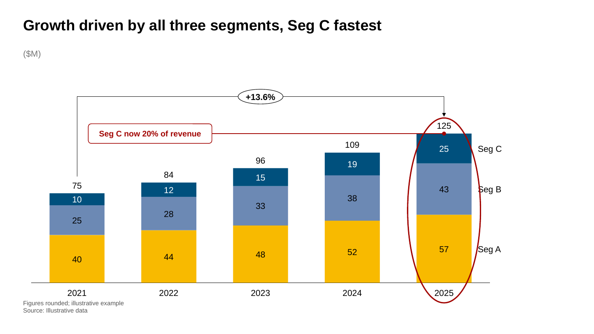

<details><summary>完整样例 JSON</summary>

```json
{
 "id": "stacked",
 "type": "stacked",
 "title": "Growth driven by all three segments, Seg C fastest",
 "subtitle": "",
 "unit": "$M",
 "source": "Illustrative data",
 "data": {
  "categories": [
   "2021",
   "2022",
   "2023",
   "2024",
   "2025"
  ],
  "series": [
   {
    "name": "Seg C",
    "values": [
     10,
     12,
     15,
     19,
     25
    ]
   },
   {
    "name": "Seg B",
    "values": [
     25,
     28,
     33,
     38,
     43
    ]
   },
   {
    "name": "Seg A",
    "values": [
     40,
     44,
     48,
     52,
     57
    ]
   }
  ]
 },
 "decorations": [
  {
   "type": "cagr",
   "from": 0,
   "to": 4
  }
 ],
 "highlight": [
  {
   "category": "2025"
  }
 ],
 "callouts": [
  {
   "text": "Seg C now 20% of revenue",
   "category": "2025",
   "dx": -6.6,
   "dy": 0.0
  }
 ],
 "footnote": "Figures rounded; illustrative example"
}
```
</details>

### `percent`（type: `percent`）

- **适合场景**：构成占比变化（100% 堆叠）
- **data 格式**：`{"categories":[str], "series":[{"name":str,"values":[绝对值]}]  // 自动换算百分比，顶部显示绝对总计}`
- **示例**：[examples/percent.json](../examples/percent.json)

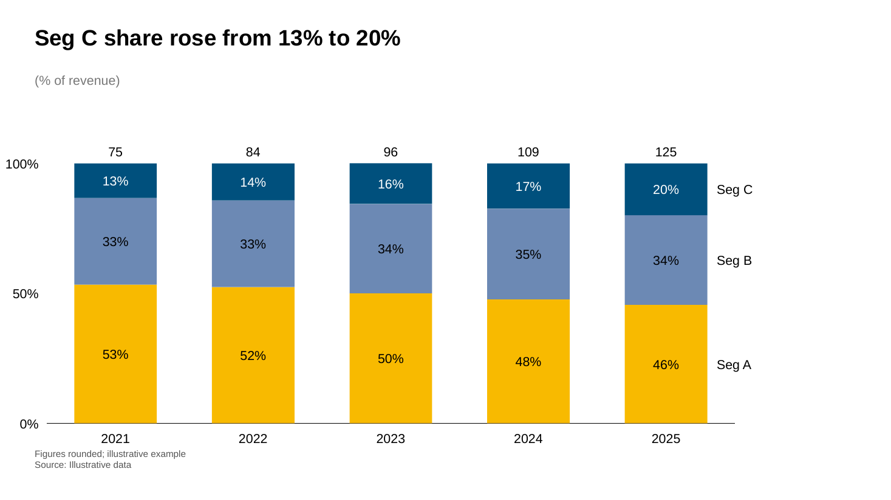

<details><summary>完整样例 JSON</summary>

```json
{
 "id": "percent",
 "type": "percent",
 "title": "Seg C share rose from 13% to 20%",
 "subtitle": "",
 "unit": "% of revenue",
 "source": "Illustrative data",
 "data": {
  "categories": [
   "2021",
   "2022",
   "2023",
   "2024",
   "2025"
  ],
  "series": [
   {
    "name": "Seg C",
    "values": [
     10,
     12,
     15,
     19,
     25
    ]
   },
   {
    "name": "Seg B",
    "values": [
     25,
     28,
     33,
     38,
     43
    ]
   },
   {
    "name": "Seg A",
    "values": [
     40,
     44,
     48,
     52,
     57
    ]
   }
  ]
 },
 "footnote": "Figures rounded; illustrative example"
}
```
</details>

### `clustered`（type: `clustered`）

- **适合场景**：少量系列跨类别直接比较
- **data 格式**：`{"categories":[str], "series":[{"name":str,"values":[num]}]}`
- **示例**：[examples/clustered.json](../examples/clustered.json)

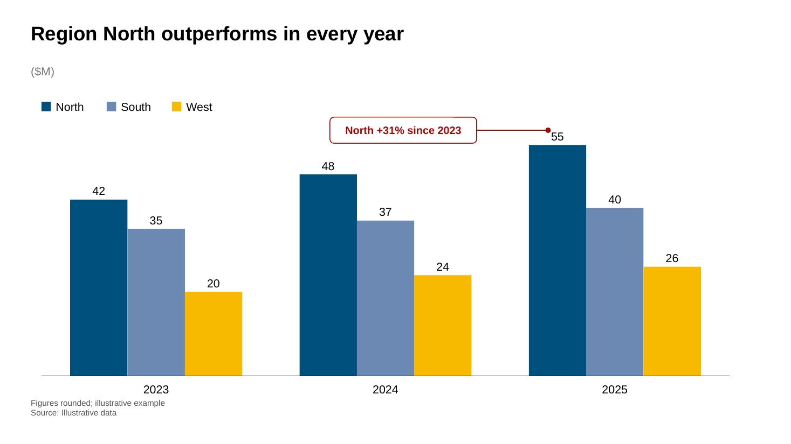

<details><summary>完整样例 JSON</summary>

```json
{
 "id": "clustered",
 "type": "clustered",
 "title": "Region North outperforms in every year",
 "subtitle": "",
 "unit": "$M",
 "source": "Illustrative data",
 "data": {
  "categories": [
   "2023",
   "2024",
   "2025"
  ],
  "series": [
   {
    "name": "North",
    "values": [
     42,
     48,
     55
    ]
   },
   {
    "name": "South",
    "values": [
     35,
     37,
     40
    ]
   },
   {
    "name": "West",
    "values": [
     20,
     24,
     26
    ]
   }
  ]
 },
 "callouts": [
  {
   "text": "North +31% since 2023",
   "anchor": "55",
   "dx": -2.6,
   "dy": -0.1
  }
 ],
 "footnote": "Figures rounded; illustrative example"
}
```
</details>

### `column_axis_break`（type: `column`）

- **适合场景**：有个别极大值时用轴破断
- **data 格式**：`{"categories":[str], "series":[{"name":str,"values":[num]}], "axis_break"?:{"from":num,"to":num}, "format"?:"{:.1f}"}`
- **示例**：[examples/column_axis_break.json](../examples/column_axis_break.json)

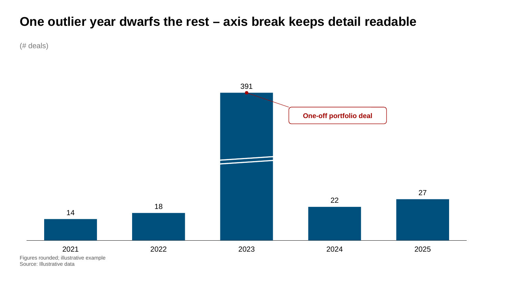

<details><summary>完整样例 JSON</summary>

```json
{
 "id": "column_axis_break",
 "type": "column",
 "title": "One outlier year dwarfs the rest – axis break keeps detail readable",
 "subtitle": "",
 "unit": "# deals",
 "source": "Illustrative data",
 "data": {
  "categories": [
   "2021",
   "2022",
   "2023",
   "2024",
   "2025"
  ],
  "series": [
   {
    "name": "Deals",
    "values": [
     14,
     18,
     391,
     22,
     27
    ]
   }
  ],
  "axis_break": {
   "from": 40,
   "to": 360
  }
 },
 "callouts": [
  {
   "text": "One-off portfolio deal",
   "category": "2023",
   "dx": 2.4,
   "dy": 0.6
  }
 ],
 "footnote": "Figures rounded; illustrative example"
}
```
</details>

### `stacked_diff`（type: `stacked`）

- **适合场景**：突出两点之间的差值（差值箭头）
- **data 格式**：`{"categories":[str], "series":[{"name":str,"values":[num]}]  // 第 1 个系列画在最上面, "show_totals"?:bool}`
- **示例**：[examples/stacked_diff.json](../examples/stacked_diff.json)


<details><summary>完整样例 JSON</summary>

```json
{
 "id": "stacked_diff",
 "type": "stacked",
 "title": "2025 revenue is 67% above 2021",
 "subtitle": "",
 "unit": "$M",
 "source": "Illustrative data",
 "data": {
  "categories": [
   "2021",
   "2022",
   "2023",
   "2024",
   "2025"
  ],
  "series": [
   {
    "name": "Seg C",
    "values": [
     10,
     12,
     15,
     19,
     25
    ]
   },
   {
    "name": "Seg B",
    "values": [
     25,
     28,
     33,
     38,
     43
    ]
   },
   {
    "name": "Seg A",
    "values": [
     40,
     44,
     48,
     52,
     57
    ]
   }
  ]
 },
 "decorations": [
  {
   "type": "diff",
   "from": 0,
   "to": 4
  }
 ],
 "footnote": "Figures rounded; illustrative example"
}
```
</details>

### `stacked_highlight`（type: `stacked`）

- **适合场景**：强调某一列 + callout 说明
- **data 格式**：`{"categories":[str], "series":[{"name":str,"values":[num]}]  // 第 1 个系列画在最上面, "show_totals"?:bool}`
- **示例**：[examples/stacked_highlight.json](../examples/stacked_highlight.json)

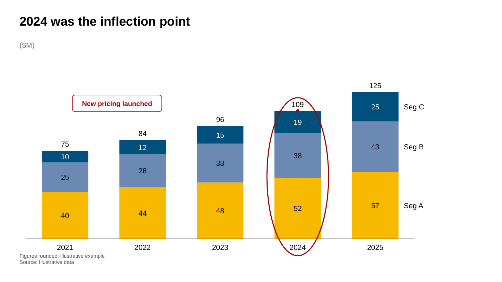

<details><summary>完整样例 JSON</summary>

```json
{
 "id": "stacked_highlight",
 "type": "stacked",
 "title": "2024 was the inflection point",
 "subtitle": "",
 "unit": "$M",
 "source": "Illustrative data",
 "data": {
  "categories": [
   "2021",
   "2022",
   "2023",
   "2024",
   "2025"
  ],
  "series": [
   {
    "name": "Seg C",
    "values": [
     10,
     12,
     15,
     19,
     25
    ]
   },
   {
    "name": "Seg B",
    "values": [
     25,
     28,
     33,
     38,
     43
    ]
   },
   {
    "name": "Seg A",
    "values": [
     40,
     44,
     48,
     52,
     57
    ]
   }
  ]
 },
 "decorations": [],
 "highlight": [
  {
   "category": "2024"
  }
 ],
 "callouts": [
  {
   "text": "New pricing launched",
   "category": "2024",
   "dx": -4.8,
   "dy": -0.2
  }
 ],
 "footnote": "Figures rounded; illustrative example"
}
```
</details>

### `stacked_clustered`（type: `stacked_clustered`）

- **适合场景**：计划 vs 实际等「每类多根堆叠柱」
- **data 格式**：`{"categories":[str], "groups":[{"name":str,"series":[{"name":str,"values":[num]}]}]}`
- **示例**：[examples/stacked_clustered.json](../examples/stacked_clustered.json)

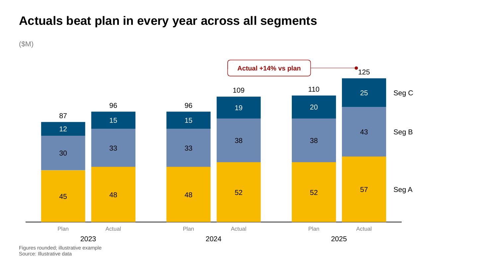

<details><summary>完整样例 JSON</summary>

```json
{
 "id": "stacked_clustered",
 "type": "stacked_clustered",
 "title": "Actuals beat plan in every year across all segments",
 "subtitle": "",
 "unit": "$M",
 "source": "Illustrative data",
 "data": {
  "categories": [
   "2023",
   "2024",
   "2025"
  ],
  "groups": [
   {
    "name": "Plan",
    "series": [
     {
      "name": "Seg C",
      "values": [
       12,
       15,
       20
      ]
     },
     {
      "name": "Seg B",
      "values": [
       30,
       33,
       38
      ]
     },
     {
      "name": "Seg A",
      "values": [
       45,
       48,
       52
      ]
     }
    ]
   },
   {
    "name": "Actual",
    "series": [
     {
      "name": "Seg C",
      "values": [
       15,
       19,
       25
      ]
     },
     {
      "name": "Seg B",
      "values": [
       33,
       38,
       43
      ]
     },
     {
      "name": "Seg A",
      "values": [
       48,
       52,
       57
      ]
     }
    ]
   }
  ]
 },
 "callouts": [
  {
   "text": "Actual +14% vs plan",
   "anchor": "125",
   "dx": -2.6,
   "dy": -0.1
  }
 ],
 "footnote": "Figures rounded; illustrative example"
}
```
</details>

### `column_error`（type: `column_error`）

- **适合场景**：带置信区间/波动范围的均值比较（误差线）
- **data 格式**：`{"categories":[str], "values":[num], "errors":[num] | "low":[num],"high":[num]}`
- **示例**：[examples/column_error.json](../examples/column_error.json)

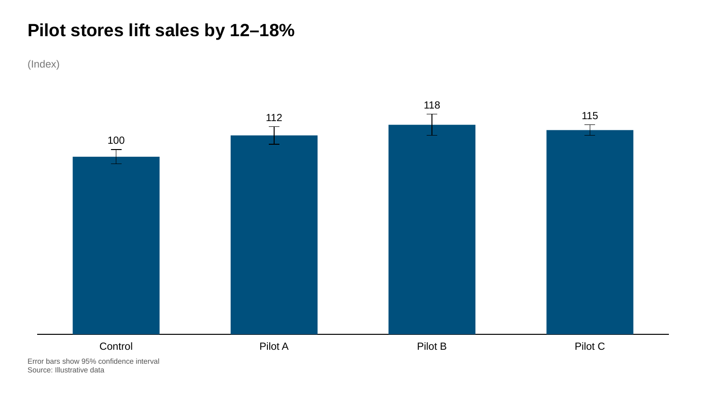

<details><summary>完整样例 JSON</summary>

```json
{
 "id": "column_error",
 "type": "column_error",
 "title": "Pilot stores lift sales by 12–18%",
 "subtitle": "",
 "unit": "Index",
 "source": "Illustrative data",
 "data": {
  "categories": [
   "Control",
   "Pilot A",
   "Pilot B",
   "Pilot C"
  ],
  "values": [
   100,
   112,
   118,
   115
  ],
  "errors": [
   4,
   5,
   6,
   3
  ]
 },
 "footnote": "Error bars show 95% confidence interval"
}
```
</details>

### `column_grouped`（type: `column_grouped`）

- **适合场景**：两级类别（年-季度）分组 + 组间间隔
- **data 格式**：`{"groups":[{"name":str,"categories":[str],"values":[num]}], "gap"?:num}`
- **示例**：[examples/column_grouped.json](../examples/column_grouped.json)

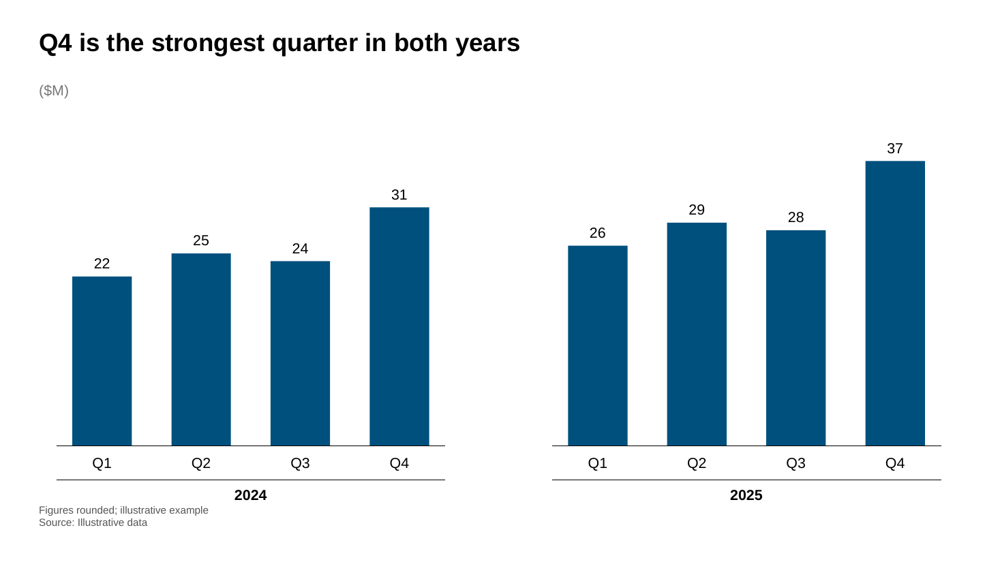

<details><summary>完整样例 JSON</summary>

```json
{
 "id": "column_grouped",
 "type": "column_grouped",
 "title": "Q4 is the strongest quarter in both years",
 "subtitle": "",
 "unit": "$M",
 "source": "Illustrative data",
 "data": {
  "groups": [
   {
    "name": "2024",
    "categories": [
     "Q1",
     "Q2",
     "Q3",
     "Q4"
    ],
    "values": [
     22,
     25,
     24,
     31
    ]
   },
   {
    "name": "2025",
    "categories": [
     "Q1",
     "Q2",
     "Q3",
     "Q4"
    ],
    "values": [
     26,
     29,
     28,
     37
    ]
   }
  ]
 },
 "footnote": "Figures rounded; illustrative example"
}
```
</details>

### `column_target`（type: `column_target`）

- **适合场景**：实际 vs 目标（目标标记线 + 达成率）
- **data 格式**：`{"categories":[str], "actual":[num], "target":[num], "target_name"?:str}`
- **示例**：[examples/column_target.json](../examples/column_target.json)

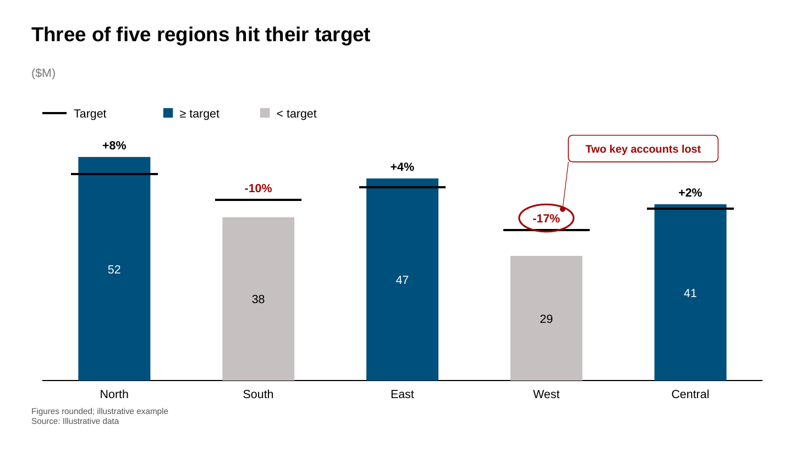

<details><summary>完整样例 JSON</summary>

```json
{
 "id": "column_target",
 "type": "column_target",
 "title": "Three of five regions hit their target",
 "subtitle": "",
 "unit": "$M",
 "source": "Illustrative data",
 "data": {
  "categories": [
   "North",
   "South",
   "East",
   "West",
   "Central"
  ],
  "actual": [
   52,
   38,
   47,
   29,
   41
  ],
  "target": [
   48,
   42,
   45,
   35,
   40
  ]
 },
 "highlight": [
  {
   "anchor": "-17%",
   "shape": "circle",
   "w": 0.9,
   "h": 0.45
  }
 ],
 "callouts": [
  {
   "text": "Two key accounts lost",
   "anchor": "-17%",
   "dx": 1.6,
   "dy": -1.15
  }
 ],
 "footnote": "Figures rounded; illustrative example"
}
```
</details>

### `column_xbreak`（type: `column_xbreak`）

- **适合场景**：类别轴不连续（跳过年份）时用横轴破断
- **data 格式**：`{"categories":[str], "values":[num], "break_after":int}`
- **示例**：[examples/column_xbreak.json](../examples/column_xbreak.json)

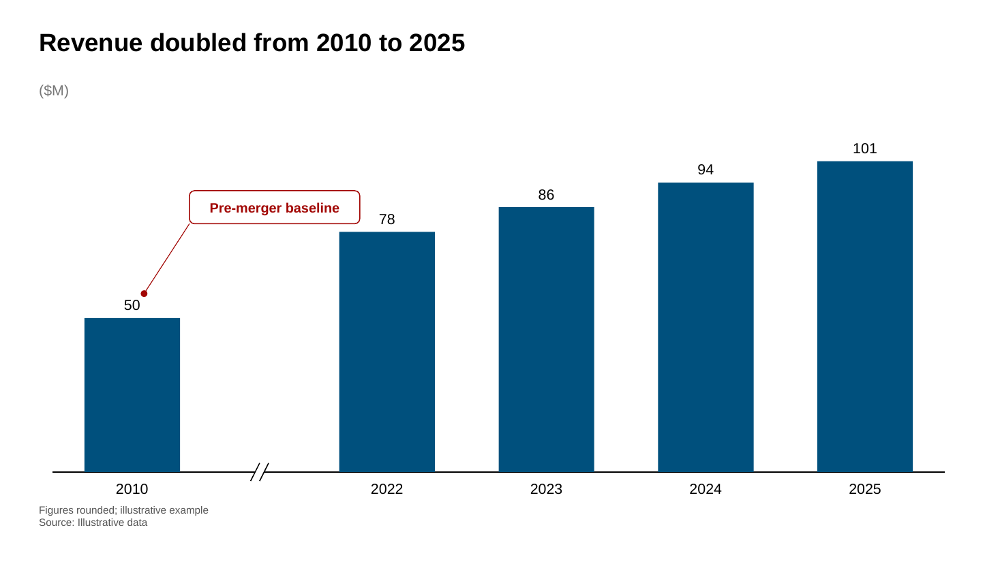

<details><summary>完整样例 JSON</summary>

```json
{
 "id": "column_xbreak",
 "type": "column_xbreak",
 "title": "Revenue doubled from 2010 to 2025",
 "subtitle": "",
 "unit": "$M",
 "source": "Illustrative data",
 "data": {
  "categories": [
   "2010",
   "2022",
   "2023",
   "2024",
   "2025"
  ],
  "values": [
   50,
   78,
   86,
   94,
   101
  ],
  "break_after": 0
 },
 "callouts": [
  {
   "text": "Pre-merger baseline",
   "anchor": "50",
   "dx": 1.9,
   "dy": -1.3
  }
 ],
 "footnote": "Figures rounded; illustrative example"
}
```
</details>

### `stacked_value_line`（type: `stacked`）

- **适合场景**：数值线/平均线（value line）
- **data 格式**：`{"categories":[str], "series":[{"name":str,"values":[num]}]  // 第 1 个系列画在最上面, "show_totals"?:bool}`
- **示例**：[examples/stacked_value_line.json](../examples/stacked_value_line.json)

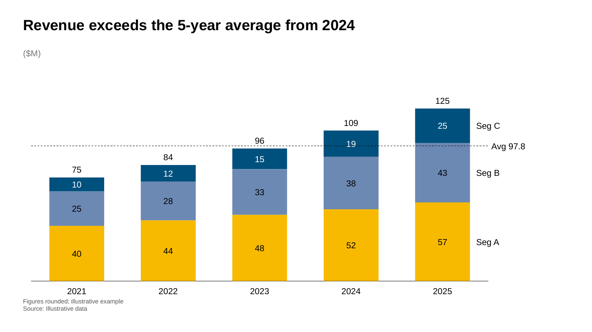

<details><summary>完整样例 JSON</summary>

```json
{
 "id": "stacked_value_line",
 "type": "stacked",
 "title": "Revenue exceeds the 5-year average from 2024",
 "subtitle": "",
 "unit": "$M",
 "source": "Illustrative data",
 "data": {
  "categories": [
   "2021",
   "2022",
   "2023",
   "2024",
   "2025"
  ],
  "series": [
   {
    "name": "Seg C",
    "values": [
     10,
     12,
     15,
     19,
     25
    ]
   },
   {
    "name": "Seg B",
    "values": [
     25,
     28,
     33,
     38,
     43
    ]
   },
   {
    "name": "Seg A",
    "values": [
     40,
     44,
     48,
     52,
     57
    ]
   }
  ]
 },
 "decorations": [
  {
   "type": "value_line",
   "value": 97.8,
   "label": "Avg 97.8"
  }
 ],
 "footnote": "Figures rounded; illustrative example"
}
```
</details>


## 瀑布图

### `waterfall`（type: `waterfall`）

- **适合场景**：起点→驱动因素→终点的桥（收入桥、利润桥）
- **data 格式**：`{"items":[{"label":str,"value":num,"kind":"start|delta|total"}], "signed_labels"?:bool, "color_by_sign"?:bool}`
- **示例**：[examples/waterfall.json](../examples/waterfall.json)

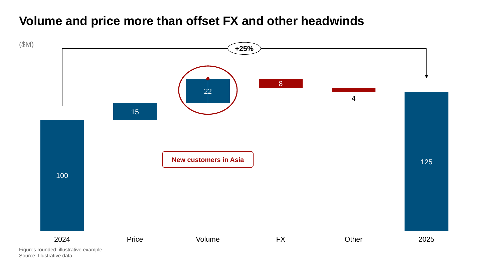

<details><summary>完整样例 JSON</summary>

```json
{
 "id": "waterfall",
 "type": "waterfall",
 "title": "Volume and price more than offset FX and other headwinds",
 "subtitle": "",
 "unit": "$M",
 "source": "Illustrative data",
 "data": {
  "items": [
   {
    "label": "2024",
    "value": 100,
    "kind": "start"
   },
   {
    "label": "Price",
    "value": 15
   },
   {
    "label": "Volume",
    "value": 22
   },
   {
    "label": "FX",
    "value": -8
   },
   {
    "label": "Other",
    "value": -4
   },
   {
    "label": "2025",
    "value": 125,
    "kind": "total"
   }
  ]
 },
 "decorations": [
  {
   "type": "total_diff",
   "from": 0,
   "to": 5
  }
 ],
 "highlight": [
  {
   "category": "Volume"
  }
 ],
 "callouts": [
  {
   "text": "New customers in Asia",
   "category": "Volume",
   "dx": 0,
   "dy": 2.2
  }
 ],
 "footnote": "Figures rounded; illustrative example"
}
```
</details>

### `waterfall_signed`（type: `waterfall`）

- **适合场景**：需要一眼看出正负方向时
- **data 格式**：`{"items":[{"label":str,"value":num,"kind":"start|delta|total"}], "signed_labels"?:bool, "color_by_sign"?:bool}`
- **示例**：[examples/waterfall_signed.json](../examples/waterfall_signed.json)

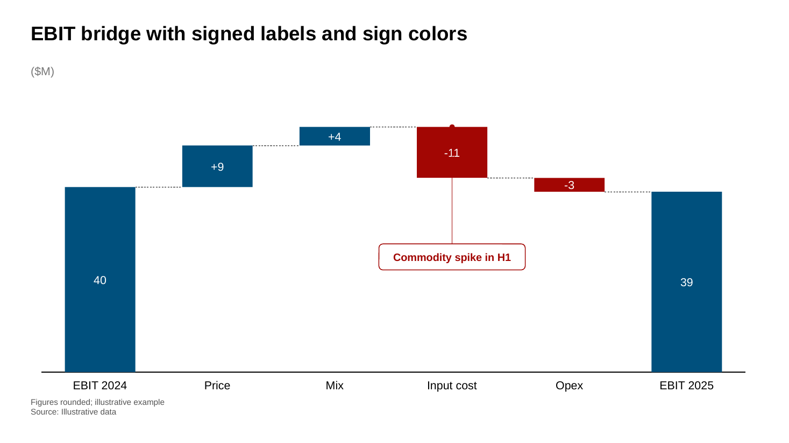

<details><summary>完整样例 JSON</summary>

```json
{
 "id": "waterfall_signed",
 "type": "waterfall",
 "title": "EBIT bridge with signed labels and sign colors",
 "subtitle": "",
 "unit": "$M",
 "source": "Illustrative data",
 "data": {
  "items": [
   {
    "label": "EBIT 2024",
    "value": 40,
    "kind": "start"
   },
   {
    "label": "Price",
    "value": 9
   },
   {
    "label": "Mix",
    "value": 4
   },
   {
    "label": "Input cost",
    "value": -11
   },
   {
    "label": "Opex",
    "value": -3
   },
   {
    "label": "EBIT 2025",
    "value": 39,
    "kind": "total"
   }
  ],
  "signed_labels": true,
  "color_by_sign": true
 },
 "callouts": [
  {
   "text": "Commodity spike in H1",
   "category": "Input cost",
   "dx": 0,
   "dy": 2.2
  }
 ],
 "footnote": "Figures rounded; illustrative example"
}
```
</details>

### `waterfall_h`（type: `waterfall_h`）

- **适合场景**：总额向下分解（build-down，条目名较长时用水平版）
- **data 格式**：`{"items":[{"label":str,"value":num,"kind":"start|delta|total"}]}`
- **示例**：[examples/waterfall_h.json](../examples/waterfall_h.json)

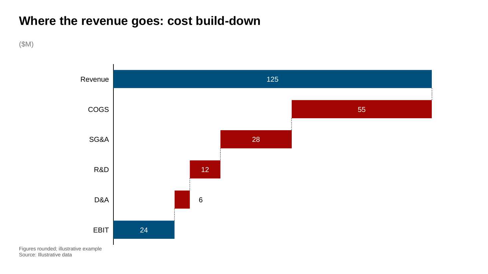

<details><summary>完整样例 JSON</summary>

```json
{
 "id": "waterfall_h",
 "type": "waterfall_h",
 "title": "Where the revenue goes: cost build-down",
 "subtitle": "",
 "unit": "$M",
 "source": "Illustrative data",
 "data": {
  "items": [
   {
    "label": "Revenue",
    "value": 125,
    "kind": "start"
   },
   {
    "label": "COGS",
    "value": -55
   },
   {
    "label": "SG&A",
    "value": -28
   },
   {
    "label": "R&D",
    "value": -12
   },
   {
    "label": "D&A",
    "value": -6
   },
   {
    "label": "EBIT",
    "value": 24,
    "kind": "total"
   }
  ]
 },
 "footnote": "Figures rounded; illustrative example"
}
```
</details>

### `waterfall_stacked`（type: `waterfall_stacked`）

- **适合场景**：每个驱动再按产品/区域拆分（堆叠瀑布）
- **data 格式**：`{"series":[str], "items":[{"label":str,"values":[num 每系列],"kind":"start|delta|total"}]}`
- **示例**：[examples/waterfall_stacked.json](../examples/waterfall_stacked.json)

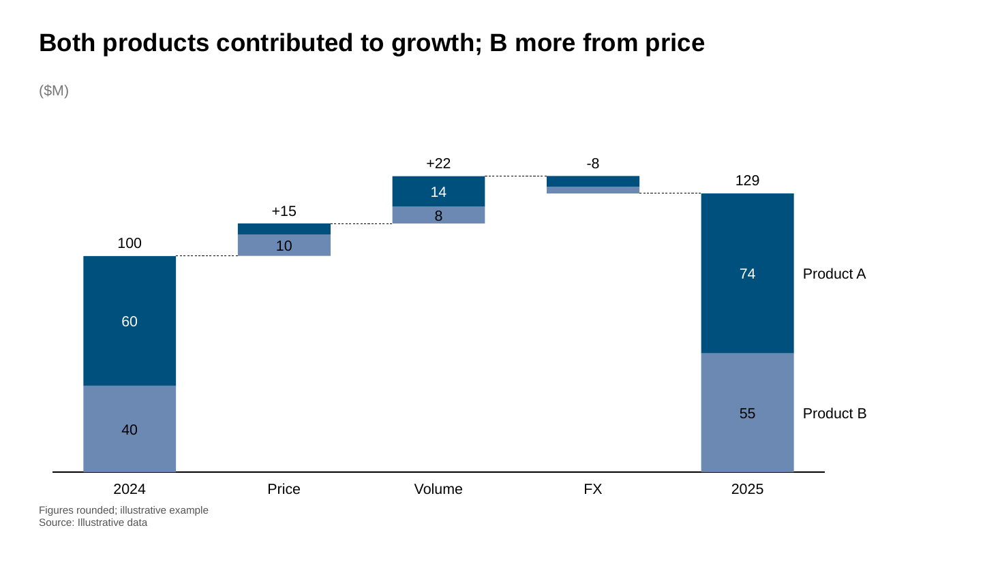

<details><summary>完整样例 JSON</summary>

```json
{
 "id": "waterfall_stacked",
 "type": "waterfall_stacked",
 "title": "Both products contributed to growth; B more from price",
 "subtitle": "",
 "unit": "$M",
 "source": "Illustrative data",
 "data": {
  "series": [
   "Product A",
   "Product B"
  ],
  "items": [
   {
    "label": "2024",
    "values": [
     60,
     40
    ],
    "kind": "start"
   },
   {
    "label": "Price",
    "values": [
     5,
     10
    ]
   },
   {
    "label": "Volume",
    "values": [
     14,
     8
    ]
   },
   {
    "label": "FX",
    "values": [
     -5,
     -3
    ]
   },
   {
    "label": "2025",
    "values": [
     74,
     55
    ],
    "kind": "total"
   }
  ]
 },
 "footnote": "Figures rounded; illustrative example"
}
```
</details>

### `waterfall_subtotal`（type: `waterfall_subtotal`）

- **适合场景**：多级小计的损益桥（subtotal 自动计算）
- **data 格式**：`{"items":[{"label":str,"value"?:num,"kind":"start|delta|subtotal|total"}]}  // subtotal/total 不给 value 自动累计`
- **示例**：[examples/waterfall_subtotal.json](../examples/waterfall_subtotal.json)

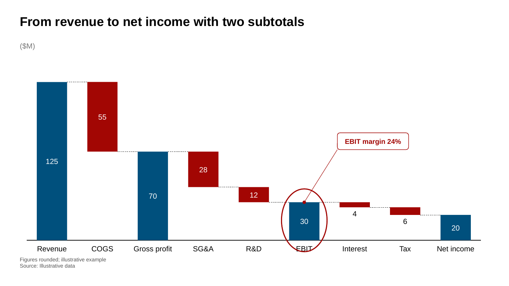

<details><summary>完整样例 JSON</summary>

```json
{
 "id": "waterfall_subtotal",
 "type": "waterfall_subtotal",
 "title": "From revenue to net income with two subtotals",
 "subtitle": "",
 "unit": "$M",
 "source": "Illustrative data",
 "data": {
  "items": [
   {
    "label": "Revenue",
    "value": 125,
    "kind": "start"
   },
   {
    "label": "COGS",
    "value": -55
   },
   {
    "label": "Gross profit",
    "kind": "subtotal"
   },
   {
    "label": "SG&A",
    "value": -28
   },
   {
    "label": "R&D",
    "value": -12
   },
   {
    "label": "EBIT",
    "kind": "subtotal"
   },
   {
    "label": "Interest",
    "value": -4
   },
   {
    "label": "Tax",
    "value": -6
   },
   {
    "label": "Net income",
    "kind": "total"
   }
  ]
 },
 "highlight": [
  {
   "category": "EBIT"
  }
 ],
 "callouts": [
  {
   "text": "EBIT margin 24%",
   "category": "EBIT",
   "dx": 1.8,
   "dy": -1.6
  }
 ],
 "footnote": "Figures rounded; illustrative example"
}
```
</details>

### `waterfall_percent`（type: `waterfall_percent`）

- **适合场景**：百分比/利润率桥（pp 变化）
- **data 格式**：`同 waterfall，加 "format":"{:.1f}%", "delta_format":"{:+.1f}pp"`
- **示例**：[examples/waterfall_percent.json](../examples/waterfall_percent.json)

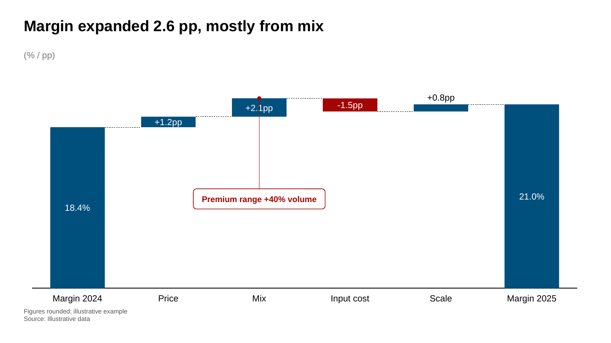

<details><summary>完整样例 JSON</summary>

```json
{
 "id": "waterfall_percent",
 "type": "waterfall_percent",
 "title": "Margin expanded 2.6 pp, mostly from mix",
 "subtitle": "",
 "unit": "% / pp",
 "source": "Illustrative data",
 "data": {
  "items": [
   {
    "label": "Margin 2024",
    "value": 18.4,
    "kind": "start"
   },
   {
    "label": "Price",
    "value": 1.2
   },
   {
    "label": "Mix",
    "value": 2.1
   },
   {
    "label": "Input cost",
    "value": -1.5
   },
   {
    "label": "Scale",
    "value": 0.8
   },
   {
    "label": "Margin 2025",
    "value": 21.0,
    "kind": "total"
   }
  ],
  "format": "{:.1f}%",
  "delta_format": "{:+.1f}pp",
  "signed_labels": true
 },
 "callouts": [
  {
   "text": "Premium range +40% volume",
   "category": "Mix",
   "dx": 0,
   "dy": 2.2
  }
 ],
 "footnote": "Figures rounded; illustrative example"
}
```
</details>

### `waterfall_negative_end`（type: `waterfall`）

- **适合场景**：终点为负的桥（零线以下）
- **data 格式**：`{"items":[{"label":str,"value":num,"kind":"start|delta|total"}], "signed_labels"?:bool, "color_by_sign"?:bool}`
- **示例**：[examples/waterfall_negative_end.json](../examples/waterfall_negative_end.json)

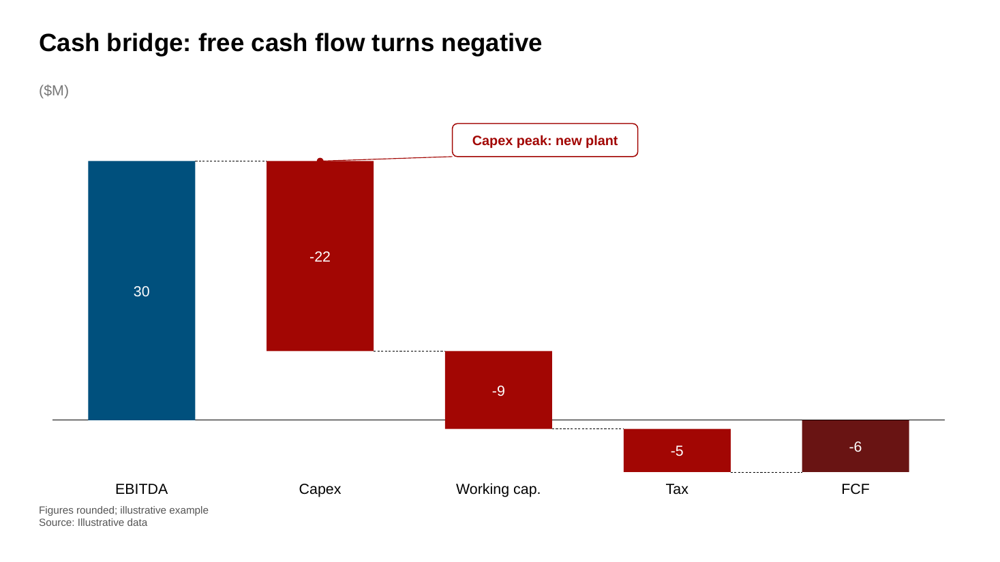

<details><summary>完整样例 JSON</summary>

```json
{
 "id": "waterfall_negative_end",
 "type": "waterfall",
 "title": "Cash bridge: free cash flow turns negative",
 "subtitle": "",
 "unit": "$M",
 "source": "Illustrative data",
 "data": {
  "items": [
   {
    "label": "EBITDA",
    "value": 30,
    "kind": "start"
   },
   {
    "label": "Capex",
    "value": -22
   },
   {
    "label": "Working cap.",
    "value": -9
   },
   {
    "label": "Tax",
    "value": -5
   },
   {
    "label": "FCF",
    "value": -6,
    "kind": "total"
   }
  ],
  "color_by_sign": true,
  "signed_labels": true
 },
 "callouts": [
  {
   "text": "Capex peak: new plant",
   "category": "Capex",
   "dx": 3.0,
   "dy": -0.6
  }
 ],
 "footnote": "Figures rounded; illustrative example"
}
```
</details>


## Mekko 图

### `mekko_percent`（type: `mekko_percent`）

- **适合场景**：市场规模（宽度）× 份额（高度），看结构
- **data 格式**：`{"categories":[str], "widths"?:[num], "series":[{"name":str,"values":[num]}], "total_label"?:str}`
- **示例**：[examples/mekko_percent.json](../examples/mekko_percent.json)

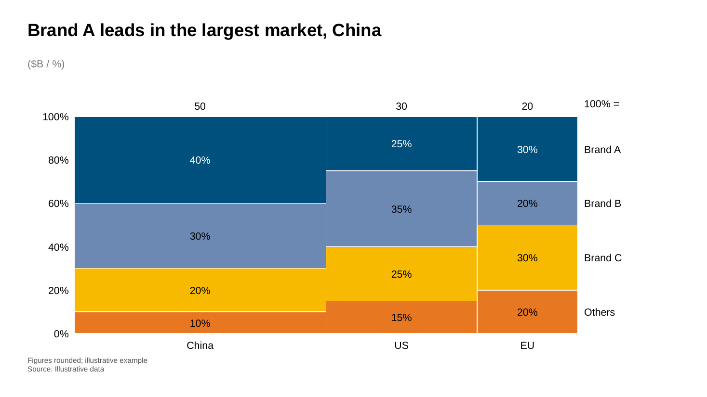

<details><summary>完整样例 JSON</summary>

```json
{
 "id": "mekko_percent",
 "type": "mekko_percent",
 "title": "Brand A leads in the largest market, China",
 "subtitle": "",
 "unit": "$B / %",
 "source": "Illustrative data",
 "data": {
  "categories": [
   "China",
   "US",
   "EU"
  ],
  "widths": [
   50,
   30,
   20
  ],
  "series": [
   {
    "name": "Brand A",
    "values": [
     40,
     25,
     30
    ]
   },
   {
    "name": "Brand B",
    "values": [
     30,
     35,
     20
    ]
   },
   {
    "name": "Brand C",
    "values": [
     20,
     25,
     30
    ]
   },
   {
    "name": "Others",
    "values": [
     10,
     15,
     20
    ]
   }
  ]
 },
 "footnote": "Figures rounded; illustrative example"
}
```
</details>

### `mekko_unit`（type: `mekko_unit`）

- **适合场景**：宽度和高度都是绝对值（单位 Mekko）
- **data 格式**：`{"categories":[str], "series":[{"name":str,"values":[绝对值]}]}`
- **示例**：[examples/mekko_unit.json](../examples/mekko_unit.json)

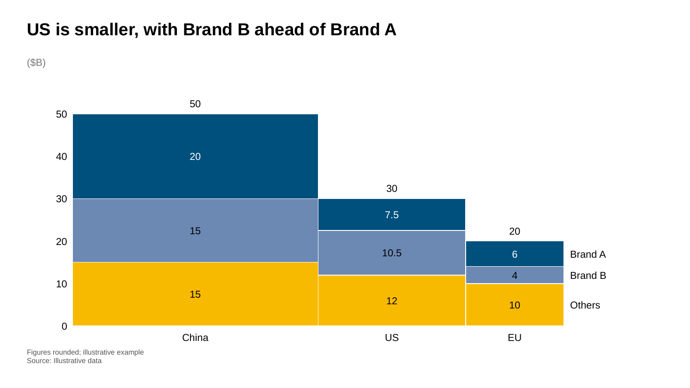

<details><summary>完整样例 JSON</summary>

```json
{
 "id": "mekko_unit",
 "type": "mekko_unit",
 "title": "US is smaller, with Brand B ahead of Brand A",
 "subtitle": "",
 "unit": "$B",
 "source": "Illustrative data",
 "data": {
  "categories": [
   "China",
   "US",
   "EU"
  ],
  "series": [
   {
    "name": "Brand A",
    "values": [
     20,
     7.5,
     6
    ]
   },
   {
    "name": "Brand B",
    "values": [
     15,
     10.5,
     4
    ]
   },
   {
    "name": "Others",
    "values": [
     15,
     12,
     10
    ]
   }
  ]
 },
 "footnote": "Figures rounded; illustrative example"
}
```
</details>

### `variwide`（type: `variwide`）

- **适合场景**：宽=规模、高=指标的变宽柱（单系列 Mekko）
- **data 格式**：`{"categories":[str], "widths":[num], "values":[num], "suffix"?:str, "highlight"?:[str]}`
- **示例**：[examples/variwide.json](../examples/variwide.json)

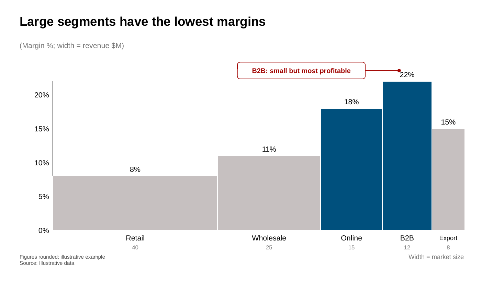

<details><summary>完整样例 JSON</summary>

```json
{
 "id": "variwide",
 "type": "variwide",
 "title": "Large segments have the lowest margins",
 "subtitle": "",
 "unit": "Margin %; width = revenue $M",
 "source": "Illustrative data",
 "data": {
  "categories": [
   "Retail",
   "Wholesale",
   "Online",
   "B2B",
   "Export"
  ],
  "widths": [
   40,
   25,
   15,
   12,
   8
  ],
  "values": [
   8,
   11,
   18,
   22,
   15
  ],
  "suffix": "%",
  "highlight": [
   "Online",
   "B2B"
  ]
 },
 "callouts": [
  {
   "text": "B2B: small but most profitable",
   "anchor": "22%",
   "dx": -2.8,
   "dy": -0.2
  }
 ],
 "footnote": "Figures rounded; illustrative example"
}
```
</details>

### `proportional_area`（type: `proportional_area`）

- **适合场景**：量级差距很大时用面积比例
- **data 格式**：`{"items":[{"label":str,"value":num,"color"?:hex}]}`
- **示例**：[examples/proportional_area.json](../examples/proportional_area.json)

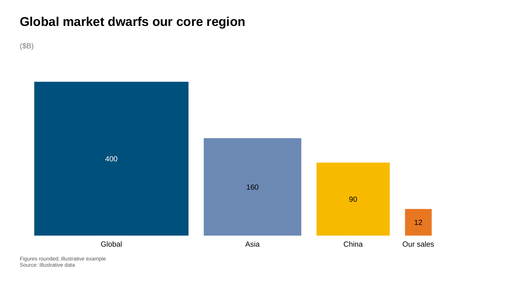

<details><summary>完整样例 JSON</summary>

```json
{
 "id": "proportional_area",
 "type": "proportional_area",
 "title": "Global market dwarfs our core region",
 "subtitle": "",
 "unit": "$B",
 "source": "Illustrative data",
 "data": {
  "items": [
   {
    "label": "Global",
    "value": 400
   },
   {
    "label": "Asia",
    "value": 160
   },
   {
    "label": "China",
    "value": 90
   },
   {
    "label": "Our sales",
    "value": 12
   }
  ]
 },
 "footnote": "Figures rounded; illustrative example"
}
```
</details>


## 条形图

### `bar`（type: `bar`）

- **适合场景**：类别名较长/类别较多时的排名
- **data 格式**：`{"categories":[str], "series":[{"name":str,"values":[num]}], "highlight"?:[str]}`
- **示例**：[examples/bar.json](../examples/bar.json)

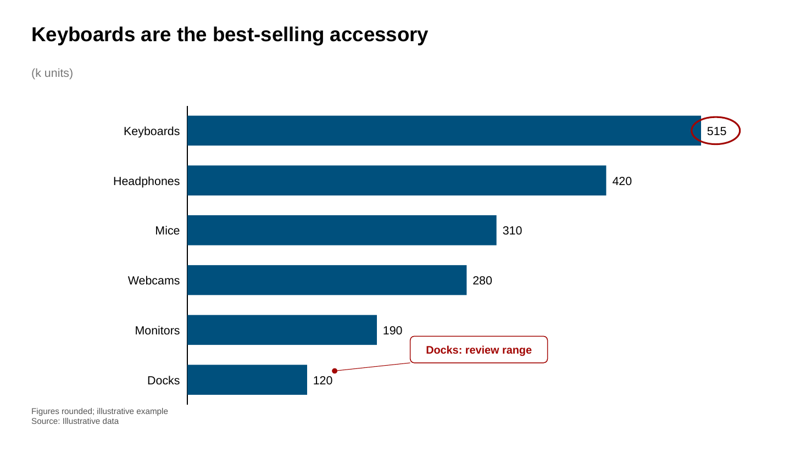

<details><summary>完整样例 JSON</summary>

```json
{
 "id": "bar",
 "type": "bar",
 "title": "Keyboards are the best-selling accessory",
 "subtitle": "",
 "unit": "k units",
 "source": "Illustrative data",
 "data": {
  "categories": [
   "Keyboards",
   "Headphones",
   "Mice",
   "Webcams",
   "Monitors",
   "Docks"
  ],
  "series": [
   {
    "name": "Units",
    "values": [
     515,
     420,
     310,
     280,
     190,
     120
    ]
   }
  ]
 },
 "highlight": [
  {
   "anchor": "515",
   "shape": "circle",
   "w": 0.8,
   "h": 0.45
  }
 ],
 "callouts": [
  {
   "text": "Docks: review range",
   "anchor": "120",
   "dx": 2.6,
   "dy": -0.5
  }
 ],
 "footnote": "Figures rounded; illustrative example"
}
```
</details>

### `bar_sorted`（type: `bar_sorted`）

- **适合场景**：自动降序 + 高亮重点项
- **data 格式**：`同 bar，自动降序；"highlight":[类别名] 高亮绿色，其余浅灰`
- **示例**：[examples/bar_sorted.json](../examples/bar_sorted.json)

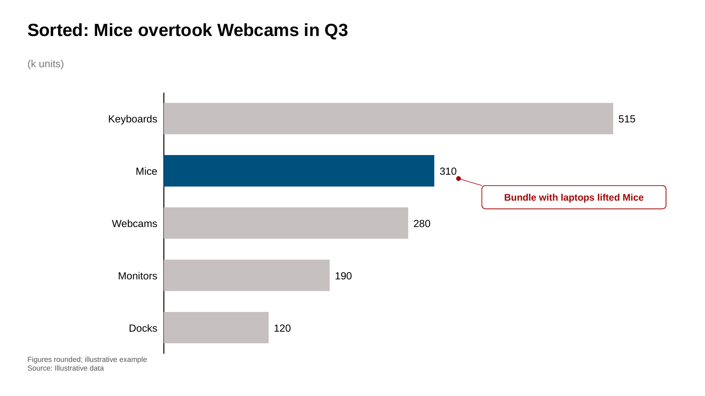

<details><summary>完整样例 JSON</summary>

```json
{
 "id": "bar_sorted",
 "type": "bar_sorted",
 "title": "Sorted: Mice overtook Webcams in Q3",
 "subtitle": "",
 "unit": "k units",
 "source": "Illustrative data",
 "data": {
  "categories": [
   "Webcams",
   "Mice",
   "Docks",
   "Keyboards",
   "Monitors"
  ],
  "series": [
   {
    "name": "Units",
    "values": [
     280,
     310,
     120,
     515,
     190
    ]
   }
  ],
  "highlight": [
   "Mice"
  ]
 },
 "callouts": [
  {
   "text": "Bundle with laptops lifted Mice",
   "anchor": "310",
   "dx": 3.0,
   "dy": 0.5
  }
 ],
 "footnote": "Figures rounded; illustrative example"
}
```
</details>

### `bar_stacked`（type: `bar_stacked`）

- **适合场景**：水平堆叠，类别名长时用
- **data 格式**：`{"categories":[str], "series":[{"name":str,"values":[num]}]}`
- **示例**：[examples/bar_stacked.json](../examples/bar_stacked.json)

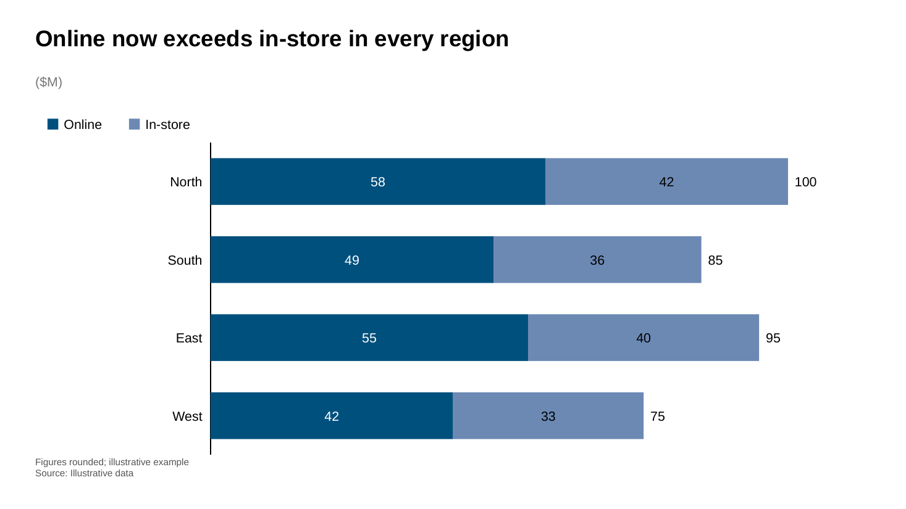

<details><summary>完整样例 JSON</summary>

```json
{
 "id": "bar_stacked",
 "type": "bar_stacked",
 "title": "Online now exceeds in-store in every region",
 "subtitle": "",
 "unit": "$M",
 "source": "Illustrative data",
 "data": {
  "categories": [
   "North",
   "South",
   "East",
   "West"
  ],
  "series": [
   {
    "name": "Online",
    "values": [
     58,
     49,
     55,
     42
    ]
   },
   {
    "name": "In-store",
    "values": [
     42,
     36,
     40,
     33
    ]
   }
  ]
 },
 "footnote": "Figures rounded; illustrative example"
}
```
</details>

### `bar_yoy`（type: `bar_yoy`）

- **适合场景**：两年逐项对比 + 变化率列
- **data 格式**：`{"categories":[str], "previous":{"name":str,"values":[num]}, "current":{"name":str,"values":[num]}}`
- **示例**：[examples/bar_yoy.json](../examples/bar_yoy.json)

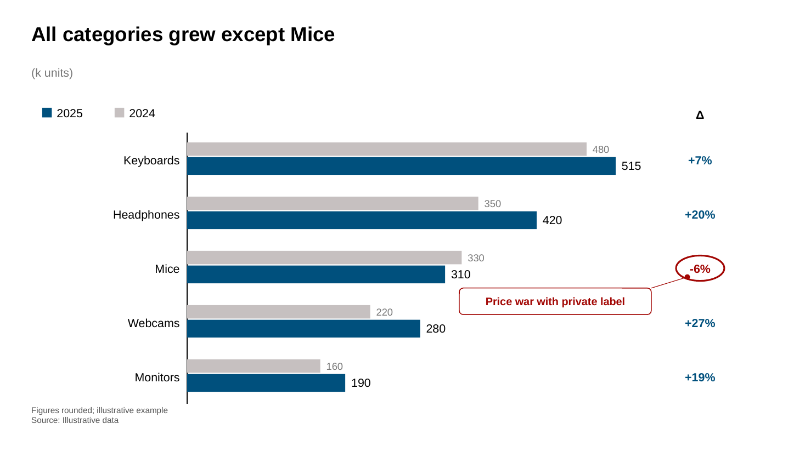

<details><summary>完整样例 JSON</summary>

```json
{
 "id": "bar_yoy",
 "type": "bar_yoy",
 "title": "All categories grew except Mice",
 "subtitle": "",
 "unit": "k units",
 "source": "Illustrative data",
 "data": {
  "categories": [
   "Keyboards",
   "Headphones",
   "Mice",
   "Webcams",
   "Monitors"
  ],
  "previous": {
   "name": "2024",
   "values": [
    480,
    350,
    330,
    220,
    160
   ]
  },
  "current": {
   "name": "2025",
   "values": [
    515,
    420,
    310,
    280,
    190
   ]
  }
 },
 "highlight": [
  {
   "anchor": "-6%",
   "shape": "circle",
   "w": 0.8,
   "h": 0.42
  }
 ],
 "callouts": [
  {
   "text": "Price war with private label",
   "anchor": "-6%",
   "dx": -2.4,
   "dy": 0.55
  }
 ],
 "footnote": "Figures rounded; illustrative example"
}
```
</details>

### `bar_diverging`（type: `bar_diverging`）

- **适合场景**：有正有负的变化（正负条形）
- **data 格式**：`{"categories":[str], "values":[±num], "suffix"?:str}`
- **示例**：[examples/bar_diverging.json](../examples/bar_diverging.json)

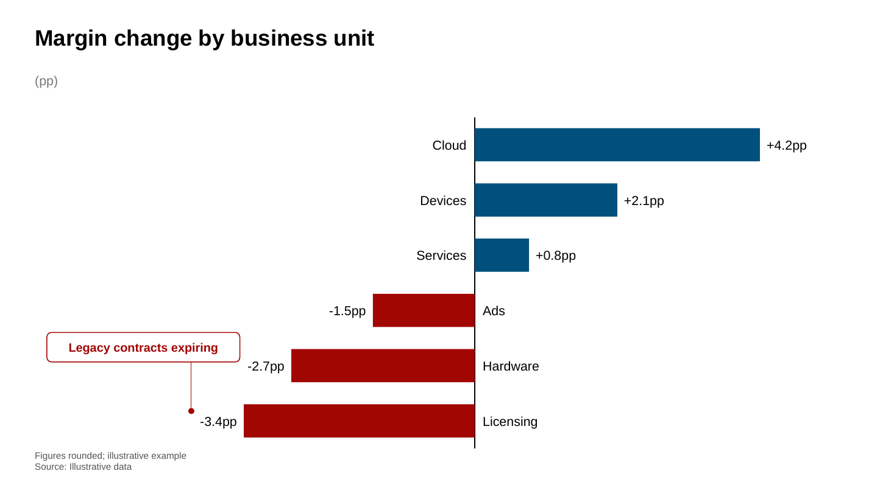

<details><summary>完整样例 JSON</summary>

```json
{
 "id": "bar_diverging",
 "type": "bar_diverging",
 "title": "Margin change by business unit",
 "subtitle": "",
 "unit": "pp",
 "source": "Illustrative data",
 "data": {
  "categories": [
   "Cloud",
   "Devices",
   "Services",
   "Ads",
   "Hardware",
   "Licensing"
  ],
  "values": [
   4.2,
   2.1,
   0.8,
   -1.5,
   -2.7,
   -3.4
  ],
  "suffix": "pp"
 },
 "callouts": [
  {
   "text": "Legacy contracts expiring",
   "anchor": "-3.4pp",
   "dx": -1.6,
   "dy": -1.1
  }
 ],
 "footnote": "Figures rounded; illustrative example"
}
```
</details>

### `bar_percent`（type: `bar_percent`）

- **适合场景**：调研量表（李克特）/ 100% 构成条形
- **data 格式**：`{"categories":[str], "series":[{"name":str,"values":[num]}], "colors"?:[hex]}`
- **示例**：[examples/bar_percent.json](../examples/bar_percent.json)

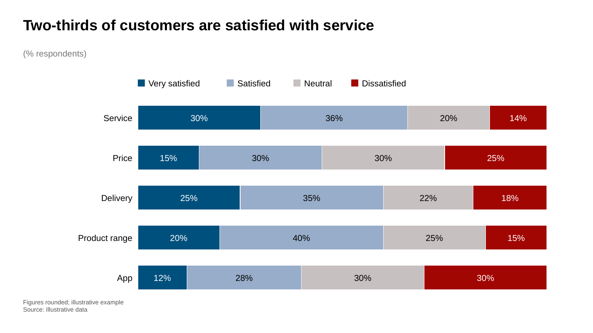

<details><summary>完整样例 JSON</summary>

```json
{
 "id": "bar_percent",
 "type": "bar_percent",
 "title": "Two-thirds of customers are satisfied with service",
 "subtitle": "",
 "unit": "% respondents",
 "source": "Illustrative data",
 "data": {
  "categories": [
   "Service",
   "Price",
   "Delivery",
   "Product range",
   "App"
  ],
  "series": [
   {
    "name": "Very satisfied",
    "values": [
     30,
     15,
     25,
     20,
     12
    ]
   },
   {
    "name": "Satisfied",
    "values": [
     36,
     30,
     35,
     40,
     28
    ]
   },
   {
    "name": "Neutral",
    "values": [
     20,
     30,
     22,
     25,
     30
    ]
   },
   {
    "name": "Dissatisfied",
    "values": [
     14,
     25,
     18,
     15,
     30
    ]
   }
  ],
  "colors": "likert"
 },
 "footnote": "Figures rounded; illustrative example"
}
```
</details>


## 对比图

### `butterfly`（type: `butterfly`）

- **适合场景**：两组人群/两个时期左右对照（蝴蝶图）
- **data 格式**：`{"categories":[str], "series":[左侧系列, 右侧系列]}`
- **示例**：[examples/butterfly.json](../examples/butterfly.json)

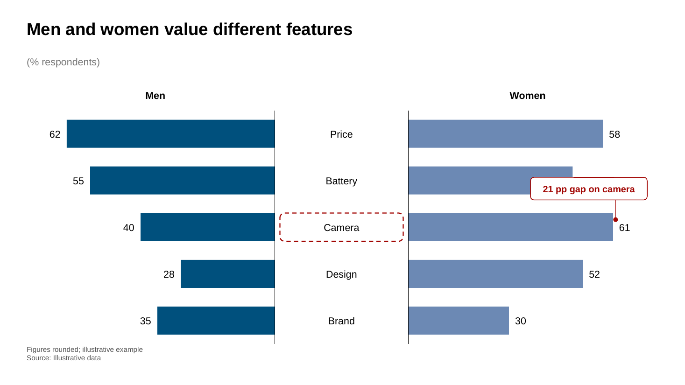

<details><summary>完整样例 JSON</summary>

```json
{
 "id": "butterfly",
 "type": "butterfly",
 "title": "Men and women value different features",
 "subtitle": "",
 "unit": "% respondents",
 "source": "Illustrative data",
 "data": {
  "categories": [
   "Price",
   "Battery",
   "Camera",
   "Design",
   "Brand"
  ],
  "series": [
   {
    "name": "Men",
    "values": [
     62,
     55,
     40,
     28,
     35
    ]
   },
   {
    "name": "Women",
    "values": [
     58,
     49,
     61,
     52,
     30
    ]
   }
  ]
 },
 "highlight": [
  {
   "anchor": "Camera",
   "shape": "box",
   "w": 2.4,
   "h": 0.55
  }
 ],
 "callouts": [
  {
   "text": "21 pp gap on camera",
   "anchor": "61",
   "dx": 0.6,
   "dy": -0.75
  }
 ],
 "footnote": "Figures rounded; illustrative example"
}
```
</details>

### `dumbbell`（type: `dumbbell`）

- **适合场景**：两个时点的前后对比（哑铃图）
- **data 格式**：`{"categories":[str], "series":[时点1, 时点2], "min"?:num}`
- **示例**：[examples/dumbbell.json](../examples/dumbbell.json)

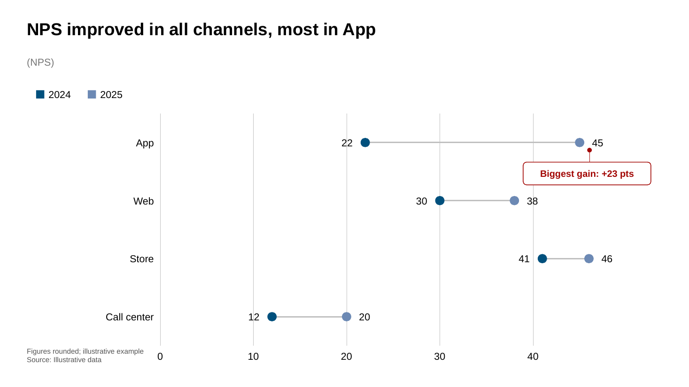

<details><summary>完整样例 JSON</summary>

```json
{
 "id": "dumbbell",
 "type": "dumbbell",
 "title": "NPS improved in all channels, most in App",
 "subtitle": "",
 "unit": "NPS",
 "source": "Illustrative data",
 "data": {
  "categories": [
   "App",
   "Web",
   "Store",
   "Call center"
  ],
  "series": [
   {
    "name": "2024",
    "values": [
     22,
     30,
     41,
     12
    ]
   },
   {
    "name": "2025",
    "values": [
     45,
     38,
     46,
     20
    ]
   }
  ],
  "min": 0
 },
 "callouts": [
  {
   "text": "Biggest gain: +23 pts",
   "anchor": "45",
   "dx": 1.4,
   "dy": 0.6
  }
 ],
 "footnote": "Figures rounded; illustrative example"
}
```
</details>

### `football`（type: `football`）

- **适合场景**：估值区间（足球场图）
- **data 格式**：`{"categories":[str], "series":[{"name":"Low",...},{"name":"High",...}], "min"?:num, "marker"?:{"value":num,"label":str}}`
- **示例**：[examples/football.json](../examples/football.json)

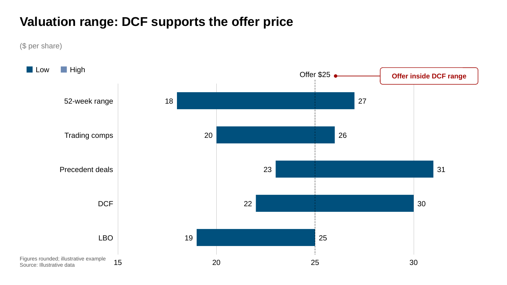

<details><summary>完整样例 JSON</summary>

```json
{
 "id": "football",
 "type": "football",
 "title": "Valuation range: DCF supports the offer price",
 "subtitle": "",
 "unit": "$ per share",
 "source": "Illustrative data",
 "data": {
  "categories": [
   "52-week range",
   "Trading comps",
   "Precedent deals",
   "DCF",
   "LBO"
  ],
  "series": [
   {
    "name": "Low",
    "values": [
     18,
     20,
     23,
     22,
     19
    ]
   },
   {
    "name": "High",
    "values": [
     27,
     26,
     31,
     30,
     25
    ]
   }
  ],
  "min": 15,
  "marker": {
   "value": 25,
   "label": "Offer $25"
  }
 },
 "callouts": [
  {
   "text": "Offer inside DCF range",
   "anchor": "Offer $25",
   "dx": 3.0,
   "dy": 0.05
  }
 ],
 "footnote": "Figures rounded; illustrative example"
}
```
</details>


## 折线/面积图

### `line`（type: `line`）

- **适合场景**：连续时间趋势
- **data 格式**：`{"categories":[str], "series":[{"name":str,"values":[num]}], "label_last"?:bool}`
- **示例**：[examples/line.json](../examples/line.json)

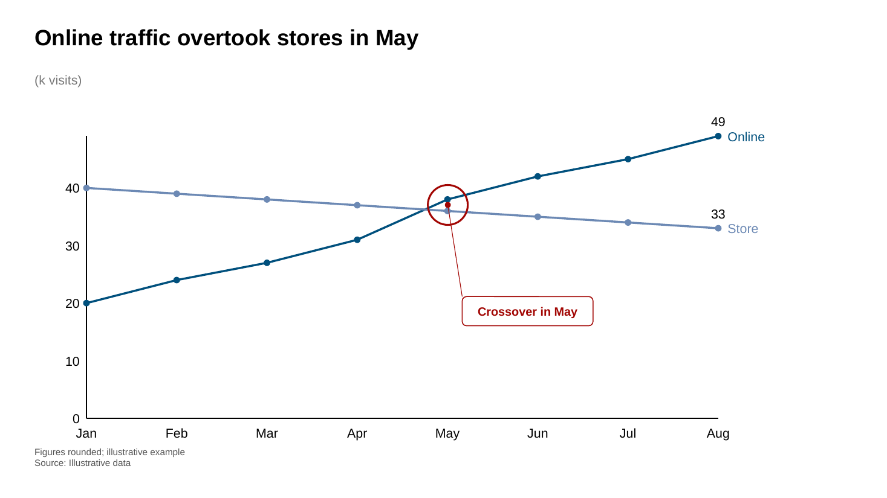

<details><summary>完整样例 JSON</summary>

```json
{
 "id": "line",
 "type": "line",
 "title": "Online traffic overtook stores in May",
 "subtitle": "",
 "unit": "k visits",
 "source": "Illustrative data",
 "data": {
  "categories": [
   "Jan",
   "Feb",
   "Mar",
   "Apr",
   "May",
   "Jun",
   "Jul",
   "Aug"
  ],
  "series": [
   {
    "name": "Online",
    "values": [
     20,
     24,
     27,
     31,
     38,
     42,
     45,
     49
    ]
   },
   {
    "name": "Store",
    "values": [
     40,
     39,
     38,
     37,
     36,
     35,
     34,
     33
    ]
   }
  ]
 },
 "highlight": [
  {
   "at": [
    0.507,
    0.27
   ],
   "shape": "circle",
   "w": 0.6,
   "h": 0.6
  }
 ],
 "callouts": [
  {
   "text": "Crossover in May",
   "at": [
    0.507,
    0.27
   ],
   "dx": 1.2,
   "dy": 1.6
  }
 ],
 "footnote": "Figures rounded; illustrative example"
}
```
</details>

### `area`（type: `area`）

- **适合场景**：总量趋势 + 构成
- **data 格式**：`{"categories":[str], "series":[{"name":str,"values":[num]}]}`
- **示例**：[examples/area.json](../examples/area.json)

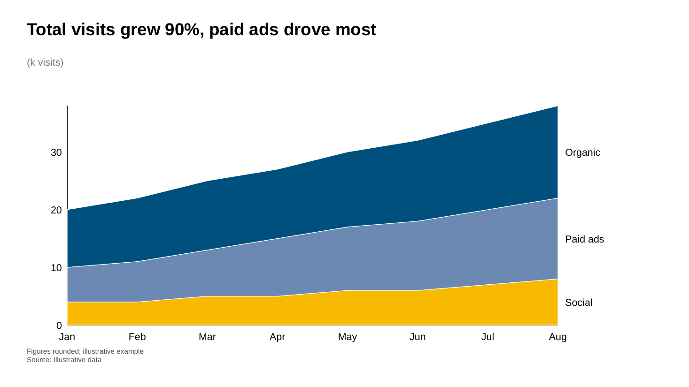

<details><summary>完整样例 JSON</summary>

```json
{
 "id": "area",
 "type": "area",
 "title": "Total visits grew 90%, paid ads drove most",
 "subtitle": "",
 "unit": "k visits",
 "source": "Illustrative data",
 "data": {
  "categories": [
   "Jan",
   "Feb",
   "Mar",
   "Apr",
   "May",
   "Jun",
   "Jul",
   "Aug"
  ],
  "series": [
   {
    "name": "Organic",
    "values": [
     10,
     11,
     12,
     12,
     13,
     14,
     15,
     16
    ]
   },
   {
    "name": "Paid ads",
    "values": [
     6,
     7,
     8,
     10,
     11,
     12,
     13,
     14
    ]
   },
   {
    "name": "Social",
    "values": [
     4,
     4,
     5,
     5,
     6,
     6,
     7,
     8
    ]
   }
  ]
 },
 "footnote": "Figures rounded; illustrative example"
}
```
</details>

### `area_percent`（type: `area_percent`）

- **适合场景**：构成占比的连续变化
- **data 格式**：`同 area，自动换算 100%`
- **示例**：[examples/area_percent.json](../examples/area_percent.json)

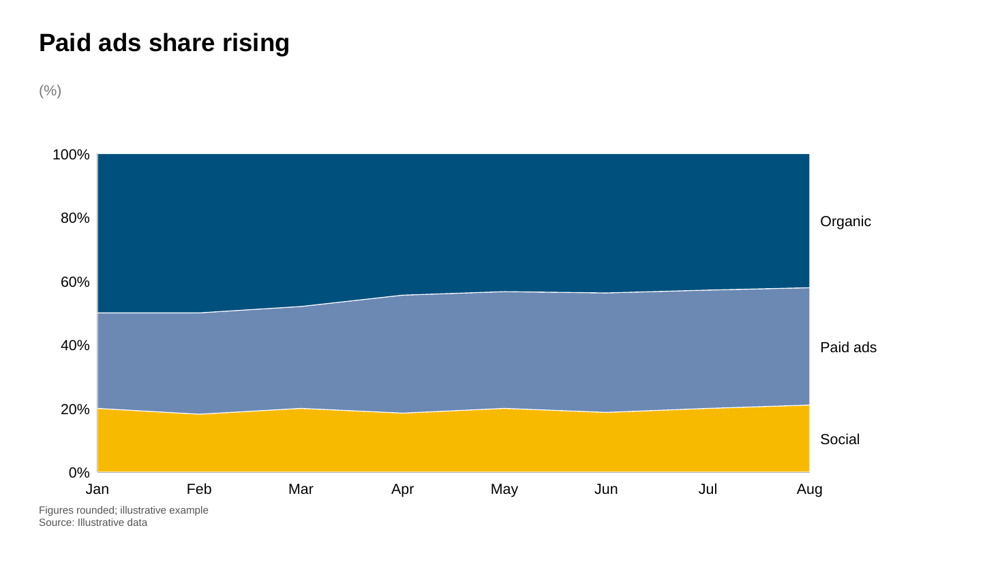

<details><summary>完整样例 JSON</summary>

```json
{
 "id": "area_percent",
 "type": "area_percent",
 "title": "Paid ads share rising",
 "subtitle": "",
 "unit": "%",
 "source": "Illustrative data",
 "data": {
  "categories": [
   "Jan",
   "Feb",
   "Mar",
   "Apr",
   "May",
   "Jun",
   "Jul",
   "Aug"
  ],
  "series": [
   {
    "name": "Organic",
    "values": [
     10,
     11,
     12,
     12,
     13,
     14,
     15,
     16
    ]
   },
   {
    "name": "Paid ads",
    "values": [
     6,
     7,
     8,
     10,
     11,
     12,
     13,
     14
    ]
   },
   {
    "name": "Social",
    "values": [
     4,
     4,
     5,
     5,
     6,
     6,
     7,
     8
    ]
   }
  ]
 },
 "footnote": "Figures rounded; illustrative example"
}
```
</details>

### `combo`（type: `combo`）

- **适合场景**：量 + 率（双轴组合）
- **data 格式**：`{"categories":[str], "columns":[{"name":str,"values":[num]}], "line":{"name":str,"values":[num],"suffix"?:"%"}}`
- **示例**：[examples/combo.json](../examples/combo.json)

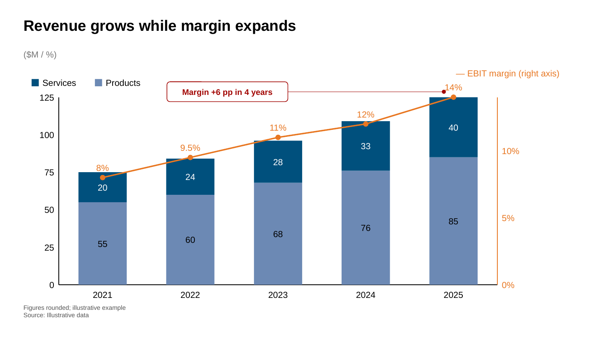

<details><summary>完整样例 JSON</summary>

```json
{
 "id": "combo",
 "type": "combo",
 "title": "Revenue grows while margin expands",
 "subtitle": "",
 "unit": "$M / %",
 "source": "Illustrative data",
 "data": {
  "categories": [
   "2021",
   "2022",
   "2023",
   "2024",
   "2025"
  ],
  "columns": [
   {
    "name": "Services",
    "values": [
     20,
     24,
     28,
     33,
     40
    ]
   },
   {
    "name": "Products",
    "values": [
     55,
     60,
     68,
     76,
     85
    ]
   }
  ],
  "line": {
   "name": "EBIT margin",
   "values": [
    8,
    9.5,
    11,
    12,
    14
   ],
   "suffix": "%"
  }
 },
 "callouts": [
  {
   "text": "Margin +6 pp in 4 years",
   "anchor": "14%",
   "dx": -5.0,
   "dy": 0.1
  }
 ],
 "footnote": "Figures rounded; illustrative example"
}
```
</details>

### `line_target`（type: `line_target`）

- **适合场景**：趋势 + 目标线 / 目标区间
- **data 格式**：`同 line，加 "target":num, "target_label"?:str, "band"?:[lo,hi], "band_label"?:str`
- **示例**：[examples/line_target.json](../examples/line_target.json)

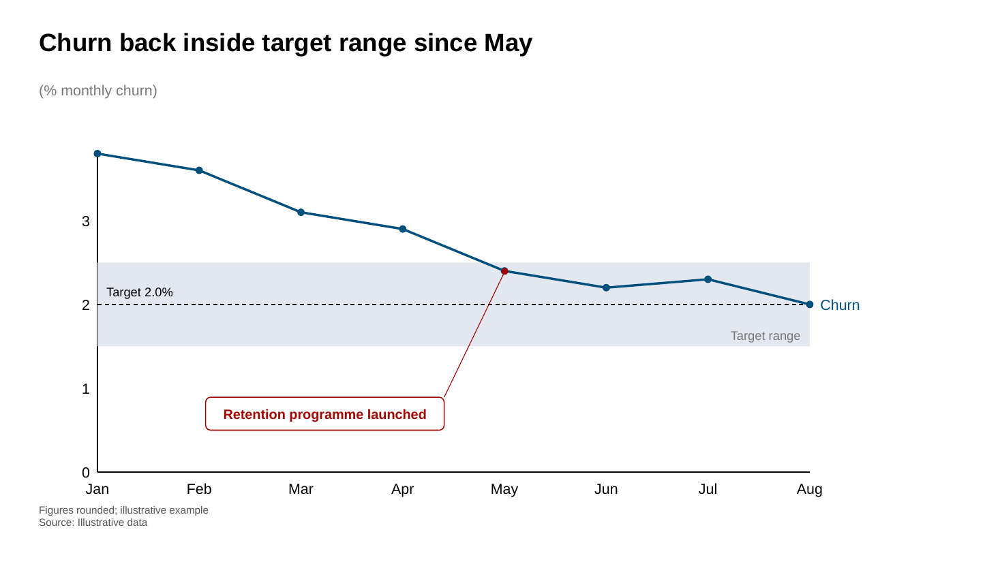

<details><summary>完整样例 JSON</summary>

```json
{
 "id": "line_target",
 "type": "line_target",
 "title": "Churn back inside target range since May",
 "subtitle": "",
 "unit": "% monthly churn",
 "source": "Illustrative data",
 "data": {
  "categories": [
   "Jan",
   "Feb",
   "Mar",
   "Apr",
   "May",
   "Jun",
   "Jul",
   "Aug"
  ],
  "series": [
   {
    "name": "Churn",
    "values": [
     3.8,
     3.6,
     3.1,
     2.9,
     2.4,
     2.2,
     2.3,
     2.0
    ]
   }
  ],
  "band": [
   1.5,
   2.5
  ],
  "label_last": false,
  "target": 2.0,
  "target_label": "Target 2.0%"
 },
 "callouts": [
  {
   "text": "Retention programme launched",
   "at": [
    0.507,
    0.378
   ],
   "dx": -2.4,
   "dy": 1.9
  }
 ],
 "footnote": "Figures rounded; illustrative example"
}
```
</details>

### `slope`（type: `slope`）

- **适合场景**：两个时点的排名/份额变化（斜率图）
- **data 格式**：`{"left_label":str,"right_label":str,"items":[{"label":str,"a":num,"b":num}],"highlight"?:[str],"red_down"?:bool}`
- **示例**：[examples/slope.json](../examples/slope.json)

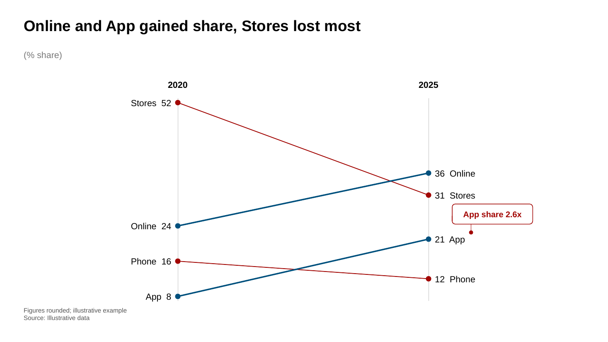

<details><summary>完整样例 JSON</summary>

```json
{
 "id": "slope",
 "type": "slope",
 "title": "Online and App gained share, Stores lost most",
 "subtitle": "",
 "unit": "% share",
 "source": "Illustrative data",
 "data": {
  "left_label": "2020",
  "right_label": "2025",
  "items": [
   {
    "label": "Stores",
    "a": 52,
    "b": 31
   },
   {
    "label": "Online",
    "a": 24,
    "b": 36
   },
   {
    "label": "App",
    "a": 8,
    "b": 21
   },
   {
    "label": "Phone",
    "a": 16,
    "b": 12
   }
  ],
  "highlight": [
   "Online",
   "App"
  ],
  "red_down": true
 },
 "callouts": [
  {
   "text": "App share 2.6x",
   "anchor": "21  App",
   "dx": 0.9,
   "dy": -0.55
  }
 ],
 "footnote": "Figures rounded; illustrative example"
}
```
</details>

### `small_multiples`（type: `small_multiples`）

- **适合场景**：多个对象同刻度并排比较（小倍数）
- **data 格式**：`{"categories":[str], "cols":int, "panels":[{"title":str,"values":[num]}]}`
- **示例**：[examples/small_multiples.json](../examples/small_multiples.json)

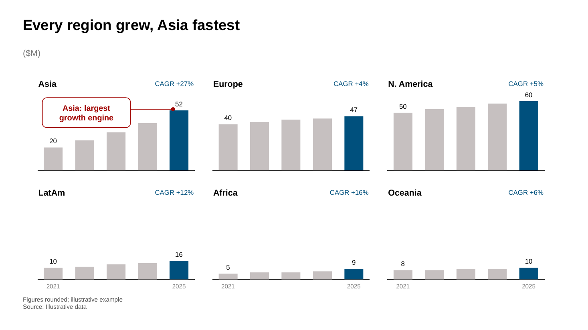

<details><summary>完整样例 JSON</summary>

```json
{
 "id": "small_multiples",
 "type": "small_multiples",
 "title": "Every region grew, Asia fastest",
 "subtitle": "",
 "unit": "$M",
 "source": "Illustrative data",
 "data": {
  "categories": [
   "2021",
   "2022",
   "2023",
   "2024",
   "2025"
  ],
  "cols": 3,
  "panels": [
   {
    "title": "Asia",
    "values": [
     20,
     26,
     33,
     41,
     52
    ]
   },
   {
    "title": "Europe",
    "values": [
     40,
     42,
     44,
     45,
     47
    ]
   },
   {
    "title": "N. America",
    "values": [
     50,
     53,
     55,
     58,
     60
    ]
   },
   {
    "title": "LatAm",
    "values": [
     10,
     11,
     13,
     14,
     16
    ]
   },
   {
    "title": "Africa",
    "values": [
     5,
     6,
     6,
     7,
     9
    ]
   },
   {
    "title": "Oceania",
    "values": [
     8,
     8,
     9,
     9,
     10
    ]
   }
  ]
 },
 "callouts": [
  {
   "text": "Asia: largest\ngrowth engine",
   "anchor": "52",
   "dx": -2.1,
   "dy": 0.2,
   "w": 2.0
  }
 ],
 "footnote": "Figures rounded; illustrative example"
}
```
</details>


## 散点/气泡图

### `scatter`（type: `scatter`）

- **适合场景**：两个指标的相关/四象限
- **data 格式**：`{"points":[{"x":num,"y":num,"label"?:str,"group"?:str}], "x_title":str, "y_title":str, "partition"?:{"x":num,"y":num}}`
- **示例**：[examples/scatter.json](../examples/scatter.json)

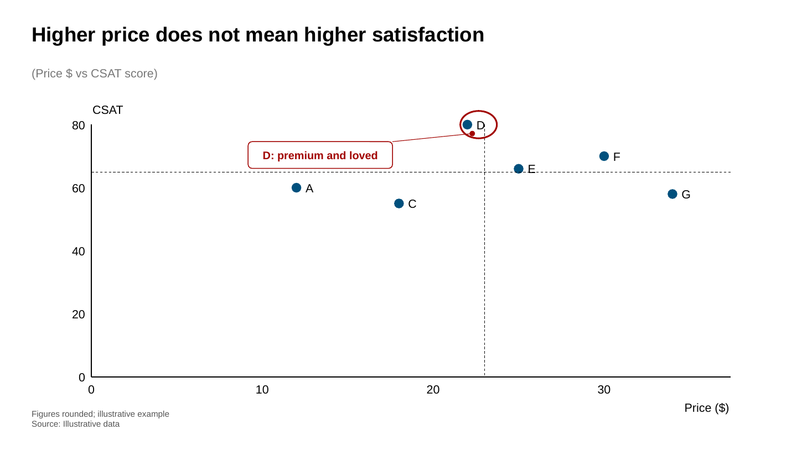

<details><summary>完整样例 JSON</summary>

```json
{
 "id": "scatter",
 "type": "scatter",
 "title": "Higher price does not mean higher satisfaction",
 "subtitle": "",
 "unit": "Price $ vs CSAT score",
 "source": "Illustrative data",
 "data": {
  "points": [
   {
    "x": 12,
    "y": 60,
    "label": "A"
   },
   {
    "x": 15,
    "y": 72,
    "label": "B"
   },
   {
    "x": 18,
    "y": 55,
    "label": "C"
   },
   {
    "x": 22,
    "y": 80,
    "label": "D"
   },
   {
    "x": 25,
    "y": 66,
    "label": "E"
   },
   {
    "x": 30,
    "y": 70,
    "label": "F"
   },
   {
    "x": 34,
    "y": 58,
    "label": "G"
   }
  ],
  "x_title": "Price ($)",
  "y_title": "CSAT",
  "partition": {
   "x": 23,
   "y": 65
  }
 },
 "highlight": [
  {
   "anchor": "D",
   "shape": "circle",
   "w": 0.6,
   "h": 0.45
  }
 ],
 "callouts": [
  {
   "text": "D: premium and loved",
   "anchor": "D",
   "dx": -2.6,
   "dy": 0.5
  }
 ],
 "footnote": "Figures rounded; illustrative example"
}
```
</details>

### `bubble`（type: `bubble`）

- **适合场景**：三个维度（x、y、规模）的组合定位
- **data 格式**：`{"points":[{"x":num,"y":num,"size":num,"label"?:str}], "x_title":str, "y_title":str}`
- **示例**：[examples/bubble.json](../examples/bubble.json)

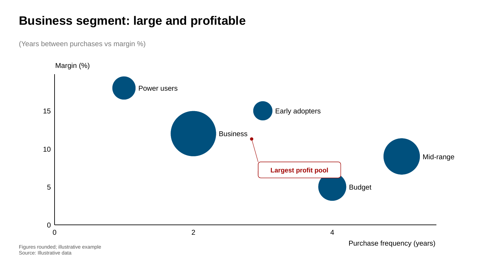

<details><summary>完整样例 JSON</summary>

```json
{
 "id": "bubble",
 "type": "bubble",
 "title": "Business segment: large and profitable",
 "subtitle": "",
 "unit": "Years between purchases vs margin %",
 "source": "Illustrative data",
 "data": {
  "points": [
   {
    "x": 2,
    "y": 12,
    "size": 25,
    "label": "Business"
   },
   {
    "x": 4,
    "y": 5,
    "size": 8,
    "label": "Budget"
   },
   {
    "x": 1,
    "y": 18,
    "size": 5,
    "label": "Power users"
   },
   {
    "x": 5,
    "y": 9,
    "size": 15,
    "label": "Mid-range"
   },
   {
    "x": 3,
    "y": 15,
    "size": 3,
    "label": "Early adopters"
   }
  ],
  "x_title": "Purchase frequency (years)",
  "y_title": "Margin (%)"
 },
 "callouts": [
  {
   "text": "Largest profit pool",
   "anchor": "Business",
   "dx": 1.8,
   "dy": 1.0
  }
 ],
 "footnote": "Figures rounded; illustrative example"
}
```
</details>


## 饼/环图

### `pie`（type: `pie`）

- **适合场景**：少数（≤5）部分占整体
- **data 格式**：`{"segments":[{"label":str,"value":num,"color"?:hex}]}`
- **示例**：[examples/pie.json](../examples/pie.json)

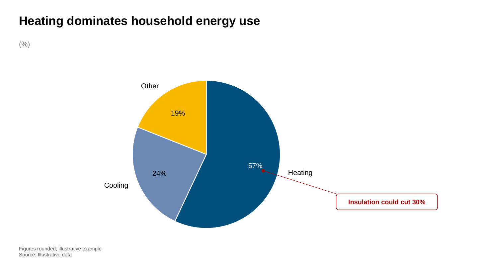

<details><summary>完整样例 JSON</summary>

```json
{
 "id": "pie",
 "type": "pie",
 "title": "Heating dominates household energy use",
 "subtitle": "",
 "unit": "%",
 "source": "Illustrative data",
 "data": {
  "segments": [
   {
    "label": "Heating",
    "value": 57
   },
   {
    "label": "Cooling",
    "value": 24
   },
   {
    "label": "Other",
    "value": 19
   }
  ]
 },
 "callouts": [
  {
   "text": "Insulation could cut 30%",
   "anchor": "57%",
   "dx": 3.6,
   "dy": 1.0
  }
 ],
 "footnote": "Figures rounded; illustrative example"
}
```
</details>

### `doughnut`（type: `doughnut`）

- **适合场景**：占比 + 中心放总量
- **data 格式**：`{"segments":[...同 pie], "center"?:str}`
- **示例**：[examples/doughnut.json](../examples/doughnut.json)

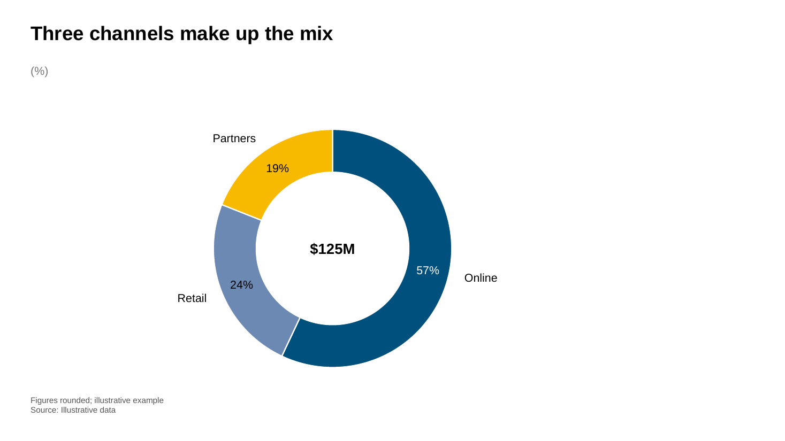

<details><summary>完整样例 JSON</summary>

```json
{
 "id": "doughnut",
 "type": "doughnut",
 "title": "Three channels make up the mix",
 "subtitle": "",
 "unit": "%",
 "source": "Illustrative data",
 "data": {
  "segments": [
   {
    "label": "Online",
    "value": 57
   },
   {
    "label": "Retail",
    "value": 24
   },
   {
    "label": "Partners",
    "value": 19
   }
  ],
  "center": "$125M"
 },
 "footnote": "Figures rounded; illustrative example"
}
```
</details>


## 甘特/时间线

### `gantt`（type: `gantt`）

- **适合场景**：项目计划、里程碑、负责人
- **data 格式**：`{"start":"YYYY-MM-DD","end":"YYYY-MM-DD","weeks"?:bool,"tasks":[{"name":str,"start"?:date,"end"?:date,"milestone"?:date,"milestone_label"?:str,"owner"?:str}],"shades"?:[{"start","end","label"}],"brackets"?:[{"start","end","label"}],"today"?:date}`
- **示例**：[examples/gantt.json](../examples/gantt.json)

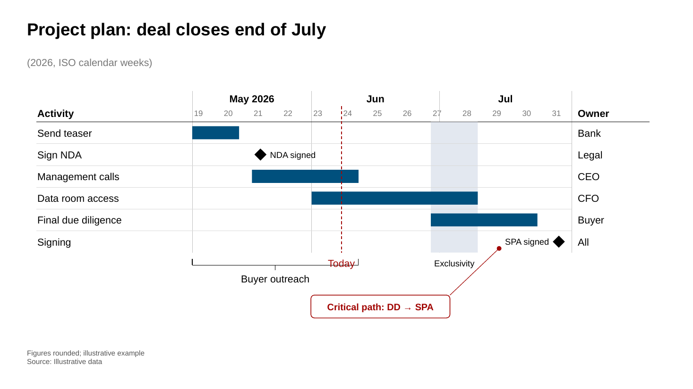

<details><summary>完整样例 JSON</summary>

```json
{
 "id": "gantt",
 "type": "gantt",
 "title": "Project plan: deal closes end of July",
 "subtitle": "",
 "unit": "2026, ISO calendar weeks",
 "source": "Illustrative data",
 "data": {
  "start": "2026-05-04",
  "end": "2026-08-01",
  "weeks": true,
  "tasks": [
   {
    "name": "Send teaser",
    "start": "2026-05-04",
    "end": "2026-05-15",
    "owner": "Bank"
   },
   {
    "name": "Sign NDA",
    "milestone": "2026-05-20",
    "milestone_label": "NDA signed",
    "owner": "Legal"
   },
   {
    "name": "Management calls",
    "start": "2026-05-18",
    "end": "2026-06-12",
    "owner": "CEO"
   },
   {
    "name": "Data room access",
    "start": "2026-06-01",
    "end": "2026-07-10",
    "owner": "CFO"
   },
   {
    "name": "Final due diligence",
    "start": "2026-06-29",
    "end": "2026-07-24",
    "owner": "Buyer"
   },
   {
    "name": "Signing",
    "milestone": "2026-07-29",
    "milestone_label": "SPA signed",
    "owner": "All"
   }
  ],
  "shades": [
   {
    "start": "2026-06-29",
    "end": "2026-07-10",
    "label": "Exclusivity"
   }
  ],
  "brackets": [
   {
    "start": "2026-05-04",
    "end": "2026-06-12",
    "label": "Buyer outreach"
   }
  ],
  "today": "2026-06-08"
 },
 "callouts": [
  {
   "text": "Critical path: DD → SPA",
   "anchor": "SPA signed",
   "dx": -2.8,
   "dy": 1.25
  }
 ],
 "footnote": "Figures rounded; illustrative example"
}
```
</details>

### `timeline`（type: `timeline`）

- **适合场景**：高层路线图/阶段 + 里程碑
- **data 格式**：`{"start":date,"end":date,"phases":[{"name","start","end","color"?:int}],"milestones":[{"date","label"}]}`
- **示例**：[examples/timeline.json](../examples/timeline.json)

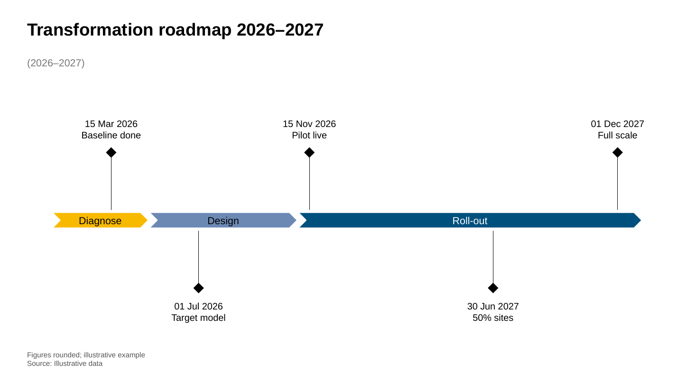

<details><summary>完整样例 JSON</summary>

```json
{
 "id": "timeline",
 "type": "timeline",
 "title": "Transformation roadmap 2026–2027",
 "subtitle": "",
 "unit": "2026–2027",
 "source": "Illustrative data",
 "data": {
  "start": "2026-01-01",
  "end": "2027-12-31",
  "phases": [
   {
    "name": "Diagnose",
    "start": "2026-01-01",
    "end": "2026-04-30",
    "color": 2
   },
   {
    "name": "Design",
    "start": "2026-05-01",
    "end": "2026-10-31",
    "color": 1
   },
   {
    "name": "Roll-out",
    "start": "2026-11-01",
    "end": "2027-12-31",
    "color": 0
   }
  ],
  "milestones": [
   {
    "date": "2026-03-15",
    "label": "Baseline done"
   },
   {
    "date": "2026-07-01",
    "label": "Target model"
   },
   {
    "date": "2026-11-15",
    "label": "Pilot live"
   },
   {
    "date": "2027-06-30",
    "label": "50% sites"
   },
   {
    "date": "2027-12-01",
    "label": "Full scale"
   }
  ]
 },
 "footnote": "Figures rounded; illustrative example"
}
```
</details>

### `gantt_progress`（type: `gantt_progress`）

- **适合场景**：甘特 + 完成百分比（项目状态汇报）
- **data 格式**：`同 gantt，task 加 "progress":0..1`
- **示例**：[examples/gantt_progress.json](../examples/gantt_progress.json)

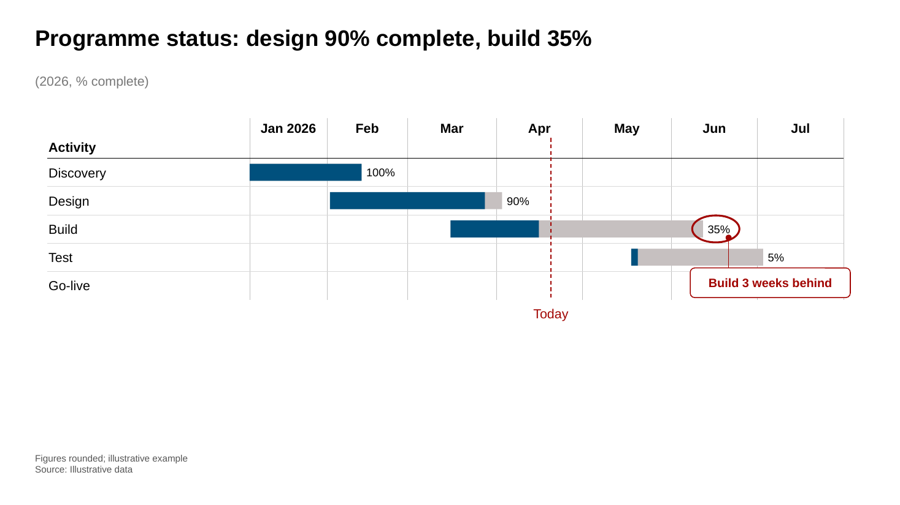

<details><summary>完整样例 JSON</summary>

```json
{
 "id": "gantt_progress",
 "type": "gantt_progress",
 "title": "Programme status: design 90% complete, build 35%",
 "subtitle": "",
 "unit": "2026, % complete",
 "source": "Illustrative data",
 "data": {
  "start": "2026-01-05",
  "end": "2026-07-31",
  "tasks": [
   {
    "name": "Discovery",
    "start": "2026-01-05",
    "end": "2026-02-13",
    "progress": 1.0
   },
   {
    "name": "Design",
    "start": "2026-02-02",
    "end": "2026-04-03",
    "progress": 0.9
   },
   {
    "name": "Build",
    "start": "2026-03-16",
    "end": "2026-06-12",
    "progress": 0.35
   },
   {
    "name": "Test",
    "start": "2026-05-18",
    "end": "2026-07-03",
    "progress": 0.05
   },
   {
    "name": "Go-live",
    "milestone": "2026-07-15",
    "milestone_label": "Go-live"
   }
  ],
  "today": "2026-04-20"
 },
 "highlight": [
  {
   "anchor": "35%",
   "shape": "circle",
   "w": 0.7,
   "h": 0.4
  }
 ],
 "callouts": [
  {
   "text": "Build 3 weeks behind",
   "anchor": "35%",
   "dx": 1.3,
   "dy": 0.8
  }
 ],
 "footnote": "Figures rounded; illustrative example"
}
```
</details>

### `gantt_swimlane`（type: `gantt_swimlane`）

- **适合场景**：按工作流分组（泳道）的甘特
- **data 格式**：`同 gantt，task 可为 {"name":str,"header":true} 分组行；"indent":true 缩进；"color":int`
- **示例**：[examples/gantt_swimlane.json](../examples/gantt_swimlane.json)

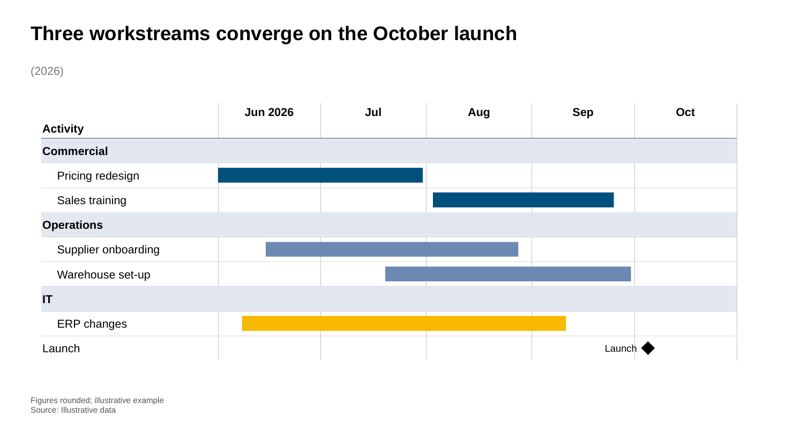

<details><summary>完整样例 JSON</summary>

```json
{
 "id": "gantt_swimlane",
 "type": "gantt_swimlane",
 "title": "Three workstreams converge on the October launch",
 "subtitle": "",
 "unit": "2026",
 "source": "Illustrative data",
 "data": {
  "start": "2026-06-01",
  "end": "2026-10-31",
  "tasks": [
   {
    "name": "Commercial",
    "header": true
   },
   {
    "name": "Pricing redesign",
    "start": "2026-06-01",
    "end": "2026-07-31",
    "indent": true
   },
   {
    "name": "Sales training",
    "start": "2026-08-03",
    "end": "2026-09-25",
    "indent": true
   },
   {
    "name": "Operations",
    "header": true
   },
   {
    "name": "Supplier onboarding",
    "start": "2026-06-15",
    "end": "2026-08-28",
    "indent": true,
    "color": 1
   },
   {
    "name": "Warehouse set-up",
    "start": "2026-07-20",
    "end": "2026-09-30",
    "indent": true,
    "color": 1
   },
   {
    "name": "IT",
    "header": true
   },
   {
    "name": "ERP changes",
    "start": "2026-06-08",
    "end": "2026-09-11",
    "indent": true,
    "color": 2
   },
   {
    "name": "Launch",
    "milestone": "2026-10-05",
    "milestone_label": "Launch"
   }
  ]
 },
 "footnote": "Figures rounded; illustrative example"
}
```
</details>


## 表格

### `table_harvey`（type: `table_harvey`）

- **适合场景**：多维度定性评估（Harvey ball / 勾叉）
- **data 格式**：`{"columns":[str], "rows":[{"name":str,"values":[str | {"harvey":0..4} | {"check":bool}]}], "harvey_legend"?:[5 个文字]}`
- **示例**：[examples/table_harvey.json](../examples/table_harvey.json)

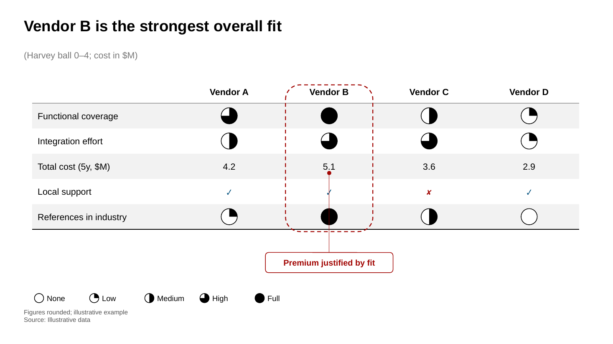

<details><summary>完整样例 JSON</summary>

```json
{
 "id": "table_harvey",
 "type": "table_harvey",
 "title": "Vendor B is the strongest overall fit",
 "subtitle": "",
 "unit": "Harvey ball 0–4; cost in $M",
 "source": "Illustrative data",
 "data": {
  "columns": [
   "Vendor A",
   "Vendor B",
   "Vendor C",
   "Vendor D"
  ],
  "rows": [
   {
    "name": "Functional coverage",
    "values": [
     {
      "harvey": 3
     },
     {
      "harvey": 4
     },
     {
      "harvey": 2
     },
     {
      "harvey": 1
     }
    ]
   },
   {
    "name": "Integration effort",
    "values": [
     {
      "harvey": 2
     },
     {
      "harvey": 3
     },
     {
      "harvey": 3
     },
     {
      "harvey": 1
     }
    ]
   },
   {
    "name": "Total cost (5y, $M)",
    "values": [
     "4.2",
     "5.1",
     "3.6",
     "2.9"
    ]
   },
   {
    "name": "Local support",
    "values": [
     {
      "check": true
     },
     {
      "check": true
     },
     {
      "check": false
     },
     {
      "check": true
     }
    ]
   },
   {
    "name": "References in industry",
    "values": [
     {
      "harvey": 1
     },
     {
      "harvey": 4
     },
     {
      "harvey": 2
     },
     {
      "harvey": 0
     }
    ]
   }
  ]
 },
 "highlight": [
  {
   "anchor": "Vendor B",
   "shape": "box",
   "w": 1.9,
   "h": 3.2,
   "oy": 1.45
  }
 ],
 "callouts": [
  {
   "text": "Premium justified by fit",
   "anchor": "5.1",
   "dx": 0.0,
   "dy": 2.1
  }
 ],
 "footnote": "Figures rounded; illustrative example"
}
```
</details>


## 咨询常用图

### `funnel`（type: `funnel`）

- **适合场景**：转化漏斗（逐级转化率）
- **data 格式**：`{"stages":[{"label":str,"value":num}]}`
- **示例**：[examples/funnel.json](../examples/funnel.json)

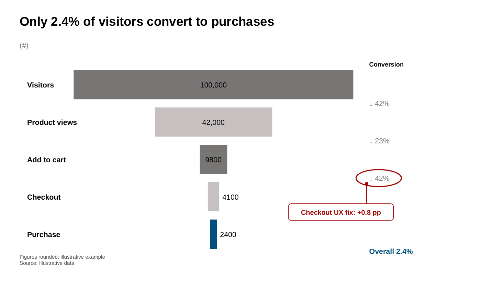

<details><summary>完整样例 JSON</summary>

```json
{
 "id": "funnel",
 "type": "funnel",
 "title": "Only 2.4% of visitors convert to purchases",
 "subtitle": "",
 "unit": "#",
 "source": "Illustrative data",
 "data": {
  "stages": [
   {
    "label": "Visitors",
    "value": 100000
   },
   {
    "label": "Product views",
    "value": 42000
   },
   {
    "label": "Add to cart",
    "value": 9800
   },
   {
    "label": "Checkout",
    "value": 4100
   },
   {
    "label": "Purchase",
    "value": 2400
   }
  ]
 },
 "highlight": [
  {
   "anchor": "↓ 42%",
   "nth": 1,
   "shape": "circle",
   "w": 1.2,
   "h": 0.45
  }
 ],
 "callouts": [
  {
   "text": "Checkout UX fix: +0.8 pp",
   "anchor": "↓ 42%",
   "nth": 1,
   "dx": -1.0,
   "dy": 0.9
  }
 ],
 "footnote": "Figures rounded; illustrative example"
}
```
</details>

### `heatmap`（type: `heatmap`）

- **适合场景**：两维交叉的强弱分布（热力矩阵）
- **data 格式**：`{"rows":[str], "cols":[str], "values":[[num]], "min"?,"max"?, "low_color"?, "high_color"?}`
- **示例**：[examples/heatmap.json](../examples/heatmap.json)

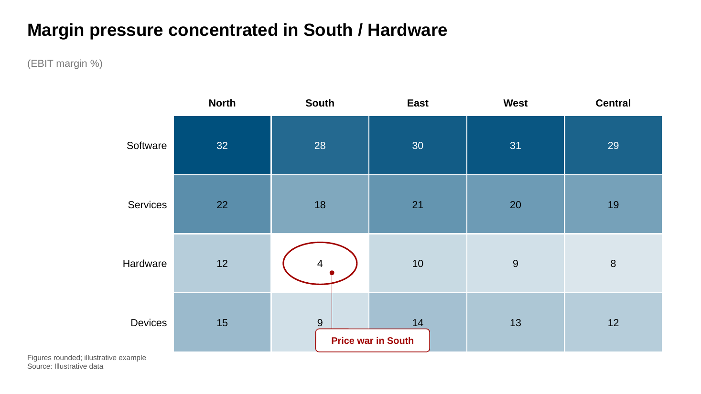

<details><summary>完整样例 JSON</summary>

```json
{
 "id": "heatmap",
 "type": "heatmap",
 "title": "Margin pressure concentrated in South / Hardware",
 "subtitle": "",
 "unit": "EBIT margin %",
 "source": "Illustrative data",
 "data": {
  "rows": [
   "Software",
   "Services",
   "Hardware",
   "Devices"
  ],
  "cols": [
   "North",
   "South",
   "East",
   "West",
   "Central"
  ],
  "values": [
   [
    32,
    28,
    30,
    31,
    29
   ],
   [
    22,
    18,
    21,
    20,
    19
   ],
   [
    12,
    4,
    10,
    9,
    8
   ],
   [
    15,
    9,
    14,
    13,
    12
   ]
  ]
 },
 "highlight": [
  {
   "anchor": "Hardware|South",
   "shape": "circle",
   "w": 1.4,
   "h": 0.8
  }
 ],
 "callouts": [
  {
   "text": "Price war in South",
   "anchor": "Hardware|South",
   "dx": 1.0,
   "dy": 1.5
  }
 ],
 "footnote": "Figures rounded; illustrative example"
}
```
</details>

### `matrix_2x2`（type: `matrix_2x2`）

- **适合场景**：战略矩阵 / 二乘二优先级
- **data 格式**：`{"x_title","y_title","quadrants":[左上,右上,左下,右下],"points":[{"x":0..1,"y":0..1,"size":num,"label":str,"focus"?:bool}],"x_range"?,"y_range"?}`
- **示例**：[examples/matrix_2x2.json](../examples/matrix_2x2.json)


<details><summary>完整样例 JSON</summary>

```json
{
 "id": "matrix_2x2",
 "type": "matrix_2x2",
 "title": "Prioritise Cloud and Analytics: attractive and winnable",
 "subtitle": "",
 "unit": "Bubble size = revenue",
 "source": "Illustrative data",
 "data": {
  "x_title": "Ability to win",
  "y_title": "Market attractiveness",
  "quadrants": [
   "Partner / build",
   "Invest to grow",
   "Deprioritise",
   "Harvest"
  ],
  "points": [
   {
    "x": 0.78,
    "y": 0.82,
    "size": 30,
    "label": "Cloud",
    "focus": true
   },
   {
    "x": 0.66,
    "y": 0.68,
    "size": 18,
    "label": "Analytics",
    "focus": true
   },
   {
    "x": 0.3,
    "y": 0.75,
    "size": 22,
    "label": "AI platforms"
   },
   {
    "x": 0.75,
    "y": 0.3,
    "size": 25,
    "label": "On-prem"
   },
   {
    "x": 0.22,
    "y": 0.22,
    "size": 8,
    "label": "Legacy HW"
   }
  ]
 },
 "callouts": [
  {
   "text": "Invest $40M over 3 years",
   "anchor": "Cloud",
   "dx": -2.6,
   "dy": -0.75
  }
 ],
 "footnote": "Figures rounded; illustrative example"
}
```
</details>

### `pareto`（type: `pareto`）

- **适合场景**：找出 80/20 主因（帕累托）
- **data 格式**：`{"categories":[str], "values":[num]}  // 自动降序 + 累计%`
- **示例**：[examples/pareto.json](../examples/pareto.json)


<details><summary>完整样例 JSON</summary>

```json
{
 "id": "pareto",
 "type": "pareto",
 "title": "Three causes explain 83% of defects",
 "subtitle": "",
 "unit": "# defects",
 "source": "Illustrative data",
 "data": {
  "categories": [
   "Solder",
   "Alignment",
   "Paint",
   "Packaging",
   "Label",
   "Screws",
   "Other"
  ],
  "values": [
   120,
   85,
   60,
   22,
   15,
   10,
   8
  ]
 },
 "highlight": [
  {
   "anchor": "83%",
   "shape": "circle",
   "w": 0.8,
   "h": 0.42
  }
 ],
 "callouts": [
  {
   "text": "Top 3 causes = 83% of defects",
   "anchor": "83%",
   "dx": 3.2,
   "dy": 0.8
  }
 ],
 "footnote": "Figures rounded; illustrative example"
}
```
</details>

### `tornado`（type: `tornado`）

- **适合场景**：敏感性分析（龙卷风图）
- **data 格式**：`{"base":num, "items":[{"label":str,"low":num,"high":num}]}`
- **示例**：[examples/tornado.json](../examples/tornado.json)


<details><summary>完整样例 JSON</summary>

```json
{
 "id": "tornado",
 "type": "tornado",
 "title": "NPV is most sensitive to price and volume",
 "subtitle": "",
 "unit": "NPV $M",
 "source": "Illustrative data",
 "data": {
  "base": 120,
  "items": [
   {
    "label": "Price ±10%",
    "low": 78,
    "high": 162
   },
   {
    "label": "Volume ±15%",
    "low": 92,
    "high": 150
   },
   {
    "label": "Input cost ±10%",
    "low": 135,
    "high": 104
   },
   {
    "label": "WACC ±1pp",
    "low": 138,
    "high": 105
   },
   {
    "label": "Capex ±20%",
    "low": 131,
    "high": 110
   }
  ]
 },
 "callouts": [
  {
   "text": "Pricing power is the key value lever",
   "anchor": "162",
   "dx": 1.2,
   "dy": 2.7
  }
 ],
 "footnote": "Figures rounded; illustrative example"
}
```
</details>

### `tree`（type: `tree`）

- **适合场景**：指标拆解树 / 驱动树
- **data 格式**：`{"root":{"label":str,"value":str,"highlight"?:bool,"op"?:"×|÷|+|−","children":[...递归]}}`
- **示例**：[examples/tree.json](../examples/tree.json)


<details><summary>完整样例 JSON</summary>

```json
{
 "id": "tree",
 "type": "tree",
 "title": "ROCE driver tree: asset turnover is the gap",
 "subtitle": "",
 "unit": "FY2025",
 "source": "Illustrative data",
 "data": {
  "root": {
   "label": "ROCE",
   "value": "14%",
   "children": [
    {
     "label": "EBIT margin",
     "value": "9%",
     "op": "×",
     "children": [
      {
       "label": "Gross margin",
       "value": "38%"
      },
      {
       "label": "Opex ratio",
       "value": "29%",
       "op": "−"
      }
     ]
    },
    {
     "label": "Asset turnover",
     "value": "1.6x",
     "op": "",
     "highlight": true,
     "children": [
      {
       "label": "Revenue",
       "value": "$125M"
      },
      {
       "label": "Capital employed",
       "value": "$78M",
       "op": "÷"
      }
     ]
    }
   ]
  }
 },
 "callouts": [
  {
   "text": "Peers at 2.1x",
   "anchor": "Asset turnover",
   "dx": 0.3,
   "dy": 1.1
  }
 ],
 "footnote": "Figures rounded; illustrative example"
}
```
</details>

### `kpi_cards`（type: `kpi_cards`）

- **适合场景**：KPI 仪表板卡片
- **data 格式**：`{"cols":int, "cards":[{"label":str,"value":str,"delta":str,"good"?:bool,"spark"?:[num]}]}`
- **示例**：[examples/kpi_cards.json](../examples/kpi_cards.json)


<details><summary>完整样例 JSON</summary>

```json
{
 "id": "kpi_cards",
 "type": "kpi_cards",
 "title": "Q3 at a glance",
 "subtitle": "",
 "unit": "Q3 2026 vs Q3 2025",
 "source": "Illustrative data",
 "data": {
  "cols": 4,
  "cards": [
   {
    "label": "Revenue",
    "value": "$125M",
    "delta": "+14.7% YoY",
    "spark": [
     75,
     84,
     96,
     109,
     125
    ]
   },
   {
    "label": "EBIT margin",
    "value": "21.0%",
    "delta": "+2.6 pp",
    "spark": [
     16,
     17,
     18.4,
     19,
     21
    ]
   },
   {
    "label": "NPS",
    "value": "45",
    "delta": "+23 pts",
    "spark": [
     10,
     15,
     22,
     30,
     45
    ]
   },
   {
    "label": "Churn",
    "value": "2.0%",
    "delta": "+0.3 pp",
    "good": false,
    "spark": [
     1.6,
     1.7,
     1.7,
     1.8,
     2.0
    ]
   }
  ]
 },
 "highlight": [
  {
   "anchor": "2.0%",
   "shape": "circle",
   "w": 1.6,
   "h": 0.75
  }
 ],
 "callouts": [
  {
   "text": "Above 1.8% ceiling",
   "anchor": "+0.3 pp",
   "dx": 0.4,
   "dy": 0.9
  }
 ],
 "footnote": "Figures rounded; illustrative example"
}
```
</details>

### `bullet`（type: `bullet`）

- **适合场景**：实际 vs 目标 vs 区间（子弹图）
- **data 格式**：`{"items":[{"label":str,"unit":str,"value":num,"target":num,"ranges":[num,num,num]}]}`
- **示例**：[examples/bullet.json](../examples/bullet.json)


<details><summary>完整样例 JSON</summary>

```json
{
 "id": "bullet",
 "type": "bullet",
 "title": "Revenue and NPS ahead of target, margin behind",
 "subtitle": "",
 "unit": "YTD actual vs target",
 "source": "Illustrative data",
 "data": {
  "items": [
   {
    "label": "Revenue",
    "unit": "$M",
    "value": 125,
    "target": 118,
    "ranges": [
     90,
     110,
     140
    ]
   },
   {
    "label": "EBIT margin",
    "unit": "%",
    "value": 19,
    "target": 21,
    "ranges": [
     15,
     20,
     25
    ]
   },
   {
    "label": "NPS",
    "unit": "pts",
    "value": 45,
    "target": 40,
    "ranges": [
     20,
     35,
     60
    ]
   },
   {
    "label": "New customers",
    "unit": "k",
    "value": 8.2,
    "target": 9,
    "ranges": [
     5,
     8,
     12
    ]
   }
  ]
 },
 "callouts": [
  {
   "text": "Mix headwind in Q3",
   "anchor": "19 / 21",
   "dx": -1.6,
   "dy": 0.62
  }
 ],
 "footnote": "Figures rounded; illustrative example"
}
```
</details>

### `progress_bars`（type: `progress_bars`）

- **适合场景**：举措/目标完成进度（对照时间进度）
- **data 格式**：`{"expected"?:0..1, "items":[{"label":str,"value":num,"target":num}]}`
- **示例**：[examples/progress_bars.json](../examples/progress_bars.json)


<details><summary>完整样例 JSON</summary>

```json
{
 "id": "progress_bars",
 "type": "progress_bars",
 "title": "Initiatives behind plan: procurement and pricing",
 "subtitle": "",
 "unit": "$M",
 "source": "Illustrative data",
 "data": {
  "expected": 0.6,
  "items": [
   {
    "label": "Procurement savings",
    "value": 4.1,
    "target": 12
   },
   {
    "label": "Pricing uplift",
    "value": 3.2,
    "target": 8
   },
   {
    "label": "SG&A reduction",
    "value": 6.5,
    "target": 10
   },
   {
    "label": "Footprint",
    "value": 2.8,
    "target": 4
   },
   {
    "label": "Working capital",
    "value": 15,
    "target": 20
   }
  ]
 },
 "callouts": [
  {
   "text": "Supplier renegotiation delayed",
   "anchor": "34%",
   "dx": -2.6,
   "dy": 0.55
  }
 ],
 "footnote": "Figures rounded; illustrative example"
}
```
</details>

### `radar`（type: `radar`）

- **适合场景**：多维能力画像对比（雷达）
- **data 格式**：`{"axes":[str], "max":num, "series":[{"name":str,"values":[num]}]}`
- **示例**：[examples/radar.json](../examples/radar.json)


<details><summary>完整样例 JSON</summary>

```json
{
 "id": "radar",
 "type": "radar",
 "title": "We lead on product, lag on service",
 "subtitle": "",
 "unit": "Score 1–5",
 "source": "Illustrative data",
 "data": {
  "axes": [
   "Product",
   "Price",
   "Service",
   "Brand",
   "Distribution",
   "Innovation"
  ],
  "max": 5,
  "series": [
   {
    "name": "Us",
    "values": [
     4.6,
     3.2,
     2.5,
     3.8,
     3.5,
     4.2
    ]
   },
   {
    "name": "Competitor",
    "values": [
     3.8,
     3.9,
     4.1,
     4.0,
     3.0,
     3.1
    ]
   }
  ]
 },
 "callouts": [
  {
   "text": "Service gap = top priority",
   "anchor": "Service",
   "dx": 1.3,
   "dy": 0.8
  }
 ],
 "footnote": "Figures rounded; illustrative example"
}
```
</details>

### `tam_sam_som`（type: `tam_sam_som`）

- **适合场景**：潜在市场规模分层（TAM/SAM/SOM）
- **data 格式**：`{"levels":[{"label":str,"value":num,"display"?:str,"desc"?:str}]}`
- **示例**：[examples/tam_sam_som.json](../examples/tam_sam_som.json)


<details><summary>完整样例 JSON</summary>

```json
{
 "id": "tam_sam_som",
 "type": "tam_sam_som",
 "title": "A $1.2B obtainable market within a $40B TAM",
 "subtitle": "",
 "unit": "$B, 2026",
 "source": "Illustrative data",
 "data": {
  "levels": [
   {
    "label": "TAM",
    "value": 40,
    "display": "$40B",
    "desc": "Global B2B payments software"
   },
   {
    "label": "SAM",
    "value": 9,
    "display": "$9B",
    "desc": "Mid-market, Europe + NA"
   },
   {
    "label": "SOM",
    "value": 1.2,
    "display": "$1.2B",
    "desc": "5-year obtainable at 13% share"
   }
  ]
 },
 "footnote": "Figures rounded; illustrative example"
}
```
</details>

### `waffle`（type: `waffle`）

- **适合场景**：直观的百分比（华夫图）
- **data 格式**：`{"items":[{"label":str,"value":num,"color"?:hex}]}`
- **示例**：[examples/waffle.json](../examples/waffle.json)


<details><summary>完整样例 JSON</summary>

```json
{
 "id": "waffle",
 "type": "waffle",
 "title": "Almost two-thirds of spend is addressable",
 "subtitle": "",
 "unit": "% of spend",
 "source": "Illustrative data",
 "data": {
  "items": [
   {
    "label": "Addressable",
    "value": 64
   },
   {
    "label": "Partly addressable",
    "value": 21
   },
   {
    "label": "Locked-in contracts",
    "value": 15
   }
  ]
 },
 "footnote": "Figures rounded; illustrative example"
}
```
</details>


## 多图拼版（dashboard / facet）

一页多图：自由区域或网格拼版（`dashboard`）、行×列分面（`facet`）；支持分段虚线、多层共享横轴、条件着色、时间进度线、圈注/箭头/批注。完整字段见 [DASHBOARD.md](DASHBOARD.md)。

### `dash_shared_axis_layers`（type: `dashboard`）

- **示例**：[examples/dashboards/dash_shared_axis_layers.json](../examples/dashboards/dash_shared_axis_layers.json)


### `dash_three_column`（type: `dashboard`）

- **示例**：[examples/dashboards/dash_three_column.json](../examples/dashboards/dash_three_column.json)


### `dash_three_column_circle`（type: `dashboard`）

- **示例**：[examples/dashboards/dash_three_column_circle.json](../examples/dashboards/dash_three_column_circle.json)


### `facet_country_metric`（type: `facet`）

- **示例**：[examples/dashboards/facet_country_metric.json](../examples/dashboards/facet_country_metric.json)


### `facet_target_bars`（type: `facet`）

- **示例**：[examples/dashboards/facet_target_bars.json](../examples/dashboards/facet_target_bars.json)


