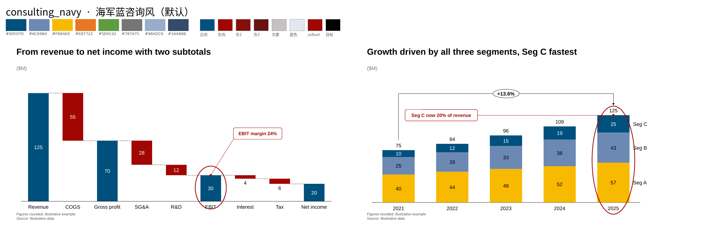
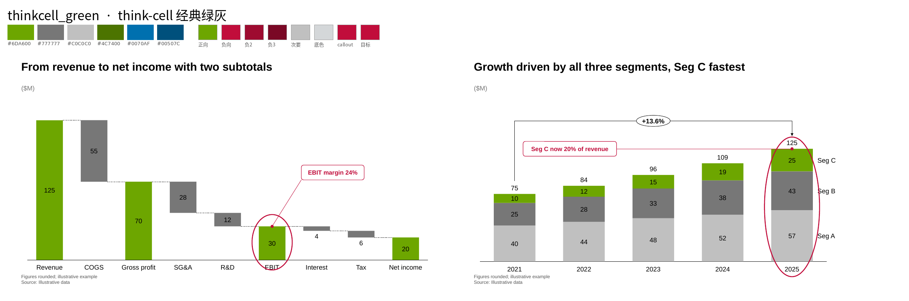
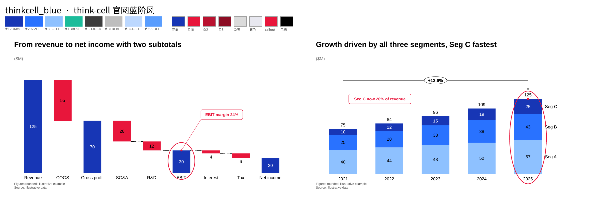
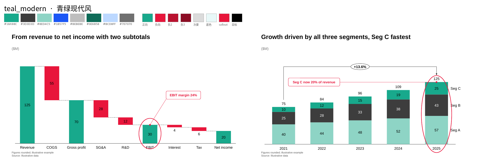
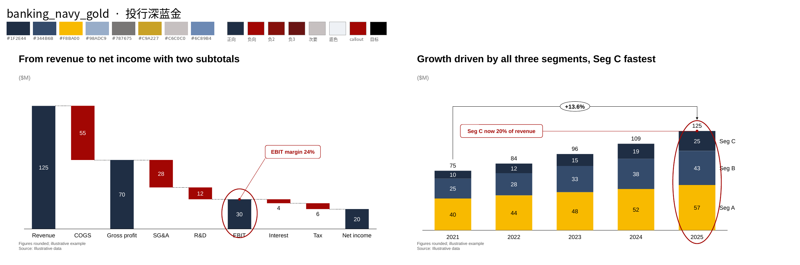
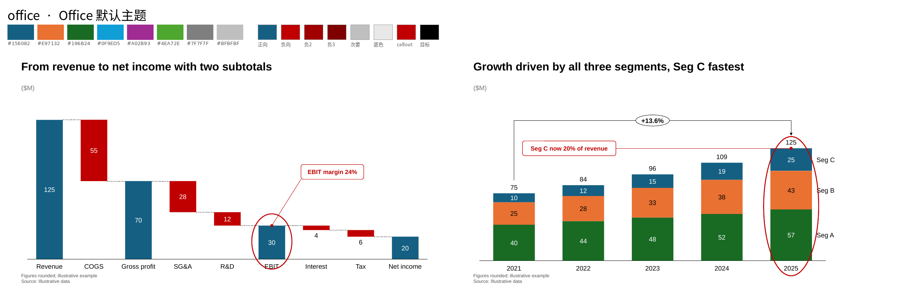
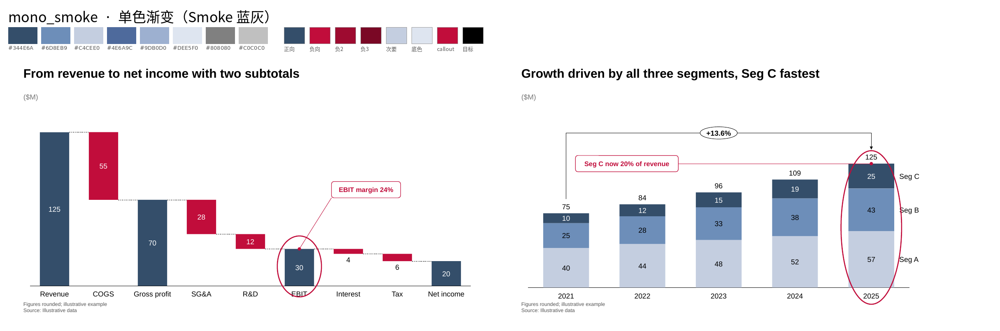
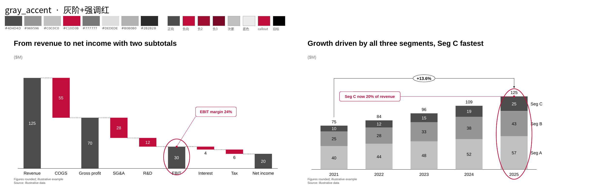

# 预设配色方案（PALETTES）

本 skill 提供 9 套主题，每套都有同一组语义角色，新默认 restrained_navy 同时采用克制的拼版标题与注释；其余主题保留原有风格。

- 用法：spec 顶层写 `"theme": "<名称>"`，或命令行 `tc_render.py ... --theme <名称>`（会覆盖 spec）；`tc_render.py --list-themes` 列出全部主题。
- 预览：每套一张 `gallery/palettes/<名称>.png`（同一张瀑布图 + 堆叠柱），总对比 `gallery/palettes/all-palettes.png`。
- 取色原图与 URL：`references/palettes/` 和 `references/palettes/SOURCES.csv`。取色方法：对大面积色块按 8 级量化找众数，再取该簇像素中位数（JPEG 误差约 ±3）。
- **命名说明**：名称描述的是视觉风格，不代表任何公司的官方品牌色。用户要求里提到的“McKinsey 海军蓝系 / BCG 绿系 / Bain 红系”等，本 skill 没有取到这些公司可直接下载的公开图表图片（官网图表是脚本渲染，命令行抓不到），所以没有按公司取色；对应的视觉方向分别由 consulting_navy / teal_modern / gray_accent 覆盖，来源如实写在下表。

## 总览

| 主题 | 中文名 | 一句话特征 | 适用场景 | 来源 |
|---|---|---|---|---|
| `restrained_navy`（默认） | 克制蓝灰 | 白底、深蓝与灰阶，酒红只标负差；注释与标题减少装饰 | 经营分析、专业咨询图表 | 本地用户审美偏好，色值为设计约定 |
| `consulting_navy` | 海军蓝咨询风 | 海军蓝主色，酒红表示负向，金、橙、绿做辅色 | 战略/咨询汇报、董事会材料（历史主题） | 用户参考图 A、B 取色（user-ref--A/B.png）；橙 #E87722、绿 #5E9C42 为约定；酒红 2 为插值 |
| `thinkcell_green` | think-cell 经典绿灰 | think-cell 手册经典绿 + 深灰/浅灰，瀑布增量用灰 | 想要 think-cell 原厂手册观感 | 手册 introductioncharting--applying_color.jpg 菜单色块取色（见 COLORS.md） |
| `thinkcell_blue` | think-cell 官网蓝阶风 | think-cell 官网现在用的饱和蓝阶，配青绿和亮红 | 科技/产品/财务分析，偏现代、鲜明 | think-cell 官网产品页截图取色：cluster、ebitda、pie、stacked、density 等（tc-site--*.jpg）；负向 2/3 为推导 |
| `teal_modern` | 青绿现代风 | 青绿为主，深炭灰次之，亮红表示负向 | 可持续、医疗、消费等希望“清新”的主题 | think-cell 官网瀑布/马利美科图截图中的青绿 #18A98C、炭灰 #3D3D3D；浅青 #8ED4C5、深青 #0E6B58 为推导 |
| `banking_navy_gold` | 投行深蓝金 | 更深的海军蓝配金色，庄重 | 投行/并购/融资材料、估值页 | #344B6B、#F8BA00、#98ADC9 取自用户参考图 B；#1F2E44（加深）和 #C9A227（暗金）为约定 |
| `office` | Office 默认主题 | PowerPoint 新版默认主题色 | 需要跟客户 Office 默认模板一致时 | Office 2023+ 默认主题 Accent1-6；前三色用 think-cell 产品图 difference-arrow-100-v2.jpg 核对；负向 #C00000 为 Office 标准深红 |
| `mono_smoke` | 单色渐变（Smoke 蓝灰） | 同一蓝灰色系的深浅渐变，克制 | 系列多但不想花哨、或需要打印/黑白友好 | think-cell 手册填充菜单 Smoke 10–90% 色块取色（applying_color.jpg）；负向用 tc Red |
| `gray_accent` | 灰阶+强调红 | 全部灰阶，只用红色点出重点和负向 | “只讲一件事”的页面、强调单一结论 | think-cell 手册灰阶（Light/Med/Dark Gray、Accent 6）+ tc Red 取色；#4D4D4D、#2B2B2B、#DEDEDE 为推导 |

## 语义角色

| 角色 | 键 | 用在哪里 |
|---|---|---|
| 系列 1–8 | palette | 堆叠/簇状/饼图等多系列，按数据顺序取色 |
| 正向 / 重点 | pos (=accent1, good) | 正向增量、高亮柱、达标、KPI 强调 |
| 负向 1/2/3 | neg / neg2 / neg3 | 负向增量与费用；更深两级用于分层费用、负值总计柱 |
| 次要灰 | accent5 / accent6 | 非重点柱、比较期、背景系列 |
| 目标线 | target | 目标/计划/today 线 |
| 区间底色 | tc_gray | 甘特阴影期、目标区间带、泳道分组 |
| callout | callout | 强调圈、callout 边框与文字 |
| 瀑布增量 | wf_pos / wf_neg | 瀑布图正负增量（thinkcell_green 沿用手册灰色） |
| 其他 | muted / bullet / tam / likert | 矩阵非重点气泡、子弹图实际值、TAM 三层、李克特四档 |

## `restrained_navy` · 克制蓝灰（本地默认）

本地设计约定，不是从参考 PDF 取色。配方见 [professional-patterns.md](../references/professional-patterns.md)。默认直接使用，不再弹出选色询问。旧画廊的八套主题预览保留为历史示例；新增预览见 `../gallery/restrained-preview.png`。

| 角色 | 色值 |
|---|---|
| 系列可用池 | `#24465C` `#7391A4` `#B7C6D0` `#DCE3E8` `#536773` `#94A3AE` `#C9D0D5` `#3C5666` |
| 当期 / 重点 / 正增量 | `#24465C` |
| 对照 / 深灰 | `#C9D0D5` / `#687782` |
| 负差 / 深负差 | `#A0525A` / `#85434B` / `#69363D` |
| 目标 / 区间底色 | `#414D57` / `#EEF2F5` |
| 普通注释 | `#24465C` |

通常只用前 2–4 色，不能为凑满色板制造新类别。超过可辨认范围优先分面或直接标签。显式 `palette`、`series_colors`、`point_colors`、`rule.ge/lt`、文字颜色仍然优先，不会被换主题自动抹掉。普通注释与数据负差分开；数值下降是否有利需要结合业务解释。

## `consulting_navy` · 海军蓝咨询风

来源：用户参考图 A、B 取色（user-ref--A/B.png）；橙 #E87722、绿 #5E9C42 为约定；酒红 2 为插值

| 角色 | 色值 |
|---|---|
| 系列 1–8 | `#00507D` `#6C89B4` `#F8BA00` `#E87722` `#5E9C42` `#787675` `#98ADC9` `#344B6B` |
| 正向 | `#00507D` |
| 负向 1/2/3 | `#A20603` `#85100B` `#691413` |
| 次要灰 | `#C6C0C0` |
| 深灰 | `#787675` |
| 目标线 | `#000000` |
| 区间底色 | `#E3E8F0` |
| callout | `#A20603` |
| 瀑布正/负 | `#00507D` / `#A20603` |

## `thinkcell_green` · think-cell 经典绿灰

来源：手册 introductioncharting--applying_color.jpg 菜单色块取色（见 COLORS.md）

| 角色 | 色值 |
|---|---|
| 系列 1–8 | `#6DA600` `#777777` `#C0C0C0` `#4C7400` `#0070AF` `#00507C` |
| 正向 | `#6DA600` |
| 负向 1/2/3 | `#C10D3B` `#9E0B30` `#7A0825` |
| 次要灰 | `#C0C0C0` |
| 深灰 | `#777777` |
| 目标线 | `#C10D3B` |
| 区间底色 | `#D4D7D9` |
| callout | `#C10D3B` |
| 瀑布正/负 | `#C0C0C0` / `#777777` |

## `thinkcell_blue` · think-cell 官网蓝阶风

来源：think-cell 官网产品页截图取色：cluster、ebitda、pie、stacked、density 等（tc-site--*.jpg）；负向 2/3 为推导

| 角色 | 色值 |
|---|---|
| 系列 1–8 | `#1736B5` `#2972FF` `#8EC1FF` `#1BBC9B` `#3D3D3D` `#BEBEBE` `#BCD8FF` `#599DFE` |
| 正向 | `#1736B5` |
| 负向 1/2/3 | `#E8163B` `#BA1230` `#8C0D24` |
| 次要灰 | `#DBDBDB` |
| 深灰 | `#707070` |
| 目标线 | `#000000` |
| 区间底色 | `#E8E8F0` |
| callout | `#E8163B` |
| 瀑布正/负 | `#1736B5` / `#E8163B` |

## `teal_modern` · 青绿现代风

来源：think-cell 官网瀑布/马利美科图截图中的青绿 #18A98C、炭灰 #3D3D3D；浅青 #8ED4C5、深青 #0E6B58 为推导

| 角色 | 色值 |
|---|---|
| 系列 1–8 | `#18A98C` `#3D3D3D` `#8ED4C5` `#1B57F5` `#BEBEBE` `#0E6B58` `#BCD8FF` `#707070` |
| 正向 | `#18A98C` |
| 负向 1/2/3 | `#E8163B` `#BA1230` `#8C0D24` |
| 次要灰 | `#DBDBDB` |
| 深灰 | `#707070` |
| 目标线 | `#000000` |
| 区间底色 | `#E8F8F8` |
| callout | `#E8163B` |
| 瀑布正/负 | `#18A98C` / `#E8163B` |

## `banking_navy_gold` · 投行深蓝金

来源：#344B6B、#F8BA00、#98ADC9 取自用户参考图 B；#1F2E44（加深）和 #C9A227（暗金）为约定

| 角色 | 色值 |
|---|---|
| 系列 1–8 | `#1F2E44` `#344B6B` `#F8BA00` `#98ADC9` `#787675` `#C9A227` `#C6C0C0` `#6C89B4` |
| 正向 | `#1F2E44` |
| 负向 1/2/3 | `#A20603` `#85100B` `#691413` |
| 次要灰 | `#C6C0C0` |
| 深灰 | `#787675` |
| 目标线 | `#000000` |
| 区间底色 | `#EEF1F5` |
| callout | `#A20603` |
| 瀑布正/负 | `#1F2E44` / `#A20603` |

## `office` · Office 默认主题

来源：Office 2023+ 默认主题 Accent1-6；前三色用 think-cell 产品图 difference-arrow-100-v2.jpg 核对；负向 #C00000 为 Office 标准深红

| 角色 | 色值 |
|---|---|
| 系列 1–8 | `#156082` `#E97132` `#196B24` `#0F9ED5` `#A02B93` `#4EA72E` `#7F7F7F` `#BFBFBF` |
| 正向 | `#156082` |
| 负向 1/2/3 | `#C00000` `#A00000` `#7F0000` |
| 次要灰 | `#BFBFBF` |
| 深灰 | `#7F7F7F` |
| 目标线 | `#000000` |
| 区间底色 | `#E8E8E8` |
| callout | `#C00000` |
| 瀑布正/负 | `#156082` / `#C00000` |

## `mono_smoke` · 单色渐变（Smoke 蓝灰）

来源：think-cell 手册填充菜单 Smoke 10–90% 色块取色（applying_color.jpg）；负向用 tc Red

| 角色 | 色值 |
|---|---|
| 系列 1–8 | `#344E6A` `#6D8EB9` `#C4CEE0` `#4E6A9C` `#9DB0D0` `#DEE5F0` `#808080` `#C0C0C0` |
| 正向 | `#344E6A` |
| 负向 1/2/3 | `#C10D3B` `#9E0B30` `#7A0825` |
| 次要灰 | `#C4CEE0` |
| 深灰 | `#808080` |
| 目标线 | `#000000` |
| 区间底色 | `#DEE5F0` |
| callout | `#C10D3B` |
| 瀑布正/负 | `#344E6A` / `#C10D3B` |

## `gray_accent` · 灰阶+强调红

来源：think-cell 手册灰阶（Light/Med/Dark Gray、Accent 6）+ tc Red 取色；#4D4D4D、#2B2B2B、#DEDEDE 为推导

| 角色 | 色值 |
|---|---|
| 系列 1–8 | `#4D4D4D` `#969596` `#C0C0C0` `#C10D3B` `#777777` `#DEDEDE` `#B0B0B0` `#2B2B2B` |
| 正向 | `#4D4D4D` |
| 负向 1/2/3 | `#C10D3B` `#9E0B30` `#7A0825` |
| 次要灰 | `#C0C0C0` |
| 深灰 | `#777777` |
| 目标线 | `#000000` |
| 区间底色 | `#EDEDED` |
| callout | `#C10D3B` |
| 瀑布正/负 | `#969596` / `#C10D3B` |

## think-cell 的用色逻辑（引用手册原文）

1. **颜色来自 PowerPoint 主题，系列用 Accent 1–6，文字和装饰用 Dark 1 / Light 1。**
   > "The colors thinkcell uses in charts are Accent 1 - Accent 6. The colors thinkcell uses for text and chart decorations … are Text/Background Dark 1 or Text/Background Light 1." —— KB0105 https://www.think-cell.com/en/resources/kb/0105
2. **换主题，图表跟着换。** 这正是本 skill 主题机制的原型。
   > "If the defaults are designed correctly, thinkcell will follow seamlessly when you switch the color scheme." —— KB0105
3. **可以换颜色或换顺序、按图表类型设默认色板（style file）。**
   > "… use different colors than those defined in the PowerPoint template, or use the same colors but in a different order. … have specific, different color defaults per chart type." —— KB0021 https://www.think-cell.com/en/resources/kb/0021
4. **同色系深浅：** style file 示例直接用 Accent 1 调亮/调暗 20%。
   > `<solidFill name="Accent 1, Lighter 20%"> … <solidFill name="Accent 1, Darker 20%">` —— 手册 Style files https://www.think-cell.com/en/resources/manual/style-files
5. **文字自动黑白：** 标签颜色自动跟着底色走，保证对比度。本 skill 的 ink() 用 WCAG 对比度实现同一规则。
   > "Note that the labels automatically turn white to make them easier to read on the dark background." —— 手册 Introduction to charting https://www.think-cell.com/en/resources/manual/introductioncharting
   > "thinkcell usually automatically selects a font color to maximize contrast with the label's background." —— 手册 Text labels https://www.think-cell.com/en/resources/manual/textlabels
6. **强调用法：** 手册示例只改一个系列的填充（“we choose Accent 6 shading”）来区分系列，其余保持主题色；think-cell 填充菜单里另有 tc Red 等独立强调色（applying_color.jpg）。本 skill 约定：强调圈和 callout 用 callout 色，每页 ≤ 2 处。
7. **正负色：** 手册瀑布图只说明“正值向上、负值向下”（"Positive values result in segments going upwards, negative values create segments going downwards." —— 手册 Waterfall），没有规定颜色。手册示例图里增量用灰色，咨询和官网示例常用“正=主色、负=红色”。本 skill 两种都支持：thinkcell_green 沿用灰色增量，其他主题用正向色/负向色。**[约定]**
8. **灰度做背景：** 手册示例与官网图大量用浅灰表示对照期、非重点系列（sample_100perc.jpg、官网 density 图）。本 skill 用 accent5/accent6 承担这一角色。
